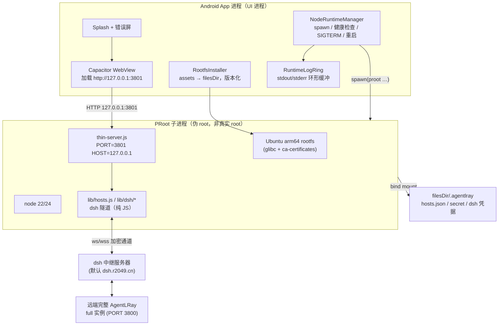

# Android 移动端 App 完整工程设计方案

> 类型：方案设计　｜　日期：2026-11-21　｜　状态：**部分实现**（仓库侧模块改造 + android/ 工程骨架已落地；P0 真机验证未完成，见 §12）
> 需求来源：`todo.md` #17「开发移动端 APP，用于远程连接」
> 前置：ADR-0008（决策收敛，grill R1–R6；2026-11-21 修订 R2 承载）、`design-thin-service`（ADR-0007，已实现）
> 决策真源：[adr-0008-android-mobile-app.zh-CN.md](adr-0008-android-mobile-app.zh-CN.md)

## 变更记录

| 版本 | 日期 | 变更内容 |
| --- | --- | --- |
| v1.0 | 2026-11-20 | 初稿：nodejs-mobile 承载 dsh-only 薄服务 + Capacitor WebView 套壳。 |
| v1.1 | 2026-11-21 | 评审整改：①承载由 nodejs-mobile 改为 **PRoot + Ubuntu + Node 22/24**（原方案受 Node 18 限制无法运行 dsh 栈）；②补齐打包路径、进程生命周期、能力面、发布合规与测试策略；③token 鉴权 / 接口鉴权 / 固定端口风险记入 §11「暂缓事项」，本期不实现。 |

本文档是 ADR-0008 的**可落地工程蓝图**：把已收敛的决策展开为架构图、工程结构、模块改造、构建打包、生命周期状态机、分阶段实施计划与验收标准。**决策本身以 ADR-0008 为准，本文件只回答"怎么做"。**

---

## 1. 目标与范围

### 1.1 目标

交付一个 Android 原生 app：**极简壳**（启动屏 + WebView），通过 **PRoot** 在 app 私有目录内运行一个 Ubuntu + Node 22/24 环境，承载 dsh-only 的现有 thin-server，连接远端完整 AgentLRay，把现有 web 页面套壳呈现。app 不做任何业务 UI，所有操作与查看都在 web 页面内完成。

### 1.2 范围

**在 app 内实现**：
- PRoot 子进程 + Ubuntu arm64 rootfs + Node 22/24，运行 `bin/thin-server.js`（dsh-only）。
- rootfs / app bundle 的首次解压、版本升级与完整性校验。
- 薄服务进程管理：启动、就绪探测、停止、崩溃重启、孤儿进程清理。
- Capacitor WebView 加载本地 `http://127.0.0.1:3801`。
- 启动屏 + 薄服务就绪门控 + 仅前台生命周期。
- 主机表单（dsh deviceId / 中继端口）→ 复用 web 前端 `HostFormDialog`，凭据 AES 落盘。
- 能力面裁剪：Android 模式只暴露 dsh 传输。
- 签名 / 加固 / 崩溃上报（原生 + Node 两侧）。

**不在 app 内实现**：
- 平台解析栈、insights、prompts、search 等数据面（全部由远端 full 实例提供，薄服务转发）。
- 后台常驻 / 推送 / 离线缓存（后续可评估）。
- SSH 隧道（**首版不启用**；PRoot 已具备 `child_process`，ssh 二进制可按需加入 rootfs，属于产品裁剪而非技术限制，见 §5.2）。

### 1.3 非目标（首版明确排除）

- iOS 版本。
- 运行多个薄服务实例 / 后台隧道池（web 前端的**多主机切换**仍保留，见本节末说明）。
- 离线查看 / 本地缓存。
- 应用层鉴权 / 接口 token（**本期明确暂缓**，风险与建议见 §11）。

> **多主机说明**：thin-server 本身支持多台 dsh 主机，web 端 `HostFormDialog` / 主机切换器可直接复用。首版排除的是"多个薄服务进程并存"与"后台常驻隧道池"，不是禁用多主机 UI。

---

## 2. 架构总览

### 2.1 组件图



### 2.2 数据流

1. **启动**：`RootfsInstaller` 检查 rootfs / app bundle 版本 → 需要时从 assets 解压到 `filesDir` → `NodeRuntimeManager` 以 `proot` 启动 Node 子进程 → `thin-server.js` 监听 `127.0.0.1:3801` 并异步 `autoConnectThinHost()`。
2. **加载**：轮询 `/api/version` 可达后，WebView 加载 `http://127.0.0.1:3801`；主机是否连上由前端 `HostConnectingView` 呈现（`/api/version` 只代表 HTTP 已就绪）。
3. **请求**：WebView 发 `GET/POST /api/*` 到本地薄服务 → 薄服务按 `X-Host-Id` 选中主机 → `lib/routes/proxy.js` 经 dsh loopback 转发到远端 full 实例 3800 → 返回。
4. **实时**：`/api/watch`（SSE）由薄服务经 dsh loopback 流式透传（`proxy.js` 已支持 SSE 透传；远端有 `: ping` 保活）。
5. **凭据**：主机表单（web 页 `HostFormDialog`）写 `/api/hosts` → 薄服务 `lib/secret.js` AES-256-GCM 加密落盘到 `filesDir/.agentlray/`。

### 2.3 运行时选型：PRoot + Ubuntu + Node，而非 nodejs-mobile

**原方案（nodejs-mobile）已不可行**，根因不是 zstd，而是 dsh 运行时栈的硬版本要求：

| 约束 | 证据 |
| --- | --- |
| vendor 产物为 ESM，依赖 Node 的 `require(esm)`（Node ≥22.12 默认开启） | `lib/dsh/vendor.js:5-8` |
| vendor 直接 `import '@lukeburns/clatterjs'`（纯 ESM，`exports` 仅 `import`） | `lib/dsh/vendor/dist/crypto/noise.js:5` |
| clatterjs 依赖 `@noble/*` v2.4.0，`engines: node >=20.19.0` | `node_modules/@lukeburns/clatterjs/node_modules/@noble/*/package.json` |
| 传输层使用全局 `WebSocket`（Node 22 才有全局实现） | `lib/dsh/vendor/dist/webrtc/adaptive-transport.js:78,553,654` |
| 官方 `nodejs-mobile` 最新版为 **18.20.4**；Node 22 仅有第三方 fork（arm64/x86_64、API 30+、V8 ABI 不兼容 18） | 见 §10 参考 |

**结论**：nodejs-mobile 无法承载 dsh → app 只剩空壳。改用 **PRoot** 在 app 私有目录内运行 Ubuntu + Node 22/24，可直接使用官方 Node 二进制，彻底绕开运行时版本问题；同时获得**真正的子进程生命周期**（可 kill / 重启），解决 nodejs-mobile 单例、无法 stop/restart 的问题。

参考实现：开源 Android 客户端 **DSH Go**（AGPL-3.0）采用同类方案——PRoot + Ubuntu + Node 24 + 应用私有目录，无需 Root/Termux，冷启动约 2.5–3 秒，Android 8.0+，仅 arm64/x86_64。本项目只借鉴架构，不复制其代码。

**nodejs-mobile 作为已否决方案**保留在 ADR 中，不再作为实现路径。

### 2.4 与现有承载的关系

同一套 `lib/*` + `frontend/dist`，三种装配：

- **full**：`server.js`（完整网关，读本机日志）。
- **thin（桌面）**：`bin/thin-server.js`（ssh + dsh 隧道）。
- **thin（Android）**：同一 `bin/thin-server.js`，运行在 PRoot Node 子进程中；首版仅启用 dsh 传输。

### 2.5 进程与线程模型

- UI 进程：Activity / Service / WebView，负责壳与进程管理。
- Node 运行在**独立的 proot 子进程**中，与 UI 进程通过 HTTP（loopback）解耦，无共享内存状态。
- UI 进程被杀时子进程可能成为孤儿：由 pid 文件 + 下次启动清理 + `proot --kill-on-exit` 兜底（见 §7.4）。

---

## 3. Android 工程结构

建议新增独立工程目录 `android/`（不并入现有 npm 包）：

```
android/
├── app/src/main/
│   ├── java/com/agentlray/app/
│   │   ├── MainActivity.kt              # Capacitor BridgeActivity + 启动门控
│   │   ├── NodeRuntimeManager.kt        # proot 子进程：spawn/健康检查/停止/重启
│   │   ├── RootfsInstaller.kt           # assets → filesDir，版本标记与校验
│   │   ├── RuntimeLogRing.kt            # stdout/stderr 环形缓冲（错误屏 + 上报）
│   │   ├── RuntimeWatchdog.kt           # 孤儿进程清理 / 退出重启退避
│   │   └── SecurityConfig.kt            # 备份排除、WebView 加固、明文白名单
│   ├── assets/runtime/
│   │   ├── rootfs-arm64.tar.zst         # 最小 Ubuntu + Node（随 app 发布）
│   │   └── app-bundle.tar.zst           # bin/lib/frontend/dist/node_modules/package.json
│   ├── jniLibs/arm64-v8a/
│   │   ├── libproot.so                  # proot 二进制（lib*.so 命名以绕过 Android 10+ exec 限制）
│   │   └── libproot-loader.so           # proot loader
│   ├── res/xml/network_security_config.xml
│   └── AndroidManifest.xml
├── build.gradle
└── scripts/
    ├── build-rootfs.sh                  # debootstrap/debootstrap 最小 rootfs + 官方 Node tarball
    ├── bundle-app.mjs                   # 从仓库收集运行时闭包 → app-bundle
    └── package-runtime.mjs              # 压缩、校验和、版本标记
```

**运行时目录（filesDir，持久化与解压分离）：**

```
filesDir/
├── runtime/            # proot / loader / rootfs（可随 app 版本重建）
│   └── rootfs/
├── app/                # AgentLRay 运行时闭包（每版本解压，可覆盖）
│   ├── package.json
│   ├── bin/thin-server.js
│   ├── lib/**
│   ├── frontend/dist/**
│   └── node_modules/**
└── .agentlray/         # 持久数据（hosts.json / secret / dsh 凭据），升级不覆盖
```

**关键决策**：保留仓库的相对目录层级（`bin/thin-server.js` + `lib/**` + `frontend/dist` + `package.json`），这样 `bin/thin-server.js` 的 `require('../package.json')`、`require('../lib/*')` 与硬编码的 `DIST_DIR = __dirname/../frontend/dist` **全部无需修改**。

---

## 4. PRoot + Capacitor 集成

### 4.1 运行时组成

| 组件 | 选型 | 说明 |
| --- | --- | --- |
| PRoot | 固定版本（随 app 打包） | GPL-2.0；`-0` 仅在 PRoot 命名空间内伪造 uid 0，**不是真实 root**。 |
| Loader | 与 PRoot 配套 | 加载 rootfs 内的 glibc ELF。 |
| Rootfs | Ubuntu 22.04/24.04 **minbase arm64** | 只装 Node 运行所需：glibc、libstdc++6、ca-certificates、tzdata。 |
| Node | 官方 **linux-arm64** 二进制，锁 22 LTS（≥22.15）或 24 LTS | 满足 `require(esm)`、全局 `WebSocket`、noble v2 的 `>=20.19`。 |

体积目标：rootfs + Node 约 **150–250 MB**（DSH Go 因含 Python/pnpm/full engine 约 1 GB，本项目不需要）。实际 filesDir 占用 = rootfs + app bundle **解压后**双份（约 APK 体积的 1.5–2 倍），P0 需同时记录「APK 体积」与「首启解压后占用」两个指标（见 §6.4）。

### 4.2 启动命令

```bash
proot \
  --kill-on-exit \
  -0 \
  -r "$FILES/runtime/rootfs" \
  -b "$FILES/app:/opt/agentlray" \
  -b "$FILES/.agentlray:/home/agentlray/.agentlray" \
  -b /dev -b /proc -b /sys \
  -w /opt/agentlray \
  /usr/bin/env \
    AGENTLRAY_HOME=/home/agentlray \
    AGENTLRAY_DISABLE_SSH=1 \
    PORT=3801 \
    HOST=127.0.0.1 \
  /usr/local/bin/node /opt/agentlray/bin/thin-server.js
```

- `/opt/agentlray` 与 `/home/agentlray/.agentlray` 在 rootfs 构建时预先创建，确保 bind target 存在。
- PRoot 与宿主共享网络命名空间，因此 `127.0.0.1:3801` 对同进程的 WebView 可达。
- `AGENTLRAY_HOME` 必须用项目变量名（`lib/config.js:5` 读取 `AGENTLRAY_HOME`），不要只设 `HOME`。
- 设备兼容性兜底：部分内核对 seccomp 敏感，预留 `PROOT_NO_SECCOMP=1`、`PROOT_TMP_DIR` 环境变量（P0 实测）。

### 4.3 Android 10+ 可执行文件限制（P0 必须验证）

Android 10（API 29）起，targetSdk ≥29 的应用**不能 `execve` 应用可写目录中的文件**（SELinux 限制）。PRoot / loader 必须：

1. 以 `lib*.so` 命名放入 `jniLibs/<abi>/`（如 `libproot.so`、`libproot-loader.so`）；
2. `AndroidManifest.xml` 设 `android:extractNativeLibs="true"`（AGP 新版对应 `useLegacyPackaging = true`）；
3. 运行时从 `applicationInfo.nativeLibraryDir` 执行，再通过 symlink 映射为普通文件名；
4. PRoot 的 loader 需通过 `PROOT_LOADER` 指到 nativeLibraryDir 中的 `libproot-loader.so`（具体文件名以 P0 实测为准）。

同时验证 **16KB page size**：目标 Android 15+/16KB 设备要求 native 库按 16KB 对齐构建（`-Wl,-z,max-page-size=16384`）。

> 若目标设备/渠道无法绕过 exec 限制，则只能退化为 targetSdk 28 的侧载包（不可上架），需在 P0 明确该约束。

### 4.4 rootfs 与 app bundle 分层

| 层 | 内容 | 更新频率 | 存放 |
| --- | --- | --- | --- |
| rootfs | Ubuntu + Node + 系统库 | 低（Node 大版本/rootfs 变更） | `filesDir/runtime/rootfs` |
| app bundle | `bin/`、`lib/`、`frontend/dist/`、`node_modules/`、`package.json` | 每个 app 版本 | `filesDir/app` |
| 持久数据 | `hosts.json`、`secret`、dsh 凭据/身份 | 运行时 | `filesDir/.agentlray` |

**升级规则**：
- rootfs 与 app bundle 各带版本标记文件（如 `.version`），APK 更新后按标记重建；
- `.agentlray` 永不随升级覆盖/删除；
- app bundle 解压使用「临时目录 + rename」原子替换，避免半包；
- 启动前校验 manifest SHA-256（防解压损坏/被篡改），失败则重建并提示。

### 4.5 依赖打包

`node_modules` 必须包含完整运行时闭包：

- `express`、`ws`、`zod`（薄服务 HTTP/SSE）。
- **`@lukeburns/clatterjs`**（vendor `crypto/noise.js` 直接 import；原设计遗漏）。
- `@lukeburns/clatterjs` 的嵌套依赖 `@noble/ciphers|curves|hashes` v2、`@noble/post-quantum`。
- `lib/dsh/vendor/dist/**`（只拷 `dist`，不拷 `src/`、`tsconfig.json`）。

打包后冒烟命令（CI 执行）：

```bash
node -e "require('@lukeburns/clatterjs'); require('ws'); require('express'); require('zod')"
```

### 4.6 Capacitor 加载时序

`server.url` 会导致 `BridgeActivity.onCreate` 立即加载 URL，若 Node 尚未监听会停在 `ERR_CONNECTION_REFUSED`。二选一（P0 验证后定稿）：

- **A（推荐）**：原生 Splash 覆盖 + 就绪后 `bridge.getWebView().loadUrl('http://127.0.0.1:3801')`；`server.allowNavigation` 放行 `127.0.0.1`。
- **B**：保留 `server.url`，在 `Application.onCreate` 尽早启动 Node，并用 Splash 覆盖 + `onReceivedError` 提供重试/错误屏。

无论哪种，都必须在加载前确认 `/api/version` 可访问；否则用户会看到系统错误页。

---

## 5. 仓库模块改造方案

改动最小化：PRoot 下 `child_process` 可用，**不再需要**原来的惰性 require / 条件加载改造。

### 5.1 `lib/config.js` — 家目录重定向（AGENTLRAY_HOME，无需改）

`HOME = process.env.AGENTLRAY_HOME || os.homedir()`（`lib/config.js:5`）。启动脚本已注入 `AGENTLRAY_HOME=/home/agentlray`，`~/.agentlray/*` 全部落到 `filesDir/.agentlray`。**无需改 config.js**。

### 5.2 `lib/transport.js` / `lib/hosts.js` — 不改造加载方式，仅加能力开关

- PRoot 内 `child_process` 可用（ssh 二进制可按需加入 rootfs），`lib/transport.js:7` 的顶层 require **保持原样**；
- 首版 dsh-only 属于**产品裁剪**，通过 `AGENTLRAY_DISABLE_SSH=1` 在 hosts 层拒绝 ssh 主机：
  - `createHost` / `updateHost`：`type === 'ssh'` 时返回 400「Android 薄服务仅支持 dsh」；
  - `openHost`：防御性拒绝；
  - 桌面 thin / full 不受影响（未设置该环境变量）。
- 后续若要支持 SSH，只需在 rootfs 中加入 `openssh-client` 并放开该开关（列入 §11 后续项，不阻塞首版）。

### 5.3 `lib/routes/dsh.js` — 无需改（注意依赖链）

`forceClient: true` 已由 `bin/thin-server.js` 传入，`/api/dsh/*` 固定 client。该文件 `require('../transport')`（第 22 行）在 PRoot 下正常，无 child_process 风险。

### 5.4 `lib/routes/mode.js` — 增加能力位

```json
{ "mode": "thin", "version": "x.y.z", "capabilities": { "transports": ["dsh"] } }
```

- 老客户端忽略未知字段，向后兼容；
- 前端据此隐藏/禁用 ssh 选项。

### 5.5 前端 — 三处小改

| 文件 | 改动 |
| --- | --- |
| `frontend/src/api/client.ts` | `ModeInfo` 增加可选 `capabilities?: { transports?: string[] }`。 |
| `frontend/src/components/HostFormDialog.tsx` | 传输下拉按 capabilities 过滤；默认选第一个可用项（Android 下即 dsh，见当前默认 `transport: 'ssh'`）。 |
| 下载辅助（`views/sessions/exports.ts`、`views/prompts/promptsLib.ts`、`ReviewTransferPanel.tsx`） | Android WebView 不支持 blob 下载；按 `capabilities.nativeSave` 走 Capacitor 文件保存/分享桥接（见 §7.6）。 |

### 5.6 `bin/thin-server.js` — 无需改

不修改仓库入口；环境变量全部由原生 `spawn` 注入。桌面语义保持不变。

### 5.7 改动汇总

| 文件 | 类型 | 说明 |
| --- | --- | --- |
| `lib/hosts.js` | 小改 | ①`AGENTLRAY_DISABLE_SSH` 守卫（创建/修改/连接）；②`lastHostId` 记忆字段（`resolveThinBootHost` 优先 + `GET/PUT /api/hosts` 透传，见 §7.7 API 契约） |
| `lib/routes/hosts.js` | 小改 | `GET` 响应附 `lastHostId`、`PUT` 透传该字段 |
| `lib/routes/mode.js` | 小改 | capabilities |
| `frontend/src/api/client.ts` | 小改 | ModeInfo 类型 |
| `frontend/src/components/HostFormDialog.tsx` | 小改 | 传输过滤/默认值 |
| 下载辅助 3 处 | 小改 | 原生保存桥接 |
| `bin/thin-server.js` / `lib/transport.js` / `lib/dsh/*` | 不改 | PRoot 下原样运行 |

---

## 6. 构建与打包流程

### 6.1 rootfs 构建（可复现）

```bash
# 在 Linux/docker 中执行（CI 任务，不在开发机手工维护）
debootstrap --arch=arm64 --variant=minbase bookworm rootfs/ http://ports.ubuntu.com/ubuntu-ports
# 安装最小运行依赖
chroot rootfs/ apt-get install -y --no-install-recommends libstdc++6 ca-certificates tzdata
# 解压官方 Node linux-arm64 到 /usr/local
tar -xJf node-v22.x-linux-arm64.tar.xz -C rootfs/usr/local --strip-components=1
# 预创建 bind target
mkdir -p rootfs/opt/agentlray rootfs/home/agentlray/.agentlray
# 校验动态依赖
chroot rootfs/ ldd /usr/local/bin/node
# 打包
tar --zstd -cf rootfs-arm64.tar.zst -C rootfs .
```

- 记录 debootstrap 镜像快照/包清单、Node 版本与 SHA-256，产出 `rootfs.manifest.json`；
- 目标体积 150–250 MB；P0 记录冷启动与内存。
- **ABI 双构建**：上述命令为 arm64（真机主路径）。x86_64 模拟器需要**独立的 x86_64 rootfs + x86_64 Node 二进制**（arm64 rootfs 无法在 x86_64 模拟器执行）。`build-rootfs.sh` 按 `$ABI`（`arm64`/`x86_64`）切换 `debootstrap --arch` 与 Node tarball；`assets/runtime/` 按 ABI 目录存放。若 x86_64 仅用于 UI/壳冒烟、不承载运行时，则 P0 明确该口径并跳过 x86_64 rootfs 构建，避免承诺无法兑现。

### 6.2 app bundle

```bash
node android/scripts/bundle-app.mjs
# 收集：package.json、bin/thin-server.js、lib/**（排除 lib/dsh/vendor/src）、
#       frontend/dist/**、node_modules 运行时闭包
# 产出：app-bundle.tar.zst + app.manifest.json（SHA-256 清单）
```

**必须包含**：`package.json`（`bin/thin-server.js:24` 需要）、`frontend/dist`（`DIST_DIR` 依赖）、`@lukeburns/clatterjs` 及其嵌套依赖。

### 6.3 Android 构建

```bash
cd android
npm install && npx cap sync
./gradlew assembleRelease     # APK/AAB
```

### 6.4 发布

| 项 | 方案 |
| --- | --- |
| 分发渠道 | 首版按**侧载/企业内部分发**设计；PRoot + `lib*.so` exec 方案与 Google Play 政策存在冲突，上架前需单独评估（§10）。 |
| ABI | `arm64-v8a` 为主，`x86_64` 仅模拟器（需独立 x86_64 rootfs + Node，见 §6.1）；不支持 32 位 ARM（与 Node 22/24 官方 arm64 构建一致）。 |
| minSdk / targetSdk | minSdk 26（Android 8.0+）；targetSdk 按当前商店要求，但受 §4.3 exec 限制约束。 |
| 签名 | 正式 keystore 不入库；CI 密钥注入，文档记录轮换流程。 |
| 加固 | 企业分发或渠道要求时接入厂商加固 SDK。 |
| 体积 | ABI split + rootfs 压缩；预算：APK ≤ 350 MB，且记录首启解压后 filesDir 占用（rootfs + app 双份，P0 实测后一并修订）；企业 MDM/AAB 分发链的体积约束另行评估。 |
| 崩溃上报 | 原生 Sentry/Crashlytics + Node 侧 stderr/异常转发（§7.5）。 |

---

## 7. 生命周期与状态机

### 7.1 启动顺序

```
Application.onCreate / Service.onCreate
  → RootfsInstaller.ensure()           # 版本标记/校验/解压（仅首次或升级）
  → NodeRuntimeManager.start()          # spawn proot → node thin-server
  → 轮询 GET /api/version（200ms，≤20s）
  → 就绪 → WebView.loadUrl("http://127.0.0.1:3801")
  → 失败（超时/进程退出）→ 错误屏：展示日志尾部 + 重试
```

> `/api/version` 只代表 HTTP 服务已监听，**不代表 dsh 已连上**；主机连接状态由前端 `HostConnectingView` 负责。

### 7.2 前台/后台（仅前台策略）

| 事件 | 行为 |
| --- | --- |
| `onStop`（界面不可见，防抖 5s） | `SIGTERM` proot（`--kill-on-exit` 连带清理 Node），等待 3s 后 `SIGKILL`；记录退出原因。 |
| `onStart`（回前台） | 重新 `start()`，恢复上次选中的主机，WebView reload。 |
| 隧道断开 | 薄服务 hostReady 置 false，web 端显示断线占位；重连由 `autoConnectThinHost` 或用户操作触发。 |

- **不要在 `onStart` 时与 `onStop` 的回收竞态**：`start()` 前必须 `await` 旧进程完全回收（SIGTERM 后至多 3s 的 `SIGKILL` 完成）再 spawn 新进程；否则快速前后台切换会同时存在新旧进程，撞 `3801` 端口 `EADDRINUSE`。`NodeRuntimeManager.start()` 内部串行化：任何时刻至多一个 proot 子进程存活。

- **不要用 `onPause`**：对话框、通知栏、权限弹窗都可能触发，会误停服务。
- 旋转/多窗口：`android:configChanges` 避免 Activity 重建；进程管理放在 Application/Service 单例，不绑定 Activity 生命周期。
- `onStop` 后的 5s 防抖用于吸收短暂切后台（如系统弹窗），避免频繁杀进程/冷启动。

### 7.3 崩溃与重启

- `NodeRuntimeManager` 监听进程退出码与 stderr；
- 非用户主动停止 → 指数退避重启（1s / 2s / 4s，最多 3 次）；
- 超过重试次数 → 错误屏（含最后 200 行日志 + "重启运行时"按钮）；
- Node 侧安装 `uncaughtException` / `unhandledRejection`：打印堆栈后 `process.exit(1)`，由原生 supervisor 重启；**不吞异常**。

### 7.4 孤儿进程清理

- 启动时读取 `filesDir/runtime/node.pid`；若 pid 存活且 `/proc/<pid>/cmdline` 含我们的 proot 路径 → 先 `SIGKILL` 再启动；
- `proot --kill-on-exit` 保证 proot 退出时清理其 tracee；
- 应用被系统杀死后，下次启动必须完成上述清理，避免 3801 端口被残留进程占用。

### 7.5 日志与崩溃上报

- proot stdout/stderr → `RuntimeLogRing`（内存环形缓冲 + logcat）；
- 原生 Sentry 捕获 Java 崩溃；
- Node 致命异常 / proot 异常退出 → 原生将日志尾部作为 breadcrumb/event 上报 Sentry（Node 侧无独立 SDK，避免额外依赖）；
- 错误屏展示同一份日志尾部，便于用户截图反馈。

### 7.6 下载 / 导出 / 文件选择

- `<input type="file">`：Capacitor WebView 自带文件选择，私钥文件与导入 JSON 可用；
- **blob 下载在 Android WebView 不工作**（`URL.createObjectURL` + `a.download`）：导出会话、导出 prompts、复核 JSON 下载需要原生保存桥接；
- 方案：自定义 Capacitor 插件 `saveFile({ base64, fileName, mime })` → 写入 `Downloads`/应用私有目录并触发分享；
- `/api/mode` 增加 `capabilities.nativeSave = true`，前端下载辅助按能力切换；
- P2/P3 验收必须覆盖「导出 → 文件落盘/分享成功」。

### 7.7 恢复上次主机

现有 `resolveThinBootHost()` 只认 `AGENTLRAY_THIN_HOST` 或 `hosts[0]`（`lib/hosts.js:428-436`），**没有"记忆主机"**。Android 侧需：

- 在 `hosts.json` 顶层记录 `lastHostId`；
- `resolveThinBootHost` 优先 `lastHostId`，且过滤掉非 dsh 主机；
- 前端切换主机时写入该字段。

**API 契约（新增，纳入 §5.7 改动汇总）**：
- `GET /api/hosts` 响应对象顶层返回 `lastHostId`（与既有 `hosts` 数组并存）；
- `PUT /api/hosts`（前端保存主机表单）透传可选的 `lastHostId` 顶层字段，由 `lib/hosts.js` 写入 `hosts.json`；
- 兼容性：字段为可选，老客户端不写不影响；桌面 thin / full 未设置 `AGENTLRAY_DISABLE_SSH` 时 `lastHostId` 同样生效（记忆主机是通用行为，非 Android 专属），但 Android 端仅接受 dsh 类型。

> 原生侧备选（不引入 API 改动）：把上次主机 id 作为 `AGENTLRAY_THIN_HOST` 注入。但该 env 仅在启动时读取，无法表达「前端运行时切换」，因此采用 `lastHostId` 字段方案。

---

## 8. 安全与凭据

### 8.1 本期实现

| 项 | 做法 |
| --- | --- |
| 凭据加密 | `lib/secret.js` AES-256-GCM；密钥 `filesDir/.agentlray/secret`（0600，app 私有目录）。 |
| 网络绑定 | 薄服务固定 `HOST=127.0.0.1`、`PORT=3801`（端口固定为产品决策，风险见 §11）。 |
| 端口占用检测 | 启动后若 `/api/version` 不通且进程报告 `EADDRINUSE` → **不加载 WebView**，显示错误屏，防止加载未知页面。 |
| Android 备份 | `android:allowBackup="false"` + `dataExtractionRules` 排除 `.agentlray`（secret/hosts 不进云备份）。 |
| 明文流量 | `network_security_config.xml` 仅对 `127.0.0.1` 放行 cleartext；其余默认拒绝。 |
| WebView 加固 | 关闭 file/content access；release 关闭调试；禁止混合内容；敏感页面评估 `FLAG_SECURE`。 |
| PRoot 信任边界 | rootfs/app bundle 来自 app 自身签名包；启动前校验 SHA-256；PRoot 仅是同进程权限下的兼容层，**不构成安全边界**。 |
| dsh 通道 | Noise IK 握手 + 加密传输，经中继，不要求 full 实例暴露公网端口。 |
| VPN/隧道 | 用户自选（WireGuard / 公司 VPN / 中继）。 |

### 8.2 暂缓（本期明确不实现）

- 应用层 token 认证、`/api/*` 接口鉴权、dsh loopback 端点鉴权；
- 随机端口 / 防端口抢占；
- 详见 §11「暂缓事项」。

> 已知边界：Android 的 loopback 不是 app 私有，其他应用可访问 `127.0.0.1:3801`；`lib/csrf.js` 对无 Origin 的非浏览器客户端放行。当前接受该风险，正式对外分发前必须回到 §11 处理。

---

## 9. 分阶段实施计划

| 阶段 | 内容 | 验收（必须留证据） |
| --- | --- | --- |
| **P0-A 运行时可行性** | PRoot + rootfs + Node 在真机启动 thin-server；完成 dsh 握手；记录 proot/Node 版本、rootfs 构建脚本、SHA-256、体积、冷启动、内存 | arm64 真机（API 26/29/33/35）`/api/version` 200；dsh 隧道连通；会话列表可见；SSE 连续 5 分钟；`exec` 限制与 16KB 结论 |
| **P0-B 打包闭环** | assets→filesDir、rootfs/app bundle 分层、`package.json`/`@lukeburns/clatterjs`/`frontend/dist` 路径、bind mount、升级保留 `.agentlray` | 全新安装/覆盖升级/清除数据三种路径均可启动；依赖冒烟命令通过 |
| **P0-C 生命周期** | spawn/就绪/stop/restart/崩溃退避/孤儿清理/旋转 | 前后台往返 ≥3 次、崩溃自动重启、旋转不重载、无残留进程占 3801 |
| **P0-D 能力面** | `/api/mode` capabilities、ssh 隐藏与后端拒绝、下载桥接决策 | Android 下新建主机只出现 dsh；ssh 请求返回 400；导出落盘/分享成功 |
| **P0-E 安全基线** | allowBackup、network security config、WebView 加固、端口占用错误屏 | 备份不含 `.agentlray`；非 127.0.0.1 明文被拒；占用 3801 时不加载 WebView |
| **P1 最小可运行壳** | Capacitor 工程 + PRoot 进程管理 + 启动门控 + WebView | 启动 → 本地薄服务可达 → 空态「添加主机」页面正常 |
| **P2 dsh 连接闭环** | dsh 登录/设备选择 → 主机表单 → 隧道连远端 full → 会话/分析视图 | 手机经 dsh 中继看到远端会话列表与详情；导出/下载可用 |
| **P3 健壮性** | 断线重连、前后台、SSE 流式、错误屏、版本兼容检查 | 断网/切后台往返后数据恢复；SSE 实时尾随正常；远端版本不兼容时给出明确提示 |
| **P4 发布** | 签名、加固、崩溃上报、体积优化、分发说明 | 可分发 APK/AAB；崩溃日志可回传；安装包体积达标 |

**P0 是 go/no-go 门禁**：若 P0-A 在目标分发渠道上无法满足 exec/16KB/targetSdk 约束，则回到 ADR-0008 重新评估（targetSdk 28 侧载、替代运行时或放弃原生 app），不得带着未验证的假设进入 P1。

### 9.1 测试与回归

| 层 | 覆盖 | 方式 |
| --- | --- | --- |
| 后端 | `AGENTLRAY_DISABLE_SSH` 守卫（create/update/open）、`/api/mode` capabilities、dsh 路由 `forceClient` 不变、`lastHostId` 记忆（resolveThinBootHost 优先 + GET/PUT 透传） | `node --require ./test/setup-env.cjs --test test/*.test.js`；新增 `test/thin-android-guards.test.js`（含 lastHostId 用例） |
| 前端 | 传输过滤/默认值、下载能力分支 | 前端当前无测试运行器 → 构建校验 + 手工用例（P2/P3 留证据） |
| 设备矩阵 | API 26 / 29 / 33 / 35；arm64 真机为主，x86_64 仅模拟器 | 手工冒烟 |
| 安装/升级 | 全新安装、覆盖升级、清除数据、rootfs 版本变更 | 手工，逐项留日志 |
| 生命周期 | 前后台往返、崩溃重启、孤儿清理、端口占用 | 手工 + logcat |
| 回归 | 现有 full / 桌面 thin / CLI 行为不变 | `npm test`（全量） |

---

## 10. 风险与开放问题

| 风险 | 等级 | 缓解 |
| --- | --- | --- |
| Android 10+ 禁止从可写目录 exec；Play 政策不欢迎 `lib*.so` 绕过 | **高** | P0 验证 `jniLibs` + `extractNativeLibs=true`；明确侧载/企业分发；上架前单独评估。 |
| PRoot 二进制/loader 与 16KB page、ABI 不匹配 | 高 | 固定 proot 版本并重编译（`-Wl,-z,max-page-size=16384`）；P0 真机验证。 |
| PRoot 许可证（GPL-2.0）与分发合规 | 中 | 作为独立程序随包分发，保留许可证与源码获取方式；法务确认后再发布。 |
| rootfs 体积/冷启动/内存 | 中 | minbase + 官方 Node；rootfs 只解压一次；预算 150–250 MB；P0 实测。 |
| 孤儿进程 / 端口占用 | 中 | pid 文件 + 启动清理 + `--kill-on-exit`；EADDRINUSE 错误屏。 |
| Android 自动备份泄露凭据 | 中 | `allowBackup=false` + 备份排除规则。 |
| 本机 API 无鉴权（其他 app 可访问） | 中 | **本期暂缓**，见 §11；正式分发前处理。 |
| 固定端口 3801 可被抢占 | 中 | 本期仅做占用检测；随机端口/token 见 §11。 |
| app 前端 dist 与远端 full 版本漂移 | 中 | 连接时检查远端 `/api/version` 最低版本；不兼容给出升级提示。 |
| 下载/导出在 WebView 不可用 | 中 | 原生保存桥接 + `capabilities.nativeSave`；P2 验收覆盖。 |
| Node 崩溃日志漏报 | 中 | stderr 环形缓冲 + 异常退出 → Sentry breadcrumb/event。 |
| dsh 中继/账号不可用 | 中 | 错误屏提示检查登录/网络；复用现有 dsh 登录弹框。 |

**开放问题（P0 关闭）**：
- PRoot 在目标 OEM 设备上的 `exec`/seccomp 行为；
- rootfs 最小依赖清单（`ldd` 结果）；
- Capacitor `server.url` vs 手动 `loadUrl` 的最终加载时序；
- 侧载/企业分发渠道与签名/加固方案。

---

## 11. 暂缓事项（记录在案，本期不实现）

> 2026-11-21 评审决定：**token 认证与接口鉴权暂不考虑；端口固定使用 3801。** 以下问题与建议留档，待正式对外分发或安全评审时处理。

| 编号 | 问题 | 当前决定 | 后续建议 | 触发条件 |
| --- | --- | --- | --- | --- |
| D1 | Android loopback 非 app 私有，其他应用可访问 `127.0.0.1:3801`；`lib/csrf.js` 对无 Origin 客户端放行 | 接受风险 | 每次启动生成随机 token：原生经 env/args 传给 Node（不走 TCP），WebView 通过 URL fragment 获取；fetch 用 header、EventSource 用 `?token=`；`/api/*` 统一校验 | 对外分发 / 安全评审 |
| D2 | dsh loopback 端点（`lib/dsh/loopback-client.js`）是无鉴权本地 HTTP 服务 | 接受风险 | 增加内部鉴权头，由 `proxy.js` 注入；或改为进程内 RPC，不落 TCP | 同 D1 |
| D3 | 固定端口 3801 可被其他应用抢占，导致监听失败或加载未知页面 | 固定 3801（产品决策） | 采用随机端口 + 稳定 origin 方案（如自定义 scheme / 端口映射）；或在加载前做服务身份校验 | 同 D1 |
| D4 | 无 TLS（loopback 明文） | 接受 | 本机回环风险低；如引入 token，token 不得出现在可被其他应用读取的位置 | 同 D1 |
| D5 | SSH 传输 | 首版禁用 | PRoot 已具备 `child_process`；后续可在 rootfs 加入 `openssh-client` 并放开 `AGENTLRAY_DISABLE_SSH` | 用户需求 |
| D6 | 后台常驻 / 推送 | 不做 | 需要时改用 foreground service + 常驻通知 | 用户需求 |
| D7 | iOS | 不做 | 另行评估（PRoot 不可用，需独立方案） | 用户需求 |

---

## 12. 实现进度（代码核对：2026-11-21）

**状态：部分实现**——仓库侧模块改造与 Android 工程骨架已落地并做后端/前端验证；P0 真机门禁与 P1–P4 未完成（当前环境无 Android SDK/真机，未构建 APK）。

| 能力/阶段 | 状态 | 代码证据 |
| --- | --- | --- |
| 决策收敛（ADR-0008，R2 修订为 PRoot） | ✅ 已完成（待 P0 验证） | [adr-0008](adr-0008-android-mobile-app.zh-CN.md) |
| 完整工程蓝图（本文件） | ✅ 已完成 | 本文档 |
| §5 仓库模块改造（hosts 守卫/lastHostId/mode capabilities/前端传输过滤/下载桥接） | ✅ 已实现 | `lib/hosts.js`（`sshDisabled`/`assertTransportAllowed`/`getLastHostId`/`setLastHostId`、`resolveThinBootHost` 优先 lastHostId + DISABLE_SSH 过滤）、`lib/routes/hosts.js`（GET `{lastHostId,hosts}`、PUT 透传、connect 写盘）、`lib/routes/mode.js`（capabilities）、`frontend/src/api/{types,client}.ts`、`frontend/src/store.ts`（`modeCapabilities`）、`frontend/src/components/HostFormDialog.tsx`（传输按 capabilities 过滤/默认）、`frontend/src/lib/download.ts`（nativeSave 桥接）+ 3 处调用（`exports.ts`/`promptsLib.ts`/`ReviewTransferPanel.tsx`）；测试 `test/thin-android-guards.test.js`（12 例），全量 **751/751** 通过，`npm run build:ui` 通过 |
| Android 工程骨架（`android/`） | 🟡 已落地（未构建/真机验证） | `android/{package.json,capacitor.config.ts,www/,README.md}`、`android/android/app/src/main/java/com/agentlray/app/{App,MainActivity,NodeRuntimeManager,RootfsInstaller,RuntimeLogRing,RuntimeWatchdog,SecurityConfig,SaveFilePlugin}.kt`、`AndroidManifest.xml`、`res/xml/{network_security_config,data_extraction_rules,file_paths}.xml`、`android/android/{build.gradle,settings.gradle,variables.gradle,app/build.gradle}`、`android/scripts/{build-rootfs.sh,bundle-app.mjs,package-runtime.mjs}`；`bundle-app.mjs` 本机实测产出 `app-bundle.tar.zst`（2.4MB）且 `require('@lukeburns/clatterjs'/'ws'/'express'/'zod')` 冒烟通过 |
| P0 运行时/打包/生命周期/能力面/安全基线 | ⬜ 待真机验证 | 源码就绪（见上）；exec/16KB/rootfs/zstd-jni ABI/冷启动等须按 `android/README.md` P0 清单在真机完成 |
| P1 最小可运行壳 | ⬜ 待实现 | — |
| P2 dsh 连接闭环 | ⬜ 待实现 | 服务端 GET 导出（`a.href=exportUrl`）在 Android WebView 仍不可用，P2 补 fetch→saveFile |
| P3 健壮性 | ⬜ 待实现 | — |
| P4 发布（签名/加固/Sentry/体积） | ⬜ 待实现 | — |
| token 认证 / 接口鉴权 / 随机端口 | ⏸ 暂缓（§11） | — |

> 实现偏差（记录在案）：①目录布局按标准 Capacitor 落在 `android/android/`（`cap sync` 要求），design §3 扁平树为其内容；②`.tar.zst` 解压用 `commons-compress` + `zstd-jni`（Android ABI 兼容性待 P0）；③前端下载桥接依赖 `window.Capacitor.Plugins.SaveFile` 探测，未引入 `@capacitor/core` 构建耦合。

---

## 参考

- DSH Go（Android 客户端，AGPL-3.0）：PRoot + Ubuntu + Node 24 运行环境，Android 8.0+、arm64/x86_64、侧载分发、冷启动约 2.5–3 秒。
- Node.js Mobile（官方，最后版本 18.20.4）：本项目已否决，原因见 §2.3。
- PRoot：GPL-2.0；Android 10+ exec 限制与 `lib*.so` 打包方式见 §4.3。
