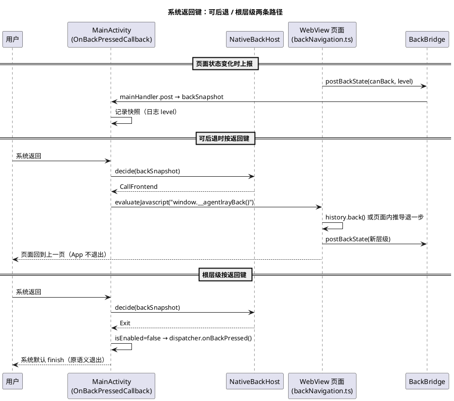

# Android 系统返回键 → 页面内后退设计（design-android-system-back.zh-CN.md）

> 类型：方案设计（缺陷修复 + 增量能力）　｜　日期：2026-11-24　｜　状态：已实现
> 需求原文：「现状：手机端 app 在系统返回按钮点击后直接退出；目标：系统返回事件不退出，而是让 webview 内部页面返回到上一页。」
> 关联文档：[design-android-mobile-app.zh-CN.md](../design/design-android-mobile-app.zh-CN.md)（壳工程蓝图）、[adr-0008-android-mobile-app.zh-CN.md](../design/adr-0008-android-mobile-app.zh-CN.md)（承载与套壳决策）。
> 范围：Android 壳（`android/android/`）+ 前端层级历史（`frontend/src/lib/backNavigation.ts` 等）。后端、API、平台适配器、离线 CLI 均无改动。

## 1. 背景与目标

Android App 用一个 Activity 承载 Capacitor WebView（详见 `design-android-mobile-app.zh-CN.md`）。WebView 里加载的是薄服务页面 `http://127.0.0.1:<thinPort>`（SPA，React 19 + zustand，**无路由库**），页面层级——页签、会话详情、子 Agent、详情子页签、移动端会话列表覆盖层——全部是 store 里的状态，**不产生任何 WebView history 条目**。

因此系统返回键走的是系统默认语义：`finish()` → `onStop`/`onDestroy(isFinishing)` → `App.instance.onActivityFinishing()` 停掉本地运行时。用户感知即为「点返回直接退出 App」。

目标（经需求澄清收敛）：

1. 系统返回键优先让 WebView 内部页面**按页面层级逐级后退**；
2. 只有已经处在根层级（首页、无会话、无覆盖层）时，才按原语义退出 App；
3. 同时引入 `history.pushState`，让**浏览器返回键 / 系统返回键 / 页面内「返回内容」按钮**落在同一条历史线上。

## 2. 根因分析

| 层 | 现象/事实 | 结论 |
| --- | --- | --- |
| 壳 | `MainActivity` 未注册任何返回键回调；Capacitor 7 的 `BridgeActivity` 不拦截返回键 | 返回键直达系统 → `finish()` |
| WebView | SPA 无路由、无 `pushState`，页面切换只改 zustand | `webView.canGoBack()` 对页面层级**恒为 false** |
| 冷启动 | WebView history 里有 Capacitor 占位页（`https://localhost`），`canGoBack()` 常为 true | `goBack()` 会把用户送回启动屏，**不能作为判据** |
| 薄服务 | 页面源是 `http://127.0.0.1:<port>`，Capacitor 只向自己的本地源注入 `window.Capacitor` | 不能用 Capacitor 插件通道，需要独立的无能力 JS 桥 |
| 页面内后退 | 移动端「返回内容」按钮此前直接 `setNavigationOpen(false)`，不写 history | 系统返回与页面内后退各走各的，容易错层 |

修复方向由此确定：**原生只认前端上报的层级快照，前端负责维护层级与 history 条目**。原生绝不猜测 WebView history。

## 3. 总体方案

### 3.1 职责划分

| 侧 | 职责 | 不做什么 |
| --- | --- | --- |
| 前端 `lib/backNavigation.ts` | 计算层级、维护 history 条目、执行页面内后退、向原生上报 `canBack/level` | 不直接退出 App、不判断 Activity 生命周期 |
| 原生 `NativeBackHost` | 纯策略：`canGoBack ? CallFrontend : Exit` | 不猜 history、不轮询 |
| 原生 `MainActivity` | 注册 `OnBackPressedCallback`；可后退时注入 `window.__agentlrayBack()`，否则转发系统默认 | 不维护页面层级 |
| 原生 `BackBridge` | 接收 `postBackState(canGoBack, level)`，切回主线程 | 不提供文件/网络/命令能力 |

### 3.2 时序



### 3.3 层级模型

`levelsFor(snapshot, initialView)` 自底向顶推导（`frontend/src/lib/backNavigation.ts:102`）：

| 顺序 | 层级 | 触发条件 | 后退一步的结果 |
| --- | --- | --- | --- |
| 1 | `tab` | `view !== initialView`（页面打开时的页签） | 回到初始页签 |
| 2 | `session` | 选中了会话 | 清空选中；窄屏（<768）同时展开会话列表覆盖层 |
| 3 | `child` | 正在看子 Agent 执行记录 | 回到父 Agent |
| 4 | `sessionView` | 详情子页签不是 `messages`（如 trace / diagnostics） | 回到 `messages` |
| 5 | `navigation` | 移动端会话列表覆盖层展开 | 收起覆盖层，保留当前会话 |

空数组 = 根层级：`canBack=false`，返回键交回系统。

> 顺序刻意让「tab」在最底层：从分析页进入会话详情后，先把详情逐级退完，最后才回到打开 App 时的页签，不会出现「退详情的途中突然跳页签」。

### 3.4 历史条目模型

每条 `history.state` 存**该页面自己的完整快照**：

```ts
interface NavEntry {
  __agentlray: true;
  seq: number;              // 0 = 页面加载时的基线条目，每前进一次 +1
  snapshot: NavSnapshot;    // host/view/sessionId/平台/agent/child/sessionView/navigation
}
```

| 用户动作 | history 操作 | store 操作 |
| --- | --- | --- |
| 前进 / 横切：切页签、切会话、展开覆盖层、进子页签或子 Agent | 先把当前条目 `replaceState` 为「离开前」的页面，再 `pushState` 新页面（`backNavigation.ts:276-285`） | 已由用户动作完成 |
| 页面内后退：点「返回内容」、切回 messages、点父 Agent、切回原页签 | `history.go(-n)` 消费对应条目（`:288-299`） | 由 `popstate` 还原条目快照 |
| 系统返回键（有本模块条目） | `history.back()`，条目快照由 `popstate` 应用（`:309-317`） | 同上 |
| 系统返回键（`seq === 0`） | **绝不** `history.back()`：页面内推导后退并重标基线（`:318-321`） | `apply(backOneLevel(...), 0)` |
| 上下文重置：切主机 / 切平台 / 切 agent 清空会话 | 不下沉历史，当前条目重标为新基线（`:264-267`） | 不变 |

冷启动（URL 已带会话、直接打开详情）时 `seq === 0`，history 里只有 Capacitor 占位页。此时任何 `history.back()` 都会落到启动屏，因此该分支一律在页面内推导后退。

### 3.5 上报通道

- 页面 → 原生：`window.AgentLRayNative.postBackState(canBack, level)`（无能力 `@JavascriptInterface`，`BackBridge.kt:30`）。
- 原生 → 页面：`webView.evaluateJavascript("window.__agentlrayBack && window.__agentlrayBack()")`（`NativeBackHost.kt:50`）。
- 桥不存在（桌面浏览器 / 旧壳 / DEMO）：上报静默失败，返回键语义由浏览器自身处理（`backNavigation.ts:195-204`）。
- 每次新导航开始清空快照（`MainActivity.kt:179-180`）：新文档还没上报层级，返回键应走系统默认，不得复用旧页面证据。

### 3.6 状态放置

移动端会话列表覆盖层的 `navigationOpen` 原本是 `App.tsx` 的局部 `useState`，返回键层级拿不到。现提升到 zustand store（`frontend/src/store.ts:470,630,1058`），`App.tsx` 改为读写 store（`App.tsx:62-63`）。`syncSessionUrl` 的 URL 写入从 `pushState` 改为 `replaceState` 并保留 `history.state`（`store.ts:379-410`），把条目的所有权统一交给 `backNavigation`，避免 URL 同步把层级历史冲掉。

## 4. 边界与异常

| 场景 | 处理 |
| --- | --- |
| 返回键连击 | `backPending` 期间只更新最后快照，不再另起历史；`__agentlrayBack` 直接返回 true（`:308`） |
| `popstate` 迟迟不来 | 500ms 兜底定时器解除 `backPending`（`:312-316`），不永久吞返回键 |
| 前进后再后退，条目不足 | `drops > currentSeq` 时就地重标基线，不退到其他上下文（`:288-293`） |
| 跨主机残留条目 | 条目 `host` 与当前主机不符 → 不还原，就地重标（`:244-248`） |
| 非本模块条目（页面加载前的历史） | 按层级推导退一步；已在根层级则只重标（`:236-243`） |
| 同一事件改多个字段 | `queueMicrotask` 合并，一次只算一步（`:254-262`） |
| 宽屏退出会话 | 只清空选中，不展开覆盖层（`isNarrowViewport()`，`:126-132`） |
| StrictMode 重复执行 | `installBackNavigation` 幂等：重复安装先卸载旧监听（`:180`） |
| 桥被页面滥用 | `BackBridge` 只接收两个原始值，不做文件/网络/命令/反射；WebView 只加载占位页与 loopback 薄服务 |

## 5. 测试与验证

### 5.1 前端单测（Node `node:test`，esbuild 现场编译 TS）

`test/back-navigation.test.js`，10 例，用假 `window/history` 建模浏览器语义（`go` 异步派发 `popstate`），最小 zustand 替身：

| # | 用例 | 覆盖点 |
| --- | --- | --- |
| 1 | 根层级上报 `canBack=false`，钩子返回 false | 根层级不吞返回键 |
| 2 | 选中会话 → 返回 → 回到「当初那一页」（列表未展开） | 条目快照还原 |
| 3 | 子页签先回 messages 再退出会话 | 逐级后退、不一次退两级 |
| 4 | 覆盖层只收起、保留会话 | `navigation` 层级 |
| 5 | 页签回到打开时的页签 | `tab` 层级 / `initialView` |
| 6 | 切会话是横切：返回上一个会话 | 横切 pushState |
| 7 | 页面内后退消费条目（`go(-1)` 而非再压一条） | 同一历史线 |
| 8 | 同一动作多字段变化只算一步 | 微任务合并 |
| 9 | 冷启动 `seq=0` 绝不 `history.back()`；窄屏退到列表覆盖层 | 占位页陷阱 |
| 10 | 切主机不下沉历史，返回不退进旧主机会话 | 上下文重置 |

### 5.2 Android JVM 单测（JUnit4 + AssertJ）

`android/android/app/src/test/java/com/agentlray/app/NativeBackHostTest.kt`，3 例：可后退 → `CallFrontend`；根层级 → `Exit`；无快照 → `Exit`（冷启动/占位页/加载中不猜 history）。
为跑纯逻辑单测，`app/build.gradle` 增加 `unitTests.returnDefaultValues = true` 与 `junit`/`assertj` 测试依赖，版本在 `variables.gradle:14-15`。

### 5.3 构建与全量回归（2026-11-24）

| 检查 | 结果 |
| --- | --- |
| `npx tsc -b`（frontend） | ✅ 通过 |
| `npm run build:ui` / `vite build` | ✅ 通过 |
| `npm test` | ✅ **903 passed / 37 suites / 0 failed**（含 `test/back-navigation.test.js`） |
| `./gradlew :app:testDebugUnitTest`（JDK 21） | ✅ 3 tests / 0 failures |

### 5.4 浏览器端到端验证（真实前端 + 隔离服务）

隔离环境：`AGENTLRAY_NO_AUTH=1 PORT=3857 AGENTLRAY_HOME=/tmp/agentlray-verify-home node server.js`（与会话中既有的 3800 实例隔离，验证后已停止）。

| 视口 | 操作 | 预期 | 实际 |
| --- | --- | --- | --- |
| 桌面 headless | 会话详情 → 点「📊 Trace」→ 浏览器后退 | 回到「💬 消息」，不退出会话 | ✅ 通过 |
| 手机 400×800 | 点「会话列表」→ 选会话 → 浏览器后退 | 回到会话列表覆盖层（标题变「返回内容」） | ✅ 通过（截图确认） |
| 手机 400×800 | 再后退一次 | 回到根层级（`canBack=false`，此后交由系统/浏览器退出） | ✅ 通过 |

### 5.5 未完成/受限项（如实记录）

- **无真机验证**：当前环境无 `adb` 设备，Android 侧只完成 JVM 单测与编译，未在真机/模拟器上按物理返回键验证。
- **biome 无法运行**：本机 `biome` 二进制因 `GLIBC_2.29/2.30 not found` 无法执行，`npm run lint`/`format` 未跑；格式遵循既有代码风格并由 `tsc`/构建兜底。
- 浏览器验证只覆盖「浏览器返回键」路径；原生 `OnBackPressedCallback` → `evaluateJavascript` 的注入链路尚未在真机闭环（逻辑由 JVM 单测与浏览器钩子调用分别覆盖）。

## 6. 文件改动清单

| 文件 | 改动 | 类型 |
| --- | --- | --- |
| `android/android/app/src/main/java/com/agentlray/app/NativeBackHost.kt` | 返回键纯策略与前端钩子注入 | 新增 |
| `android/android/app/src/main/java/com/agentlray/app/BackBridge.kt` | `@JavascriptInterface postBackState`，主线程回投 | 新增 |
| `android/android/app/src/main/java/com/agentlray/app/MainActivity.kt` | 注册 `OnBackPressedCallback`、持有快照、导航开始清空快照 | 修改 |
| `android/android/app/src/test/java/com/agentlray/app/NativeBackHostTest.kt` | 3 例 JVM 单测 | 新增 |
| `android/android/app/build.gradle` | `unitTests.returnDefaultValues` + 测试依赖 | 修改 |
| `android/android/variables.gradle` | `junitVersion` / `assertjVersion` | 修改 |
| `frontend/src/lib/backNavigation.ts` | 层级推导、history 条目、上报与页面内后退钩子 | 新增 |
| `frontend/src/store.ts` | `navigationOpen` 入 store；`syncSessionUrl` 改用 `replaceState` | 修改 |
| `frontend/src/App.tsx` | 覆盖层状态改读写 store | 修改 |
| `frontend/src/main.tsx` | 启动时安装一次返回键支持 | 修改 |
| `test/back-navigation.test.js` | 前端层级历史 10 例 | 新增 |

## 7. 实施进度（代码核对：2026-11-24）

**状态：已实现（Android 真机验证待做）**

| 能力 | 状态 | 代码证据 |
| --- | --- | --- |
| 原生不拦截返回 → 可后退时拦截 | ✅ 已实现 | `MainActivity.kt:208-233`、`NativeBackHost.kt:46` |
| 页面 → 原生层级上报 | ✅ 已实现 | `BackBridge.kt:24-34`、`backNavigation.ts:195-204` |
| 原生 → 页面后退钩子 | ✅ 已实现 | `NativeBackHost.kt:50`、`backNavigation.ts:304-323` |
| 五级层级模型 | ✅ 已实现 | `backNavigation.ts:102-110` |
| history 条目快照与前进/横切 push、页面内后退 go(-n) | ✅ 已实现 | `backNavigation.ts:276-299` |
| 冷启动不 `history.back()` | ✅ 已实现 | `backNavigation.ts:309-321` |
| 上下文重置 rebaseline | ✅ 已实现 | `backNavigation.ts:163-170,264-267` |
| 移动端覆盖层状态入 store | ✅ 已实现 | `store.ts:470,630,1058`、`App.tsx:62-63` |
| 前端单测 10 例 | ✅ 已实现 | `test/back-navigation.test.js` |
| Android 决策单测 3 例 | ✅ 已实现 | `NativeBackHostTest.kt` |
| 真机物理返回键验证 | ⏳ 待做 | 无 adb 设备 |

## 8. 后续可选

- 真机/模拟器回归：会话详情、trace、诊断、子 Agent、移动端覆盖层、根层级退出逐项核对。
- 若后续给 SPA 引入路由库，需重新审视本条历史模型（目前以 store 快照为真源，与路由无关）。
- 横向滑动返回手势（Android 预测性返回）当前走兼容层，未单独适配动画；如需可后续接入 `OnBackInvokedCallback`。
