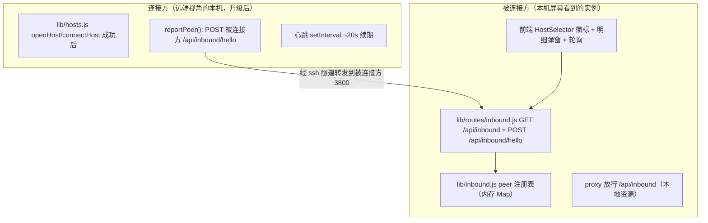

# 被连接主机情况查看（inbound peers）设计

> 状态：**已实现**（todo #11「记录连接主机数量」）。对应设计待评审稿，现实现已合入当前工作区（未提交）。基于 `design-multi-host`（多主机 P0 已实现）的反向展示增量。

## 1. 需求一句话

本机 AgentLRay **当前被哪些其他主机连接**、**几台活跃隧道在连本机**，并在**顶栏主机选择器旁**常驻展示，悬停/点击查看明细。

用户确认的口径：
- **粒度：两者都要** —— 「当前活跃连接数」概览 + 识别具体是哪台主机。
- **位置：顶栏主机选择器旁**（`HostSelector`，`App.tsx:294-296` 顶栏右侧常驻区）。

## 2. 技术约束（决定性事实）

多主机 P0 的连接方向是**本机出站**：本机 AgentLRay 经 `ssh -L 127.0.0.1:<localPort>:127.0.0.1:3800` 主动连远端（`lib/transport.js:35-57 buildSshArgs`、`lib/hosts.js:178 openHost`）。

反向"被连接"检测，逐层评估：

| 途径 | 是否可行 | 原因 |
| --- | --- | --- |
| 网络层 TCP 连接统计（`server.on('connection')`） | ❌ | 被连接方 server 绑 `127.0.0.1`（`server.js:95 app.listen(PORT, HOST)`），**任何入站连接（本地浏览器 / 本地 ssh 子进程 / 远处 ssh -R 反向转发）TCP 源地址都是 `127.0.0.1`**。无法区分"是不是别的主机在连我"，也无法识别是谁。 |
| HTTP 层被动识别 | ❌ | 隧道抹平来源；`lib/routes/proxy.js` 转发时还删掉 `X-Host-Id` 与 `?host=`（`forwardPath`/`proxyTo`），被连接方在请求里拿不到连接方身份。 |
| **连接方主动上报 + 心跳** | ✅ | 连接方 connect 成功后主动 POST 身份给被连接方，被连接方按心跳过期判定存活。**唯一可靠途径**。 |

**结论**：「连接数」与「具体主机」**都来自 peer 上报/心跳注册表**，不做 TCP 统计。

### 可行性锚点（复用现有能力）

1. **HTTP 上报可行**：node http client POST 不带 `Origin`/`Referer`/`Sec-Fetch-Site` 头 → CSRF guard 放行（`lib/csrf.js:25-41` 按"无这些头=非浏览器"推理放行）；`lib/routes/proxy.js:47-70 proxyTo` 已证明 node 转发同类路径存在。
2. **能力协商字段现成**：`GET /api/version` 返回 `{ bootId, version }`（`server.js:43-45`，`version`=package.json `0.1.0`）。用于判断对端是否升级过、能否上报，以及识别对端重启（bootId 变化）。
3. **轮询模式现成**：`frontend/src/hooks/useVersionPoller.ts` 的 `setInterval` + focus 刷新模式可复用。

## 3. 目标架构



关键点：
- 上报走 `?host=<被连接方hostId>` 或 `X-Host-Id` 指向被连接方，被连接方 proxy 将 `/api/inbound` 视为**本地资源**（同 `/api/hosts` 处理，`lib/routes/proxy.js:10-14`）→ 命中本地路由，不二次转发。
- 老版本连接方不调用 hello → 被连接方看不到它。这是设计接受的取舍：**无法识别的连接不显示**（而非显示成"未知"并误导），只展示已上报的 peers。

## 4. 接口契约

### GET /api/inbound —— 被连接方当前入站连接概览

```json
{
  "count": 2,
  "peers": [
    {
      "peerId": "devbox",
      "label": "开发机A",
      "version": "0.1.0",
      "bootId": "m8z...-1234",
      "connectedAt": "2026-11-13T08:00:00.000Z",
      "lastSeen": "2026-11-13T08:00:20.000Z"
    }
  ]
}
```

- `count` = 活跃 peer 数（未超时）。
- `peers` = 存活 peer 明细，按 `connectedAt` 升序。

### POST /api/inbound/hello —— 连接方上报/心跳

请求体：`{ peerId, label, version, bootId }`
- `peerId`：连接方自报的**本机机器名短名**（`os.hostname()` 去域后缀，如 `LIN-5C625B78247`），使被连接方能区分「是哪台机器在连」（区别于最初的 `local`/`本机` 固定值——那无法区分多台连接方）。
- `label`：展示名（当前同 `peerId`，即机器名短名）。
- `version`/`bootId`：`GET /api/version` 得到的自身版本/启动标识。

响应：`{ ok: true, ttl, serverVersion }`
- `ttl`：建议心跳间隔（秒），供连接方据此续期（防两端版本不同步）。
- `serverVersion`：被连接方版本，供连接方判断自己是否过旧。

幂等：同一 `peerId` 反复 POST 为 upsert 刷新 `lastSeen`，不新增。

## 5. 后端设计

### 5.1 `lib/inbound.js`（新）—— peer 注册表

- 内存 `Map<peerId, Peer>`，不落盘（会话级状态，进程退出即清）。
- `Peer = { peerId, label, version, bootId, connectedAt, lastSeen }`。
- 常量 `HEARTBEAT_TTL_MS = 30000`（30s），`snapshot()` 先 `expireStale()` 再返回。
- 接口：
  - `registerPeer(info): void` —— upsert（首次置 `connectedAt`，否则刷新 `lastSeen`）。
  - `expireStale(now): void` —— 清 `now - lastSeen > TTL` 的 peer。
  - `snapshot(): { count, peers }` —— 去重后的活跃列表。
  - `clear(): void` —— 进程退出清理。
- 风格对齐 `lib/hosts.js`（内存 Map + module interface + 测试专用注入）。

### 5.2 `lib/routes/inbound.js`（新）—— 路由

- `GET /api/inbound` → `res.json(snapshot())`。
- `POST /api/inbound/hello` → 校验 body 字段（`peerId`/`label` 必填，白名单正则同主机 id 风格）→ `registerPeer` → `res.json({ ok: true, ttl: HEARTBEAT_TTL_MS/1000, serverVersion: pkg.version })`。
- 挂载：`server.js` 在 `mountHostsRoutes(app)`（`server.js:76`）附近并列挂载，作为"本机本地资源"。

### 5.3 `lib/routes/proxy.js` —— 放行 /api/inbound

`WRITE_SETTINGS_BLOCKED`/`WRITE_RESOURCE_RE`（`lib/routes/proxy.js:10-21`）加入 `/api/inbound` 前缀，使带 `?host=`/`X-Host-Id` 指向被连接方时**命中本地路由而非二次转发**（同 `/api/hosts` 处理）。

### 5.4 连接方上报（升级连接方）—— `lib/hosts.js` + `lib/hosts.js` 路由

- 新增 `reportPeer(baseUrl, self)`：向 `{baseUrl}/api/inbound/hello` POST 本机身份 `{ peerId, label, version, bootId }`（本机自身 `GET /api/version` 的字段）。用 node `http`（对齐 `lib/transport.js probeVersion`），失败静默（不阻塞连接）。
- 本机身份来源：`lib/hosts.js` 的 `SELF` **默认 `peerId`/`label` = `shortHostname()`**（`os.hostname()` 去域后缀，空兜底 `local`）；`server.js` boot 调 `setSelfIdentity({ version: pkg.version, bootId: SERVER_BOOT_ID })` 仅补充版本/启动标识（不覆盖机器名）。
- 触发点：
  - `openHost` 置 connected 后（`lib/hosts.js:257`）首次上报。
  - `connectHost` 路由（`lib/routes/hosts.js:102`）成功后触发。
  - 心跳：每台 connected 主机一条 `setInterval` ~20s 续期；`closeHost`（`lib/hosts.js:271`）/`shutdownHosts` 清理定时器。
- 本机身份来源：`pkg.version` + `SERVER_BOOT_ID`（从 `GET /api/version` 或直接引 package.json）。

## 6. 前端设计

### 6.1 类型 + 客户端
- `frontend/src/api/types.ts`：`InboundPeer { peerId; label; version; bootId; connectedAt; lastSeen }`、`InboundInfo { count; peers }`。
- `frontend/src/api/client.ts`：`getInbound(): Promise<InboundInfo>` —— `fetchJson('/api/inbound', { local: true })`（被连接方本地资源，强制 local 语义，不随当前查看的远端变化，同 `getHosts`）。

### 6.2 顶栏徽标 + 明细（`HostSelector.tsx`）
- 触发条（`HostSelector.tsx:60`）旁新增**被连接徽标**：`count>0` 时显示「⛶ 被 N 连」chip（独立配色如 `bg-sky-500` 圆点或计数徽标），`count=0` 隐藏。
- 点击弹 `Popover`/`DropdownMenu` 列 peers 明细：label / peerId / version / 连接时长（`connectedAt`→now）；空态「暂无其他主机连接本机」。
- 仅**本机（selectedHostId==='local'）**展示被连接状态——远端视角下显示的是该远端自己的 inbound（经 host 头拉取），语义一致。

### 6.3 轮询
- 新增 `useInboundPoller()`（对齐 `useVersionPoller.ts`）：`setInterval` ~10s 拉 `getInbound()` + `focus` 时刷新，写入 store 的 `inbound` 字段；组件卸载清除定时器。

### 6.4 store
- `frontend/src/store.ts`：加 `inbound: InboundInfo | null` + `setInbound`。`useInboundPoller` 在顶栏挂载处启用（或 App 级）。

## 7. 边界与取舍

- **无法识别的连接不显示**：老版本连接方不上报 → 不出现在 peers。不做 TCP 层面的"未知连接数"（不可靠会误报）。
- **peerId 自报信任**：不做鉴权（与多主机整体信任模型一致——信任边界在系统 ssh 层，`design-multi-host` R3-Q2）。被连接方展示的连接方身份为**自报值**，仅展示用途，不影响任何数据面。
- **会话级状态**：peer 注册表在内存，进程重启即清；重连后连接方重新上报。
- **ttl/轮询间隔**：`HEARTBEAT_TTL_MS=30s`、心跳 20s、前端轮询 10s，集中为常量，实现时可按实际网络调整。

## 8. 实施清单

| 层 | 文件 | 改动 |
| --- | --- | --- |
| 后端 | `lib/inbound.js`（新） | peer 注册表 + 心跳过期 |
| 后端 | `lib/routes/inbound.js`（新） | GET /api/inbound + POST /api/inbound/hello |
| 后端 | `lib/routes/proxy.js` | `/api/inbound` 视为本地资源（放行） |
| 后端 | `lib/routes/hosts.js` | connect 成功后触发上报（或由 `lib/hosts.js openHost` 内触发） |
| 后端 | `lib/hosts.js` | `reportPeer` + 心跳定时器生命周期 |
| 前端 | `types.ts` / `client.ts` | InboundInfo/InboundPeer + `getInbound` |
| 前端 | `store.ts` | `inbound` + `setInbound` |
| 前端 | `HostSelector.tsx` | 被连接徽标 + 明细弹窗 |
| 前端 | 新 `useInboundPoller.ts` | ~10s 轮询 + focus 刷新 |
| 文档 | `docs/design/README.md` | 登记本文档 |

## 9. 验证

1. **后端单测**（node:test，对齐 `test/hosts.test.js`）：
   - `lib/inbound.js`：register→snapshot count/peers；touch 续期；expire 清超时。
   - `lib/routes/inbound.js`：GET 空→0；POST hello→count 1；再 POST 幂等不增。
2. **proxy 放行**：断言 `?host=<host>` 时 `/api/inbound` 走本地路由（非 503/二次转发）。
3. **连接方上报**：mock 被连接方 server，`openHost`/connect 成功后断言收到 hello + 心跳续期 + close 后停。
4. **前端构建**：`npm run build:ui`（frontend build）通过，TS 无错。
5. **全量回归**：`npm test` 既有用例不回退。
6. **手工 E2E（可选）**：起两个 AgentLRay，A 配置 B，A 切连 B 后 B 顶栏徽标「被 1 连」且列出 A。

---

## 实现进度（代码核对：2026-11-19，基线 `c7fdb8f`）

**状态：已实现**

| 能力/阶段 | 状态 | 代码证据 |
| --- | --- | --- |
| peer 注册表 + 心跳 | ✅ 已实现 | `lib/inbound.js` |
| `GET/POST /api/inbound` | ✅ 已实现 | `lib/routes/inbound.js` |
| 前端徽标/明细/轮询 | ✅ 已实现 | `frontend/src/hooks/useInboundPoller.ts`、`frontend/src/components/HostsDialog.tsx` |

