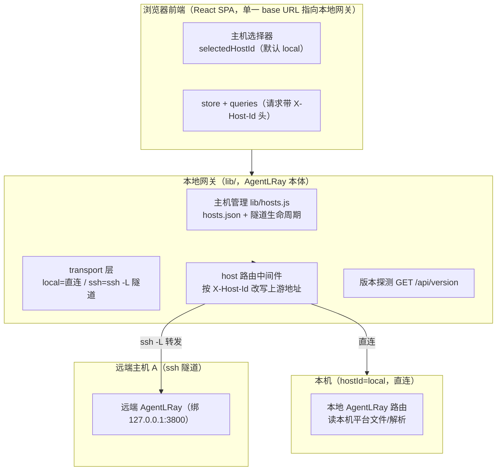

# 多主机模式设计（multi-host）

> 本文档记录 AgentLRay「多主机模式」需求的完整设计树与 grill 收敛结论。
> 状态：**设计定稿；P0 已实现（见 [plan-multi-host.zh-CN.md](plan-multi-host.zh-CN.md)）**——P0 = 只读 + 实时 + 主机管理闭环；**P1 已实现 resume/create 透传 + prompts analyze/rewrite 透传**（其余：CLI `--host`、多隧道并行、dsh 待排期）。

## 1. 需求一句话

连接其他主机上运行的 AgentLRay 服务，查看对应会话列表/详情/状态等数据，并实现现有 web 大部分操作能力；**设置除外**。主机连接与管理方式参考 `plugharness-go` 的远程模型，先支持 **ssh 主机连接**（dsh remote 后续再做）。

## 2. 决策树（grill 收敛记录）

### R1 根分叉

| Q | 问题 | 决策 |
|---|---|---|
| Q1 | 远端数据源形态 | **(a)** 远端跑一个完整 AgentLRay 实例，本地作为**网关**聚合/代理它的 HTTP `/api/*`（会话列表/详情/搜索/insights/export…），把多个远端实例并成一个视图。「设置」留在各远端自己的实例。 |
| Q2 | dsh remote 与 ssh 角色 | 只考虑 **ssh** 传输；dsh remote 后续。ssh 作为到远端主机的**传输隧道/通道**，目标是触达远端 AgentLRay 的 HTTP。 |
| Q3 | 解析在哪一端 | **远端解析**：远端 AgentLRay 读自己的本地文件、跑自己的归一化/诊断/insights/搜索；本地**只调用**（代理远端 `/api/*`），本地完全不碰远端文件/解析，**本地不需要任何远端平台适配器**。 |
| Q4 | 多主机视图形态 | **(a)** 主机列表 + **当前主机上下文**：任一时刻选一个主机看它的会话（平台/会话/分析都限定当前主机）。 |
| Q5 | 鉴权与信任 | 见 R3-Q2（凭据/指纹全委托系统 ssh）。 |

### R2 网关与传输

| Q | 问题 | 决策 |
|---|---|---|
| Q1 | 隧道形态 | **(a)** ssh 本地端口转发 `ssh -L 127.0.0.1:<port>:127.0.0.1:3800 user@host`。远端保持 localhost 绑定，安全边界在 ssh 层，远端零改动。 |
| Q2 | ssh 引擎 | **(a)** 复用系统 `ssh` 子进程：零新增 npm 依赖，吃 `~/.ssh/config`（Host 别名/端口/跳板）、`ssh-agent`、私钥、`known_hosts`。依赖环境有 ssh 命令。 |
| Q3 | 本机是否作为主机 | **(a)** 本机 = hostId `local` 内建在主机列表，走直连（不经 ssh）。UI 只有一种「选主机」交互，transport 层区分 `local`=直连 / `ssh`=隧道。 |
| Q4 | 代理允许清单（「设置除外」边界） | 数据面**全透传**：sessions / search / insights / prompts 读 / export / otlp / agents / spawn-map / spawn-tree / `GET /api/platforms`（平台清单）/ `GET /api/version`。写设置面**不透传**：`/api/settings`、`/api/platforms/:id/mount\|replace`（平台启停/替代）、`/api/cli-bins`。合意写操作**透传**：resume / create（见 R2-Q5）。 |
| Q5 | 远端放行 resume/create | **(a) 放行**：通过代理在**选中主机的远端** real-spawn 该平台 resume/create 命令（`resolveCliBin` 在远端解析远端配置）；UI 明确提示「将在 `<host>` 上执行」。P1 落地（见 §4 切分）。 |
| Q6 | 并行度与实时性 | 第 1 版**只维护当前选中主机的隧道**（切换重连）；watch SSE **流式透传**保持实时 tail。 |

### R3 配置、信任、状态、前端、CLI、LLM

| Q | 问题 | 决策 |
|---|---|---|
| Q1 | 主机配置数据模型 | `~/.agentlray/hosts.json`，最小字段集 `{ id, label, type, ssh{ host, user, port, remoteAgentLrayPort, identityFile, useAgent } }`；本地转发端口**运行时自动分配**（不落盘）。`ssh.host` 直接透传 `~/.ssh/config` 别名。`type` 预留 `dsh`。 |
| Q2 | 主机凭据与信任 | 凭据/指纹**全委托系统 ssh**（`~/.ssh/config`、密钥、`ssh-agent`、口令交互由 ssh 子进程自管），AgentLRay **零存密/私钥**；信任边界 = 「你已在系统 ssh 层信任的 host」；不做自己的指纹 pin（避免与系统 ssh 双套指纹打架）；代理面仍只放行 R2-Q4 清单，远端只读保证。 |
| Q3 | 连接状态与失败 | host 状态机 `disconnected / connecting / connected / error`（+错误文案）；切换失败**停留原主机**并显示错误与重试；`local` 恒 connected。做**版本探测**：`GET /api/version`（bootId），过低提示升级远端（防语义漂移）。 |
| Q4 | 前端改造 | 保留**单一 base URL**（前端只跟本地网关说话）；网关按 **`X-Host-Id` 请求头**路由到对应主机（不侵入各端点 URL 路径）；store 加 `selectedHostId`（默认 `local`）；新增主机管理入口。 |
| Q5 | CLI `--host` | 第 1 版 **web only**，CLI `--host` 延后（CLI 现直读本地文件，要支持远端需先改走网关 HTTP，属第二优先级重构）。 |
| Q6 | prompts LLM 分析/改写 | **(a) 透传**：在选中主机远端用**远端配置的 LLM 后端**执行 analyze/rewrite（密钥不落本地，`GET/PUT /api/settings` 不透传所以远端密钥安全）。P1 落地。 |

### R4 收尾

| Q | 问题 | 决策 |
|---|---|---|
| Q1 | 隧道生命周期与清理 | 隧道生命周期**绑定当前选中主机**：切换离开 → 关隧道；删除主机 → 关隧道 + 从 `hosts.json` 移除；**AgentLRay 进程退出 → 所有隧道子进程随之终止**（不残留孤儿 ssh）。本地端口切换后释放、重连再分配。无后台常驻隧道池。 |
| Q2 | watch/SSE 断线语义 | 网关**透传远端 `retry:` 语义**（浏览器按远端 retry 自动重连，网关不干预）；ssh 层加 **ServerAliveInterval** 保活（防长空闲隧道被掐），属于 ssh 参数而非 HTTP 层。 |
| Q3 | 主机管理 UI 形态 | 设置面板新增**「主机」tab**（列出已保存主机、添加/编辑/删除、**「测试连接」**按钮立即建隧道并探 `/api/version` 显状态）；顶栏/侧栏**主机选择器**（下拉/chip）切当前 `selectedHostId`，显示连接状态徽标，`local` 恒在。配置归设置面板，当前选中归顶栏。 |
| Q4 | P0 范围切分 | 见 §4。P0 = 只读+实时+主机管理闭环；P1 = 写操作（resume/create、prompts LLM）+ CLI `--host` + 多隧道并行 + dsh remote。 |
| Q5 | 文档落地 | 本文档 + 术语入 glossary（已确认）。 |

## 3. 目标架构

要点：

- **远端是完整 AgentLRay 实例**（读自己的文件、跑自己的解析）。本地网关是**纯 HTTP 转发 + 主机管理**，不重复实现任何平台解析逻辑。
- **统一 host 上下文**：`local` 与远端共用同一套「选主机 → 请求该主机 /api/*」语义，transport 层是唯一区分点。
- **安全边界在 ssh 层**：远端保持 `127.0.0.1` 绑定，本地经 ssh 本地端口转发触达，不暴露到远端局域网；凭据/指纹全走系统 ssh。

## 4. P0 / P1 切分

### P0（第 1 版交付）

- `lib/hosts.js`：`hosts.json` 读写（最小字段集）、主机 CRUD。
- transport 层：`local` 直连 / `ssh -L` 隧道建立与拆除（绑定选中主机，进程退出兜底清理，ServerAliveInterval 保活）。
- 网关 host 路由中间件：按 `X-Host-Id` 头路由到对应主机（`local` 走本地路由，远端走隧道），数据面全透传（R2-Q4 清单）。
- 版本探测：连接时 `GET /api/version`，低版本提示升级远端。
- 前端：store `selectedHostId`（默认 local）、顶栏/侧栏主机选择器（状态徽标）、设置面板「主机」tab（添加/编辑/删除/测试连接）、请求带 `X-Host-Id` 头。
- 连接状态机 `disconnected/connecting/connected/error`，切换失败停留原主机。

### P1（后续增量）

- ✅ resume / create 透传（R2-Q5 放行，前端加「将在 \<host\> 上执行」提示 + 写面网关放行审计）。
- ✅ prompts analyze/rewrite 透传（R3-Q6，用远端 LLM 后端）。
- ⏳ CLI `--host`（R3-Q5，需先改 CLI 走网关 HTTP）。
- ⏳ 多隧道并行/后台常驻（R2-Q6 后续）。
- ⏳ dsh remote 传输（Q2 先不做，`type:"dsh"` 预留）。

## 5. 关键边界与风险

- **「设置除外」边界**：写设置面（settings / platforms mount|replace / cli-bins）不透传，留在各远端实例自己管；`GET /api/platforms`（平台清单）算数据面，透传决定该远端显示哪些平台。
- **写操作语义**：resume/create、prompts LLM 是「用户显式合意操作」，在远端真实执行；本地不自动触发任何写。远端只读保证 = 代理面只放行白名单端点。
- **版本漂移**：多主机可能连到不同版本的远端 AgentLRay，靠 `GET /api/version` 探测并提示，避免两端语义不一致。
- **CLI 与 web 的解析口径**：CLI 现直读本地文件、不经网关；多主机第 1 版只影响 web。两者在 `local` 上仍共享同一解析逻辑（同一份规则单源），无漂移。

---

## 实现进度（代码核对：2026-11-19，基线 `c7fdb8f`）

**状态：部分实现：P0 完成；P1 ①② 完成，③ CLI `--host`、④ 多隧道池未实现**

| 能力/阶段 | 状态 | 代码证据 |
| --- | --- | --- |
| P0 只读 + 实时 + 主机管理 | ✅ 已实现 | `lib/hosts.js`、`lib/transport.js`、`lib/routes/{proxy,hosts}.js` |
| P1 ① resume/create 透传 | ✅ 已实现 | `lib/routes/proxy.js`、`lib/resume.js`、`lib/new.js` |
| P1 ② prompts analyze/rewrite 透传 | ✅ 已实现 | `lib/routes/proxy.js`、`lib/routes/prompts.js` |
| P1 ③ CLI `--host` | ❌ 未实现 | `bin/sessions.js` 无 `--host` |
| P1 ④ 多隧道并行/后台常驻 | ❌ 未实现 | `lib/routes/hosts.js:149` 仍 `closeAllExcept(id)` |

