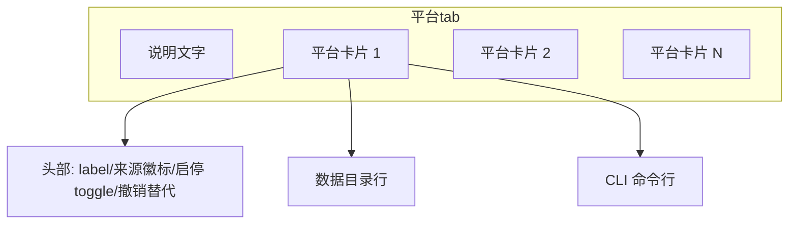

# 平台设置归并 + 目录/启停落盘服务端（设计）

> 目标：web 系统设置中所有**平台相关设置**内聚到「平台」tab 下（数据目录、平台 CLI 命令并入），并将**数据目录（dirs）与平台启停（platforms）**从前端 localStorage / 独立端点迁到统一用户配置文件 `~/.agentlray/settings.json`，服务端以用户配置为准。
>
> 类型：方案设计 · 2026-11-09 · 对应代码基线：`7fc39e6`

## 1. 背景与现状

当前 `SettingsDialog` 有 6 个 tab：

| tab | 内容 | 存储后端 |
| --- | --- | --- |
| 数据目录 | 各平台会话目录输入 | **前端 localStorage**（store.settings） |
| 平台 | 平台启停/撤销替代 | 独立端点 `PUT /api/platforms/:id/mount\|replace` → settings.json `platforms` section |
| LLM 接口 | baseUrl/model/apiKey/超时 | settings.json `llm` |
| 平台 CLI 命令 | resume 可执行命令 | settings.json `cliBins` |
| 状态时间配置 | 四态判定窗口 | settings.json `status` |
| 任务看板 | 每列 maxPerStatus | settings.json `kanban` |

**痛点**：
- 平台相关设置散落「数据目录」「平台」「平台 CLI 命令」三个 tab，语义割裂。
- 数据目录真源在前端 localStorage，服务端查询依赖前端每次组装 `?dir=` / `?dirCodex` query 传递；跨进程/多终端视角不一致。
- 平台启停走独立端点逐个即时 POST，与其它设置「统一 draft + Save」交互不一致。

## 2. 目标形态

```
Settings tab 结构：平台 | LLM 接口 | 状态时间配置 | 任务看板
                    └─（数据目录 / 平台 CLI 命令 并入「平台」）
```

「平台」tab = 说明文字 + **平台卡片列表**（不内嵌子 tab）：



每个平台卡片：
- **头部**：label + 来源徽标（内置/项目/用户）+ 挂载状态徽标（替代待生效/重启生效）+ 启停 toggle + 撤销替代按钮（`replacedDeclared` 时，Q17）。
- **数据目录行**：输入 + hint + 默认值提示；`dirSettingKey` 为空 → 只读占位（「由适配器 defaultDir 决定」，Q6-B）。
- **CLI 命令行**：输入 + 默认值提示；`bin == null` 且无 resume → 只读占位。
- **未挂载**：目录/CLI 输入 disabled（灰化），启停 toggle 仍可点（Q5-A）。
- **broken**：全禁用 + 显示错误信息。

## 3. 交互模型（Q4-B）

- **全部纳入统一 draft**，按平台聚合：`draft[platformId] = { mounted, dir, bin }`（Q15）。
- 底部 **Save** 一次 `PUT /api/settings`，服务端按 section 分发（platforms → dirs → cliBins），目录额外写 localStorage（见 §4 迁移）。
- **Reset to Defaults 不重置启停**（Q9-A）：只清目录/CLI 输入，启停 toggle 保持当前 `configuredMounted`，防误伤。

## 4. 服务端：目录真源迁移（Q8-A / Q11-B / Q12-A / Q13）

### 4.1 优先级（Q11-B）

```
env（CODEX_DIR 等，进程级注入） > settings.json dirs section > 默认段路径
```

各平台 `defaultDir()` 已通过 `dirs.js` 的 `resolveDirs` 把 env 合并进返回值（env 有值即 env 路径）。因此服务端 route 目录解析统一为：

```
resolveDir(settingsDirs[id], p.defaultDir())
```

- 用户未配 dirs → 用 `defaultDir()`（内部已含 env 优先）。
- 用户配置 dirs → **env 仍天然优先**：因 env 已在 `defaultDir()` 内部解析，仅当该平台 env 未生效时用户配置才覆盖默认段，满足 Q11-B 分层。

> **UI 语义**：设置面板填目录时，若该平台 env 已生效（`dirs.js` 有 `env` 声明且进程已注入），输入 disabled 并提示「当前由环境变量 XX 决定，此配置不生效」，与未挂载禁用同理，避免用户困惑。

### 4.2 服务端唯一真源（Q12-A）

前端**移除**全部 dir query 组装层：
- `store.ts`：`dirBySettingKey`、`dirsByParam`、store 的 `settings`（dirs 部分）。
- `client.ts`：`getSessionsAll` 的 `dirsByPlatform`、`getInsights`/`getToolsAudit`/`searchSessions` 的 `dir`/`dirs` 参数。
- 各 view：`dirBySettingKey(settings, info) || undefined` 传 `?dir=` 的调用点。

服务端 route（`sessions`/`insights`/`prompts`/`search`/`watch`/`export`/`tool-audit`）目录解析从 `resolveDir(req.query.dir, p.defaultDir())` 改为读 settings.json `dirs` section（新增 `lib/dirs-config.js`），单一出口：

```
dirFor(platform) = resolveDir(dirsConfig[platform.dirSettingKey], platform.defaultDir())
```

> **`?dir=` query 是否保留？** 设计上移除前端传参；服务端 `req.query.dir` / `req.query[dirParam]` 的覆盖能力可保留为「API 调用方临时覆盖」的向后兼容层（Q18 保留独立端点同理），但前端不再使用。此为可选保留项——若追求彻底单一真源，可在本迭代一并移除 query 覆盖（见 §9 决策记录）。

### 4.3 settings.json `dirs` section（Q8-A / Q13）

- 新增 `lib/dirs-config.js`：白名单校验（仅接受已挂载且 `dirSettingKey` 非空的平台键，值须为绝对路径且不含 `..`）、`loadDirsConfig` / `saveDirsConfig` / `dirForPlatform`。
- `PUT /api/settings` 新增 `dirs` section 分支（复用 `saveDirsConfig`）。
- `GET /api/settings` 新增 `dirs` section：返回各平台 `{ value, configured, default }`，`default` 从适配器 `defaultDir()` 解析（供设置面板回显与空态展示）。

### 4.4 一次性迁移 localStorage dirs（Q13）

首启/首次打开设置时，把前端 localStorage 中旧 dirs（`openclawDir`/`codexDir`/…）一次性上传到 `PUT /api/settings { dirs }` 并清除 localStorage 残留（幂等，settings.json 已含该键则不覆盖）。迁移在 server 启动与 CLI 入口各调一次（沿用 `migrateLegacySettings` 的幂等模式）。

## 5. 服务端：platforms section 并入 PUT /api/settings（Q8-A / Q14-A）

- `PUT /api/settings` 新增 `platforms` section 分支：解析 `{ disabled: string[], replaced: string[] }`，**逐个复用 `lib/platform-config` 的 `setPlatformMounted` / `setPlatformReplaced`**（保留「最后可查询平台不可 unmount」守卫与 id 白名单校验，Q14-A）。
- 保留独立端点 `/api/platforms/:id/mount|replace`（Q18）：CLI `bin/platform.js` 直接调 `platform-config`（不依赖 HTTP 端点），保留端点仅为 web 侧向后兼容与其它调用方。
- `GET /api/settings` 的 `platforms` 镜像由 `{ default, ids }` 扩展为含 `disabled` / `replaced`（前端设置面板据此种 draft 的启停初始值）。

## 6. 前端改动

### 6.1 SettingsDialog 重构

- 移除独立「数据目录」「平台 CLI 命令」tab，两者并入「平台」tab 的平台卡片（§2）。
- `PlatformSection` 从「即时 POST 启停」改为「draft 内 toggle + Save 统一提交」；平台数据源仍 `GET /api/platforms`（含未挂载/broken 全量 catalog）。
- Draft 按平台聚合（§3）；Save 组装 patch：`platforms`（仅变更的平台 disabled/replaced）、`dirs`（仅变更平台）、`cliBins`（仅变更平台）。
- Reset 不重置启停（Q9-A）。

### 6.2 移除前端目录 query 层

见 §4.2，涉及 `store.ts` / `client.ts` / `queries.ts` / `usePlatformProbe.ts` / `GlobalInsights.tsx` / `SessionInsights.tsx` / `ToolsAuditSection.tsx` / `PromptsView.tsx` / `SessionSummary.tsx` / `SessionsView.tsx` / `useSessionSse.ts` / `trace/childAgents.ts` / `SessionFiltersDialog.tsx`。

## 7. 服务端文件改动清单

| 文件 | 改动 |
| --- | --- |
| `lib/dirs-config.js` | 新增：`dirs` section 白名单/校验/读写、`dirForPlatform` |
| `lib/settings.js` | 迁移逻辑补充 dirs（§4.4）；`saveSections` 无需改（无白名单） |
| `lib/routes/settings.js` | PUT 新增 `dirs`/`platforms` 分支；GET 新增 `dirs` section、扩展 `platforms` 镜像 |
| `lib/platforms/*/index.js`、各 route | 目录解析接 `dirForPlatform`（sessions/insights/prompts/search/watch/export/tool-audit） |
| `server.js` / `bin/*` | 启动时执行 dirs 迁移（幂等） |

## 8. 测试与验证

- 服务端：`npm test` 全绿（新增 `dirs-config` 白名单/优先级、settings route `dirs`/`platforms` 分支用例）。
- 前端：`frontend npm run build` 通过。
- 手动：打开设置 → 平台 tab 卡片渲染、未挂载 disabled、broken 显示错误、Save 后 settings.json `dirs`/`platforms` 落盘、重启生效、localStorage 旧 dirs 迁移。

## 9. 决策记录

| 项 | 决策 | 说明 |
| --- | --- | --- |
| Q1 | 状态时间配置保持独立 tab | 非平台特有 |
| Q2 | B：按平台维度重构卡片 | 未挂载显示禁用 |
| Q3 | LLM/看板/状态独立 | — |
| Q4 | B：全部进 draft 统一 Save | 启停也进 draft |
| Q5 | A：未挂载仅输入灰化、启停可点 | — |
| Q6 | B：不可配项只读占位 | — |
| Q7 | tab 顶部说明 + 卡片列表 | 不内嵌子 tab |
| Q8 | A：`PUT /api/settings` 支持 platforms + dirs | 全部落盘用户配置文件 |
| Q9 | A：Reset 不重置启停 | 防误伤 |
| Q10 | 组合：未挂载灰化+draft toggle / broken 全禁用 | — |
| Q11 | B：env > 用户配置 dirs > 默认段 | 保留 env CLI 契约 |
| Q12 | A：服务端唯一真源 | 移除前端 dir query 组装层 |
| Q13 | 一次性迁移 + GET 新增 dirs section | — |
| Q14 | A：settings 路由复用 platform-config | 保留守卫 |
| Q15 | draft 按平台聚合 | `{mounted,dir,bin}` |
| Q16 | 卡片 = 头部 + 目录行 + CLI 行 | — |
| Q17 | 保留撤销替代按钮（卡片头部） | — |
| Q18 | 保留独立 mount/replace 端点 | CLI 不依赖 HTTP 端点 |

> **开放项**：服务端 `?dir=` query 覆盖层是否随本迭代一并移除（§4.2「可选保留项」）。默认保留为 API 向后兼容，仅前端不再使用。

---

## 实现进度（代码核对：2026-11-19，基线 `c7fdb8f`）

**状态：已实现**

| 能力/阶段 | 状态 | 代码证据 |
| --- | --- | --- |
| dirs 落 `settings.json` | ✅ 已实现 | `lib/dirs-config.js`、`lib/routes/settings.js` |
| 平台启停落服务端 | ✅ 已实现 | `lib/platform-config.js` |
| 设置面板「平台」tab 归并 | ✅ 已实现 | `frontend/src/components/SettingsDialog.tsx` |

> 本文档已从 `docs/.local/` 迁移至正式文档目录，随代码提交；`docs/.local/` 保留同名过程稿。后续实现变更请同步更新本节与 `docs/.local/README.md` 的进度索引。
