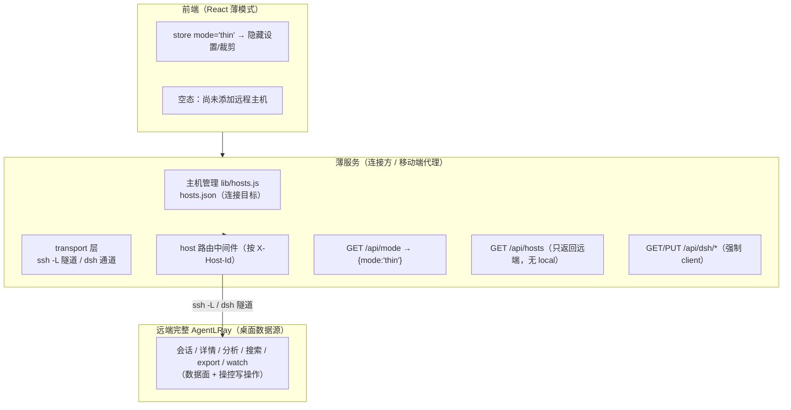

# 独立薄服务（thin service）设计 —— 仅用于远程连接

> 类型：方案设计（grill-with-docs 收敛记录）　｜　日期：2026-11-20　｜　状态：**已实现（2026-11-20）**
> 需求来源：`todo.md` #16「开发薄服务和页面，只用于远程连接」、#17「开发移动端 APP，用于远程连接」
> 前置文档：`design-multi-host`（多主机网关）、`design-remote-settings-tunnel`（设置透传远端）、`design-dsh-host-connection`（dsh 传输）、`design-host-settings-redesign`（主机设置布局）
> 决策记录：见 [adr-0007-thin-service.zh-CN.md](adr-0007-thin-service.zh-CN.md)

## 1. 需求一句话

提供一个**独立的薄服务**，只支持远程连接到远端主机并完成相应代理；前端复用现有模块，能使用现有支持的远程主机所有能力（查看 + 操控）。**去除系统配置**。为后续开发移动端 APP 远程连接桌面端查看和操控做准备。

## 2. 与现状多主机网关的关键区别

现有**多主机模式**（`design-multi-host`，P0+P1①② 已实现）：本地跑**完整 AgentLRay** 作网关，按 `X-Host-Id` 头把 `/api/*` 代理到**远端完整 AgentLRay**；设置面已透传远端（`design-remote-settings-tunnel`）。

薄服务**不是**这个完整网关——它跑在**连接方**（移动端代理侧），自身**不携带**平台注册/状态机/insights/搜索全栈，**从数据模型上排除**系统配置，只做「远程连接 + 数据面转发 + 主机管理」。

## 3. 决策树（grill R1–R4 全量收敛，Q1–Q27）

### R1 需求边界与根分叉（Q1–Q6）

| Q | 决策点 | 结论 |
| --- | --- | --- |
| Q1 | 薄服务定位 | **连接方**（移动端代理/连接方侧）跑薄服务，去连**完整 AgentLRay**；移动端永不跑完整解析栈。 |
| Q2 | 「去除系统配置」范围 | 薄服务只持有**连接所需最小配置**（主机列表 + dsh 传输），不持有会话/平台/LLM/状态系统配置。 |
| Q3 | 与现有 AgentLRay 关系 | 同一代码库、**独立入口**，复用 `lib/hosts`/`lib/transport`/`lib/routes/proxy`，只挂远程连接相关路由。 |
| Q4 | 连接对象 | 连**完整 AgentLRay**；连接方不区分对端薄厚（同构：`/api/version` + 会话数据面），与现有 `proxy.js` 一致。 |
| Q5 | 与移动端 APP 关系 | 薄服务是移动端 APP 的 **HTTP 后端**，APP 只调薄服务 API。 |
| Q6 | 移动端 APP 形态 | **移动端 Web 起步**（复用现有 React 前端，已有 767 断点 + 看板移动端适配）；后续演进原生壳 + web 内核。 |

### R2 能力边界与配置（Q7–Q12）

| Q | 决策点 | 结论 |
| --- | --- | --- |
| Q7 | 薄服务本地路由子集 | 只挂 `hosts` + `version`（Q17 dsh 例外）；其余全走 `proxy.js` 透传远端。 |
| Q8 | 前端去除系统配置 | `VITE_THIN`（构建期）隐藏设置入口（后被 Q13 运行时方案取代）。 |
| Q9 | 远端设置是否可改 | **不透传 settings**，连上远端也不改系统配置（数据面边界彻底排除）。 |
| Q10 | 传输方式 | 复用现状 `transport.js`：`ssh -L` 隧道 + dsh 通道（保留，移动端穿透 NAT 常用）。 |
| Q11 | 复用策略 | 独立 `bin/thin-server.js` 组装薄 Express app，共享 `lib/*`，不在 `server.js` 塞 flag。 |
| Q12 | 前端入口 | 单 dist，薄服务暴露 `GET /api/mode` 前端据此裁剪（后被 Q13 统一为运行时模式信号）。 |

### R3 模式信号 / local / 配置边界 / 操控 / 鉴权（Q13–Q21）

| Q | 决策点 | 结论 |
| --- | --- | --- |
| Q13 | 模式信号单一真源 | **运行时唯一**：`GET /api/mode`；完整=`{mode:'full'}`，薄=`{mode:'thin',version}`；删 `VITE_THIN`；`/api/mode` 与 hosts/version 同列**本地资源**，绝不透传。单 dist。 |
| Q14 | 薄服务 `local` 语义 | **无 `local`**：`GET /api/hosts` 只返回远端；前端 thin 不初始化为 local，自动连记忆/首台主机，无主机时显示空态。 |
| Q15 | 系统配置接口边界 | **堵写面**（settings PUT / cli-bins / platforms mount|replace 403），**保留 `GET /api/ui-selection` 只读**恢复远端平台选择；前端 thin 跳过 `syncSelectedPlatforms`（写），平台选择只存 localStorage。 |
| Q16 | 远端操控写操作 | **全部放行**（resume-command / sessions new / prompts rewrite·hidden·analyze）：非系统配置，属操控远端会话。 |
| Q17 | dsh 配置 | 薄服务本地挂 `/api/dsh/*`（连接所需最小配置例外）；dsh 是穿透 NAT 的关键通道。 |
| Q18 | 鉴权 | **无鉴权**（沿用现状 CSRF）；默认 `HOST=127.0.0.1`，LAN 需显式 `HOST=0.0.0.0`；风险已明示。 |
| Q19 | 启动自动连接 | boot 即 `openHost` 上次/首台主机；失败仅记状态，前端首帧直落该主机。 |
| Q20 | 多隧道池 | 薄服务**沿用单隧道**（`connect` 仍 `closeAllExcept`）；池化另立需求。 |
| Q21 | 启动入口与配置 | `agentlray thin` 子命令 + `npm run thin`；默认 `PORT=3801`、`HOST=127.0.0.1`；配置仍用 `~/.agentlray/hosts.json`，可用 `AGENTLRAY_HOME` 隔离。 |

### R4 前端裁剪清单与薄服务细节（Q22–Q27）

| Q | 决策点 | 结论 |
| --- | --- | --- |
| Q22 | 薄模式前端裁剪与首帧门控 | **阻塞**：store 加 `mode`，boot 先 `GET /api/mode`，未解析前渲染轻量占位；`thin` 下一次性禁用 `SettingsDialog` 与设置按钮、`useInboundPoller`、`KanbanView` 的 `getKanbanConfig` 查询、`syncSelectedPlatforms`。`getSelectedPlatforms`（GET ui-selection）保留。 |
| Q23 | 启动自动连接目标 | 服务端取 `AGENTLRAY_THIN_HOST=<id>`；缺省取 `hosts.json` 第一台；都没有则不连、前端空态引导。boot 即 `openHost`。 |
| Q24 | 薄服务能否作 dsh 被连接方 | **强制 client**：只出站连远端，不启 `startDshHostService`，`/api/dsh/config` role 固定 client。 |
| Q25 | 本地 `/api/inbound` 响应 | 与完整网关一致：`proxy.js` 对 `/api/inbound` 一律 403（本地资源、薄服务不提供）；前端 thin 已禁轮询。 |
| Q26 | 首启无主机空态 | 主区渲染「尚未添加远程主机」+「添加主机」按钮，打开现有 `HostFormDialog`；侧栏主机入口照常。 |
| Q27 | 看板配置来源 | thin 跳过 `getKanbanConfig` 查询，直接用后端默认 `maxPerStatus=20`，不落盘。 |

## 4. 文件改动清单（实现级，已落地）

| 文件 | 改动 |
| --- | --- |
| `lib/routes/mode.js`（新增） | `GET /api/mode` → 完整实例 `{mode:'full'}`、薄服务 `{mode:'thin',version}`。 |
| `bin/thin-server.js`（新增） | 独立薄 Express app：只挂 `proxy` + `hosts`（无 local）+ `dsh`（强制 client）+ `version` + `mode` + SPA；默认 PORT=3801 / HOST=127.0.0.1；先监听再后台 `autoConnectThinHost()`。 |
| `lib/routes/proxy.js` | thin 选项：`/api/settings*` 一律 403、`/api/platforms/:id/(mount|replace)` 写面 403；保留 `/api/platforms` 列表与 `GET /api/ui-selection` 透传；`/api/mode` 列入 `LOCAL_ONLY_RE`（本地资源）。 |
| `lib/routes/hosts.js` | 新增 `includeLocal` 选项；thin 下 `GET /api/hosts` 只返回远端。 |
| `lib/hosts.js` | 新增 `resolveThinBootHost()` / `autoConnectThinHost()`（取 `AGENTLRAY_THIN_HOST` 或首台，`openHost`，失败仅记状态）。 |
| `lib/routes/dsh.js` | 新增 `forceClient` 选项：config/status/auth role 恒 client，PUT 强制落 client（不启被连接方服务）。 |
| `server.js` | 挂载 `mountModeRoutes(app, { mode: 'full' })`。 |
| `bin/agentlray.js` | 新增 `thin` 子命令（解析 `--port/--host`，默认 3801）。 |
| `package.json` | 新增 `thin` script。 |
| `frontend/src/api/client.ts` | 新增 `getMode()`（`local: true`）。 |
| `frontend/src/main.tsx` | 挂载前先 `GET /api/mode` 写入 store；thin 时 `setHostConnecting()` 先停数据面，避免以 local 头抢拉。 |
| `frontend/src/store.ts` | 加 `mode` 状态、`setMode`、`adoptThinHost`（服务端已连好的主机首帧直接采用，不重复 connect）；`syncSelectedPlatforms` 在 thin 跳过；`disconnectHost` thin 不回落 local（改停数据面）。 |
| `frontend/src/App.tsx` | 首帧门控（mode 解析前占位）；thin 空态「尚未添加远程主机」+「添加主机」；thin 采用主机后渲染；隐藏设置按钮 / `SettingsDialog`；传 `useInboundPoller(disabled)`、`Sidebar` 不传 `onOpenSettings`。 |
| `frontend/src/hooks/useInboundPoller.ts` | 加 `disabled` 参数（thin 不轮询）。 |
| `frontend/src/views/kanban/KanbanView.tsx` | thin 跳过 `getKanbanConfig`（`enabled: !isThin`），用默认 20。 |
| `frontend/src/components/HostsDialog.tsx` | thin 空态文案「尚未添加远程主机」（local 行由后端已不返回）。 |
| `frontend/src/components/HostConnectingView.tsx` | thin 隐藏「回本机」（薄服务无 local）。 |
| `frontend/src/components/Sidebar.tsx` | 未传 `onOpenSettings`（thin）时不渲染设置按钮。 |
| `frontend/src/demo/flag.ts` | **无需改**：thin 纯运行时 `GET /api/mode`，无构建 flag。 |

## 5. 关键边界与风险

- **薄 ≠ 完整网关子集**：薄服务不是「隐藏设置 UI 的完整实例」，而是「数据面边界排除系统配置的连接方网关」；二者从进程与路由挂载上分离。
- **无 `local` 宿主**：从数据模型上就没有本地数据源，避免「切到本机看到 404」的伪能力。
- **无鉴权风险**：薄服务绑 LAN 即任何人可看全部会话；默认只绑 127.0.0.1，LAN 需显式开启。**主动接受**（用户拍板 Q18=c），文档需显著提示。
- **`/api/mode` 本地资源**：绝不能被 `proxy.js` 透传，否则薄服务会误把远端模式当自己的。
- **与 `design-remote-settings-tunnel` 的关系**：完整网关仍透传远端 settings（可改）；薄服务不透传——两种形态并存，非回归。
- **单隧道**：移动端切主机反复拆建隧道，体验略差；池化另立需求（P1-4）。
- **已知限制（平台多选写面）**：thin 跳过 `syncSelectedPlatforms`（不改远端系统配置），故侧栏平台多选只落 localStorage；聚合列表 `GET /api/sessions` 仍由**远端** `ui.selectedPlatforms` 驱动，thin 侧改动不会回写远端列表。属「不透传系统配置」的必然取舍；如需完全一致，只能在完整实例上调整。

## 实现进度（代码核对）

**状态：已实现（2026-11-20）**

| 能力/阶段 | 状态 | 代码证据 |
| --- | --- | --- |
| `GET /api/mode` | ✅ 已实现 | `lib/routes/mode.js`、`server.js:55`（full）、`bin/thin-server.js`（thin） |
| `bin/thin-server.js` | ✅ 已实现 | 只挂 proxy/hosts(无 local)/dsh(强制 client)/version/mode/SPA；先监听后 `autoConnectThinHost()` |
| proxy 黑名单扩展（薄模式） | ✅ 已实现 | `lib/routes/proxy.js`：`THIN_BLOCKED_ALL_RE`（settings*）、`THIN_BLOCKED_WRITE_RE`（platforms mount/replace）、`/api/mode` 入 `LOCAL_ONLY_RE` |
| boot 自动连接 + dsh 强制 client | ✅ 已实现 | `lib/hosts.js:resolveThinBootHost/autoConnectThinHost`；`lib/routes/dsh.js {forceClient}` |
| 前端 thin 裁剪 + `mode` 状态 | ✅ 已实现 | `frontend/src/{main.tsx,store.ts,App.tsx}`；`useInboundPoller(disabled)`、`KanbanView(enabled:!isThin)`、`HostsDialog`、`HostConnectingView`、`Sidebar` |
| CLI `agentlray thin` | ✅ 已实现 | `bin/agentlray.js`（thin 子命令）+ `package.json` `thin` script |
| 后端契约测试 | ✅ 已实现 | `test/thin-service.test.js`（11 例：mode / hosts 无 local / settings 403 / platforms 写面 403 + 列表透传 / ui-selection 透传 / 数据面透传 / mode 本地资源 / dsh 强制 client） |
| 验证 | ✅ 通过 | 全量后端 `738/738` 通过（含新增 11 例）；`npm run build:ui` 通过；瘦服务+完整实例实测 `/api/mode` 分别 thin/full，浏览器实测空态与已连接两态（无设置按钮、采用远端主机、数据来自远端） |

### 验收清单

1. `npm run thin` 启动薄服务（默认 3801），`GET /api/mode` 返回 `{mode:'thin',version}`。
2. `GET /api/hosts` 不含 `local`；空 `hosts.json` 时页面显示「尚未添加远程主机」+「添加主机」。
3. `hosts.json` 首台/`AGENTLRAY_THIN_HOST` 在 boot 自动连接；页面首帧直接落到该远端并可浏览/操控其会话。
4. `/api/settings*` 与 `/api/platforms/:id/(mount|replace)` 写面返回 403；`GET /api/platforms`、`GET /api/ui-selection` 正常透传。
5. thin 下设置按钮/弹框、inbound 轮询、看板 `getKanbanConfig`、平台写同步均关闭；`/api/dsh/config` role 恒 `client`。
