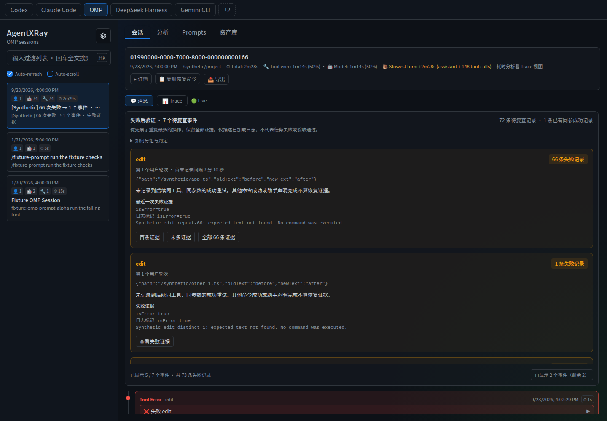
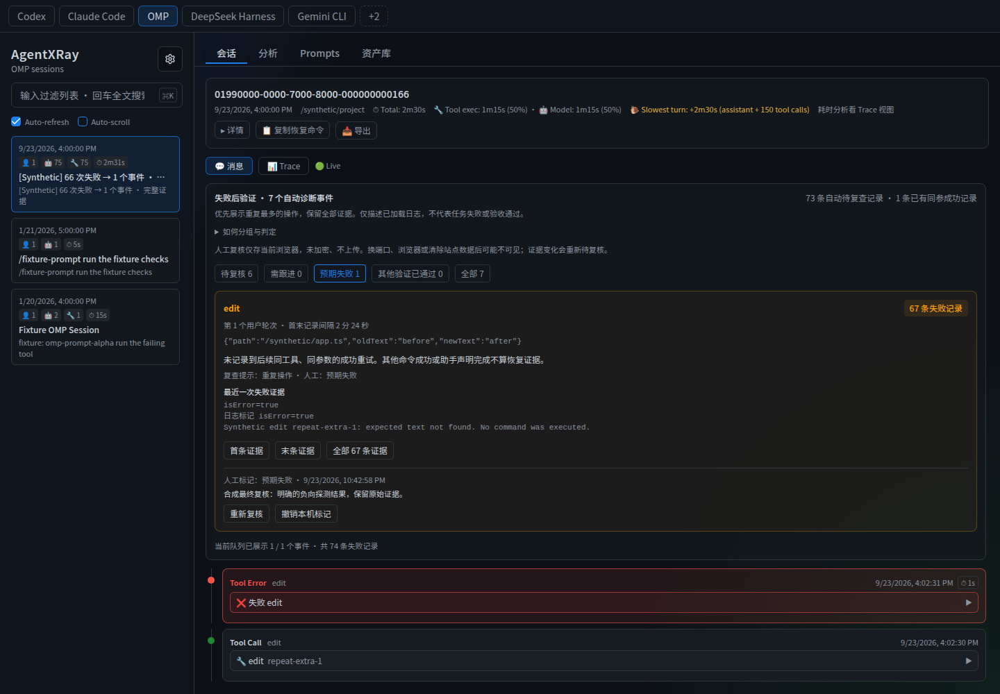
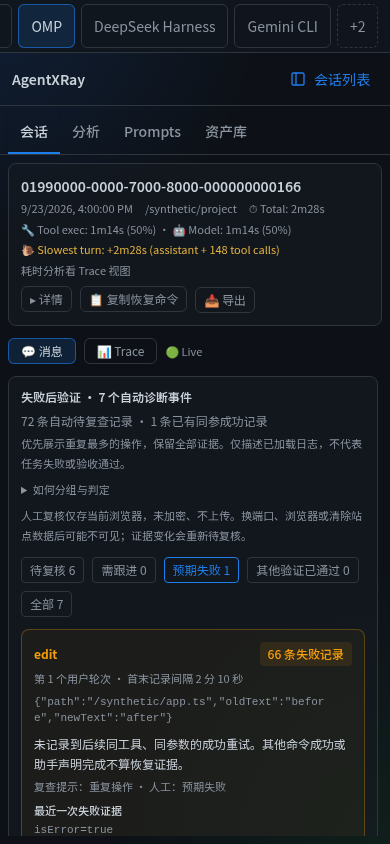

# 诊断验证收据

本收据配合基于证据的诊断、本地复查队列与窄屏会话工作流使用。所有公开截图与演示 fixture 均为合成的。个人会话日志、样例 manifest、复查笔记与详细的本地评估产物不随仓库分发。

## 从代码检出复现

需 Node 22.13+ 并已安装项目依赖：

```sh
npm test
npm run build:ui
npm run lint
git diff --exit-code -- public/js/pure.js
node scripts/demo-diagnostics.cjs
```

打开打印的 URL，并选择标记为 `[Synthetic]` 的 OMP 会话：

- 初始 72 条待复查失败记录构成 7 个事件，其中第一个事件含 66 条重复的 edit 失败。一条更早的失败已有一份匹配的成功。
- 「首条/末条/全部证据」操作会保留每一条原始结果，包括消息分页之外的结果。
- 保存一条人工复查笔记。刷新后笔记保留；另一个会话无法继承它。人工状态永不改变自动失败计数。
- 在终端输入 `n` 追加一条合成失败。该重复事件现在含 67 条失败，其先前的复查标记为过期。
- 输入 `r` 追加匹配的成功。剩余 6 个事件与 6 条待复查记录，共 68 条自动恢复的失败（若未使用 `n` 则为 67 条）。
- 输入 `q` 或 Ctrl-C 停止隔离服务器并清理其临时 HOME。

## 已记录的检查（2026-09-23）

| 检查项 | 结果 |
| --- | --- |
| Node 测试套件 | 214 通过、0 失败、0 跳过 |
| 诊断/事件/OMP/复查专项套件 | 84 通过 |
| UI 构建 | TypeScript 与 Vite 通过 |
| Lint | 退出码 0；现有 91 条警告 / 159 条信息性提示 |
| 遗留生成的 bundle | 无漂移 |
| 复查持久化 | 保存、刷新、会话隔离与跨标签页更新通过 |
| 复查失效 | 新增失败/完整结果变化会重开复查；过期笔记仍可区分 |
| 存储失败 | 读取被拒、记录损坏与写入失败均被可见地报告；失败的保存从不宣称成功 |
| 证据导航 | 首条/中间/末条结果均被保留；分页展开且目标可见 |
| 窄屏 | 已检查 360×640、390×844、740×360、768×1024 与 1440×1000 |
| 触控模拟 | Chromium 移动端/触控点按可导航并保存复查 |
| 虚拟会话列表 | 240 个合成会话；初始渲染 16 张卡片，末项可达 |

在 360px 视口宽度下，真实会话诊断面板测得 340px（旧的固定侧边栏布局留出 44px）。在 740×360 下，滚动转录文本还剩 75px；竖屏方向更舒适。在移动端与桌面端，从顶部开始时的证据跳转会保留 `window.scrollY=0`。

前述私有的、已检查过的回归集有 30 个会话与 9,076 条工具结果。其 438 条未解决记录在保留全部证据的同时归并为 373 个事件；373 个内存中的合成复查标签被检查了隔离与失效，随后被丢弃。这些汇总计数仅为上下文观察，**并非公开基准、独立人工判断、准确度度量或省时证明**。私有数据集刻意不包含在内；上述命令复现的是公开的合成验收测试。

## 截图





## 局限

- 人工笔记为未加密、浏览器本地且按来源（origin）隔离；它们并非经过认证的证据或备份。
- 不推断替代命令、隐式工作目录、后台任务链与语义等价。
- 现有的汇总统计保留其原始的错误字段语义，可能与诊断计数不同。
- 不声明任何物理 iOS/Android 设备、Safari 或软键盘认证。其他复杂页面并未被窄屏检查完全覆盖。
- 现有 lint 提示与 Vite 大块警告仍然存在；不声明零技术债。

## 发布与托管演示的后续

该功能版本以 [v1.18.0](https://github.com/bowenluo718/AgentLRay/releases/tag/v1.18.0) 形式发布。其 [Publish 运行](https://github.com/bowenluo718/AgentLRay/actions/runs/35880348489)成功，并附带包 tarball 与 provenance。从 `https://registry.npmjs.org` 的隔离安装返回 CLI 版本 `1.18.0`；所安装的服务器提供了一条带规范化状态与打包复查 UI 的合成 OMP 失败。初始 registry 查询先于 npm 处理并返回 404；仅在 registry 与安装可用后才记录成功。

一个独立的托管演示增量加入了明确为合成的 `0199demo-diagnostics` 会话与 **Try diagnostics** 入口，保留默认的 Claude demo 与既有样例。原始解析器输出与打包消息经测试断言相等；Node 测试总数现为 216 个通过（另加两个托管 fixture 测试）。上述 214 的计数记录的是发布验收，而非更新后的套件规模。

托管样例有 8 条历史失败：其中一条有匹配的成功重试，剩余 7 条待处理记录归并为 2 个事件（6 条 edit 失败与 1 条嵌套搜索失败）。后台启动持续运行。已验证 6 条独立的 edit 结果、证据跳转与浏览器本地复查；静态演示期间未发起任何后端 API 请求。Fixture 重新生成两次产生完全一致的字节。

仅演示的指南在矮屏上受高度限制。展开后的指南检查在 360×640 下为消息留出约 102px、在 360×800 下留出 224px；在 740×360 横屏下仅剩 35px，因此建议竖屏使用。这不改变普通本地应用的布局，也不意味着物理设备认证。

## 复查可移植性验收

下一增量加入显式的当前会话导出/导入，而非全历史备份。运行 `node --test test/review-transfer.test.js` 以执行其 17 个用例；合并后的诊断/复查专项套件含 103 个测试，完整套件含 233 个测试。上述较早的计数记录的是早期版本，而非当前套件规模。

仅使用合成笔记与隔离浏览器上下文验证：

- 实际 JSON 下载仅包含允许的 hash/status/note/time 字段。无关的浏览器存储、原始工具输出、命令参数与路径不会被复制。下载或导入前必须确认。
- 两条笔记在无写入的预览后迁移到空浏览器，并在刷新后持久存在。重新导入被归类为完全相同并跳过；不同的本地笔记视为冲突并被保留。
- 一条 HTML 形状的笔记按字面显示且不会执行。未知字段、格式错误的 JSON、重复记录、无效标识符、超过 1 MiB 的文件以及超过 500 条记录的表单均被拒绝。
- 预览打开时新增一条失败会禁用确认。重新预览会导入仍匹配的事件并跳过过期事件。不同的会话会跳过两条记录。
- 一个独立的 `localhost` 来源接受在 `127.0.0.1` 上导出的匹配复查；另一个先写入的标签页会使预览失效并保留该本地笔记。
- 第二次写入时模拟配额失败会报告 **1 导入 / 0 跳过 / 1 失败**。重试时重新预览报告 **1 导入 / 1 跳过 / 0 失败**，并保留首次导入。不声明原子回滚。
- 浏览器迁移发送了零次后端写入请求；自动失败/恢复计数保持不变。在 360px 下，传输面板无水平溢出。

这并不验证真实设备的文件选择器、同时跨标签页事务安全或实际生产力提升。该文件为未加密的人工文本，而非签名证据；仅当前精确匹配可被恢复。详细本地运行产物仍被忽略且不发布。

## 后续证据验收

后续增量加入仅证据的关系，而非自动恢复。`test/follow-up-evidence.test.js` 中有 22 个新测试、合并后诊断/复查测试 125 个、完整套件 255 个测试。普通与托管演示 UI 构建均通过；上述较早计数为历史发布收据。

合成测试覆盖全部五种候选状态、仅顶层 `i` 差异、完整参数比较、精确工具、同回合 edit/write 路径、显式相对路径目录、缺失/歧义字段、既有并行调用、缺失结果、调用回合与结果回合、去重、复查指纹中的完整候选输出，以及不变的精确匹配恢复。脚本化演示 `node scripts/demo-follow-up.cjs` 演练七个仅 `i` 候选、一个同文件候选以及被排除的文件/回合反例。浏览器检查了全部五种标签、五项初始显示外加加载其余项、原始结果跳转、无页面导航移动、新追加候选上的过期复查以及无窄屏溢出。

一组固定的、先前检查过的 15 个真实会话（分别来自 OMP、Codex 与 Claude Code 各五个），含 2,024 条工具结果，通过固定长度/hash 验证重新读取。自动结果保持为 **142 条失败、141 条待处理记录、76 个事件与 1 条恢复记录**，包括不变的事件成员。一个独立的关系枚举与每个候选一致。它在 OMP 中发现 **3 个仅 `i` 候选：一条失败、一条运行中结果与一条成功**；Codex/Claude 在严格规则下均无。本集合中无同文件关系合格：相关观察路径缺乏显式绝对上下文，或调用属于更晚的用户回合。代码并未放宽标准以夸大匹配。

存储键保持稳定。仅三个新增候选的事件获得新的复查指纹；无候选事件保留其先前指纹契约。未持久化任何真实复查标签。原始日志、参数与详细样例标识符保持私有；该回归并非独立基准、全局准确度估计或省时度量。

托管合成样例现包含同一绝对文件路径下、参数不同的更晚成功 edit。它保持 **2 事件 / 7 条待处理记录 / 1 条恢复记录**。浏览器检查验证了关系提示、来源结果、桌面/移动端渲染以及零静态演示 API 请求。

## 自动健康与时间线验收

下一增量使自动事实成为默认。已保存的人工标签不会隐藏自动事件，且在 **人工笔记与迁移（可选）** 打开之前，复查存储不会被读取或哈希。既有笔记与迁移仍然可用。刷新或返回自动模式会再次显示所有事件。

测试套件现为 **290 个通过的 Node 测试**。`test/session-health.test.js` 含 11 个用例，包括 20 个合成基底上的 **200 个固定变换**；`test/verification-chronology.test.js` 含 24 个用例，包括 20 个基底上的 **120 个时间变换**。所有已知结果、证据分区与调用状态会计不变量均在无模型裁判或人工标签的情况下通过。这些计数为回归覆盖，而非实测真实世界准确度或用户节省的时间。

健康检查仅配对唯一、有序的调用 ID；它汇总最近记录的状态，并将未知/无结果/运行中与失败及取消区分开。被复用或不存在的 ID 不提供成功证据。被多个事件引用的候选按结果位置计为一次。测试验证来源消息未被修改。

时间线区分成功的修改工具结果、先前的成功检查、重叠检查与更晚的尝试。即使更早的尝试通过，更晚的失败仍保持可见；同时发起的检查不会被赋予虚构的唯一最新顺序。已知不同的显式目录被排除，缺失的目录上下文被显式说明。工具成功并不证明字节已改变；常规脚本名并不证明内容或测试覆盖。

初始直接命令识别器在冻结的真实日志集中发现 **零个检查**。为显式命令片段添加了一个有界词法分析器，而非掩盖这一覆盖缺口。它识别出 **59 个含检查的调用**（52 个 OMP、7 个 Claude Code），全部为 **未知检查结果**，因为这些命令是复合的；管道成功退出不会被赋予其测试片段。替换、heredoc、控制流与带引号的提及不会被解释为已执行的检查。Codex 子集在此范围内无被识别的检查或显式 edit/write 记录，因此对其验证质量不产生任何结论。

同一 15 个冻结会话 / 2,024 条工具结果精确保留了 v1.20.0 的诊断输出：142 条失败、141 条待处理记录、76 个事件与 1 条恢复。显式修改工具成功返回 240 次；其中 112 次有更晚被识别的检查调用/片段记录，128 次没有。**这些仅为时间关系**——均未确立被修改文件经过测试，且未分类的命令可能包含验证。该数据集先前已检查过、包含旧会话，并非盲基准。原始数据与详细样例 ID 保持私有。

浏览器检查仅使用合成 fixture：

- 自动模式在复查存储读取被拒的情况下正常工作；在 opt-in 之前零次复查键读取。可选的人工过滤在退出时返回完整事件集，笔记持久存在而不成为强制项。
- 无结果调用在无重载的情况下获得记录的结果；缺口从 3 降至 2，而不相关的失败保持不变。
- 一个检查在修改之前通过；第二个检查与其重叠，第三个使用另一个目录。均不被报告为变更后验证。追加一条更晚失败的检查再追加一条成功检查，会更新最新结果并保留两次尝试。
- 调用/结果跳转解析到实际来源记录，而不移动外层页面导航。在 390px 下时间线面板无水平溢出；静态演示使用零后端 API 请求。

使用 `node scripts/demo-verification.cjs` 重放时间示例，使用 `node scripts/demo-follow-up.cjs` 处理缺失结果更新。公开托管演示在自动健康下展示较早测试/更晚编辑示例。物理设备键盘与每个复杂视图均未认证。现有 lint 提示（91 条警告 / 159 条信息）与 bundle 大小警告仍然存在。

## Codex 后台进程验收

此增量将启动结果头中的显式 Codex 进程 ID 与更晚的 `write_stdin.session_id` 调用关联。它不重写历史逐调用状态、失败计数、恢复或人工复查数据。进程结果是一条独立的证据链；当时间线使用最终轮询结果时，保留原始启动索引。

完整套件有 **313 个通过的测试**。**23 个进程证据测试** 覆盖成功/失败/运行中/缺失结果、输出文本误报、格式错误/矛盾的头部、非规范标识符、重复调用/结果、复用的进程 ID、重叠、终末轮询、发送输入调用、来源引用、限定工具名以及一条消息中的多次启动。40 个固定变换验证终末结果追加而不推断自动恢复。生成的托管样例被断言与真实 Codex 解析器输出相等。

冻结的真实语料在内容 hash 下被重新读取：所有先前的 `diagnoseSession` 与 `summarizeSessionHealth` 输出均与 v1.21.0 完全匹配。其 Codex 子集中，60 个启动头与 53 个轮询调用产生 **53 个唯一关联的轮询**、**48 个成功进程退出**、**1 个失败退出**，以及 **11 个最后证据为运行中的启动**。每个进程关联与终末结果均对照记录的进程 ID 与头部边界进行了检查。未发布任何真实命令、进程 ID 或详细日志。这些结果不确立实时运行时状态、测试覆盖、通用准确度或时间节省。

合成浏览器检查验证进程摘要、未关联轮询计数、来源结果导航、编辑前启动的测试保持重叠、更晚失败检查保持可见，以及实时完成将终末进程计数从 2 变为 3 而不改变历史失败事件。在 390px 下进程面板无水平溢出。`node scripts/demo-process-evidence.cjs` 在本地复现该示例，而不执行转录命令。

未知/冲突的链不会被静默认证；需要实时作业控制或跨会话任务关联的调用者仍需要更强的运行时证据。输入在进程摘要中以布尔值表示，但原始调用证据仍可访问。既有大块与 lint 提示保持不变。

## 离线检查验收

`agentlray inspect --platform <omp|codex|claude-code> <file> --json` 添加了无需 web 服务器的机器可消费表面。CommonJS 规则由 UI 的 TypeScript 源码生成，打包于 `lib/generated/` 下，在测试中与源码比较，并在 CI 中检查已提交的漂移。历史 UI 诊断规则保持不变。

完整套件现为 **332 个通过的测试**，含 **19 个 inspect 测试**。测试验证确定性 JSON、精确来源引用、最小化输出、策略退出、格式错误/截断输入、无效 UTF-8、目录/缺失/过大文件、错误平台、改变读取的元数据、缺失标志、空白/CRLF 物理行以及生成规则一致性。运行时守卫在 CLI 运行时阻止 Express/http/https/net/server 导入；输入字节与临时 HOME 条目保持不变。

已知的 Claude 多结果与文本/结果混合记录被测试为不完整的适配器覆盖：JSON 含 `complete:false`、原始/规范化计数与问题行，且即使请求了待处理失败门控，退出状态仍为 1。这暴露了既有解析器局限，而非宣称其已修复。解析失败不输出部分报告或敏感行文本。

一个实际的 npm tarball 被解包到无 `node_modules`、前端源码或 TypeScript 编译器的隔离目录。Inspect 直接从该产物生成预期的 OMP 合成报告（7 条待处理记录、2 个事件）。这测试的是独立检查，而非仪表盘的依赖要求。

先前冻结的 15 个真实会话 / 2,024 条工具结果仅在内存中读取。CLI 报告摘要与 UI 规则完全一致：142 条失败、141 条待处理记录、76 个事件与 60 个记录的 Codex 启动。**2,493 个来源引用** 对照冻结的原始行/消息映射得到验证；重复报告字节完全一致。未向公开产物发出任何真实原始文本、命令、路径、进程标识符或人工笔记。这是规则/报告一致性，而非真实世界准确度或省时证据。

报告按构造省略原始内容，但 hash、计数与关联仍可能敏感。该输出并非匿名化、签名任务证明或自主安全决策。退出码 0 表示有效报告生成；仅显式请求的 `pending-failures` 策略返回 2。参见[离线契约](offline-inspect.md)。
