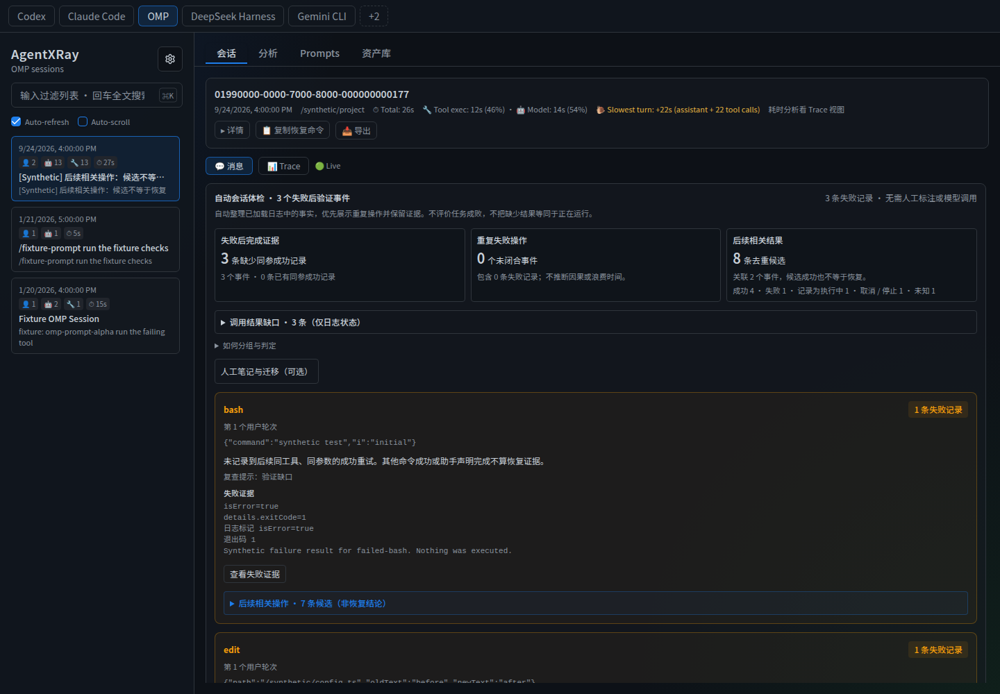
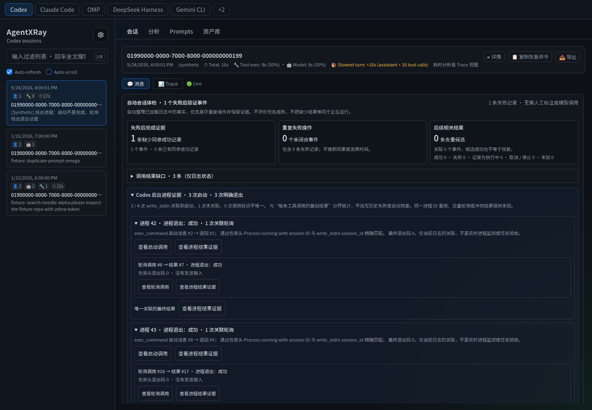
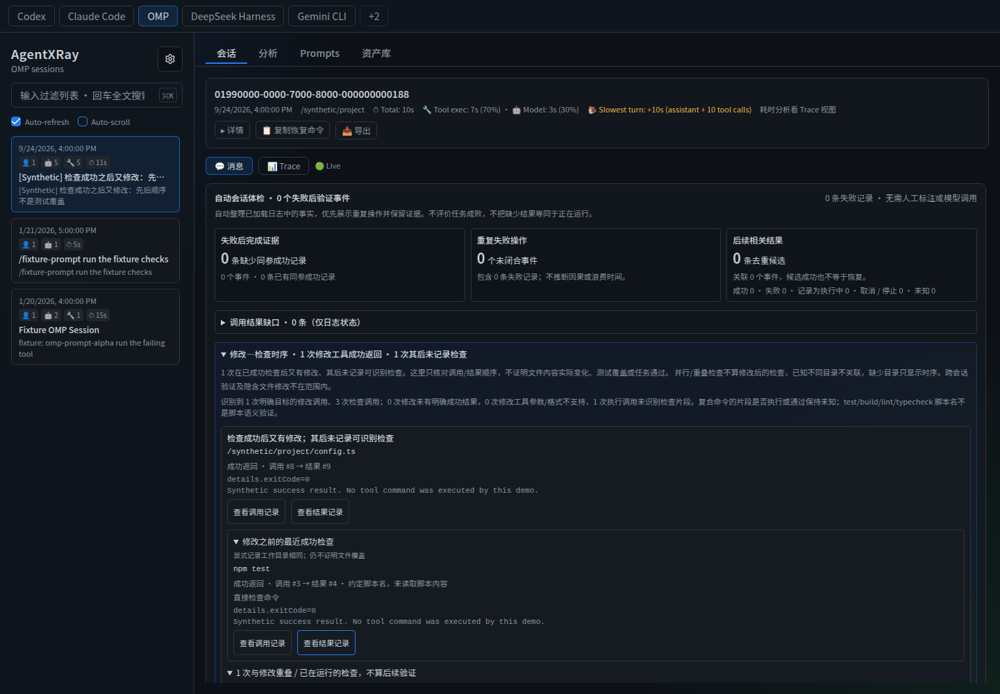
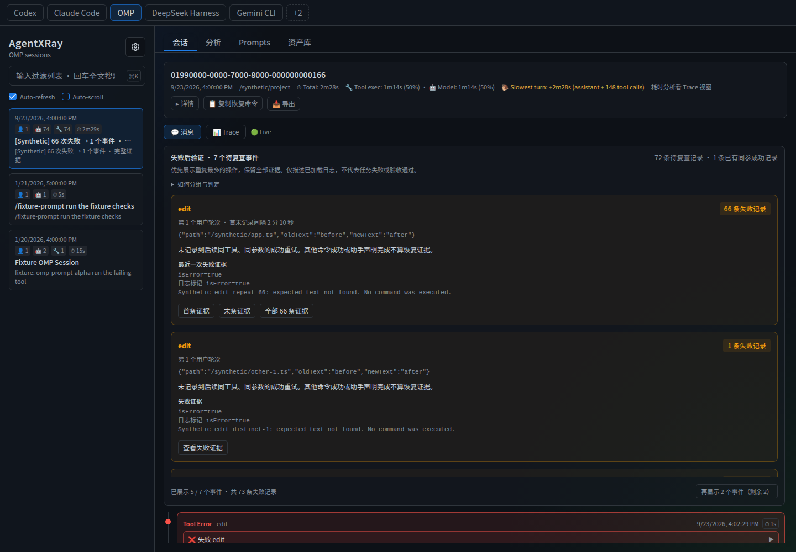
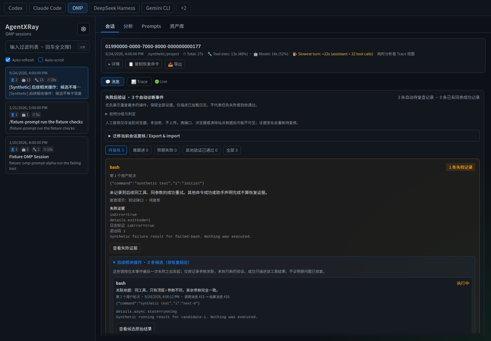
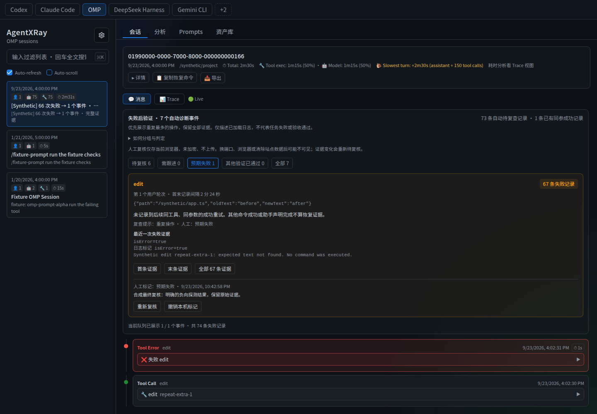
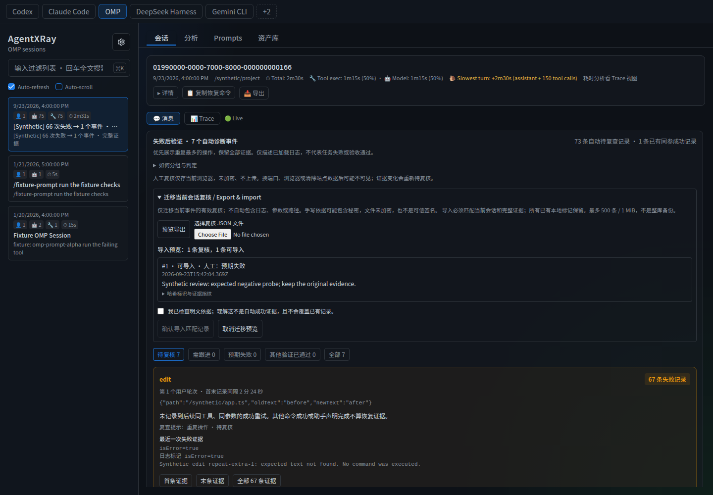
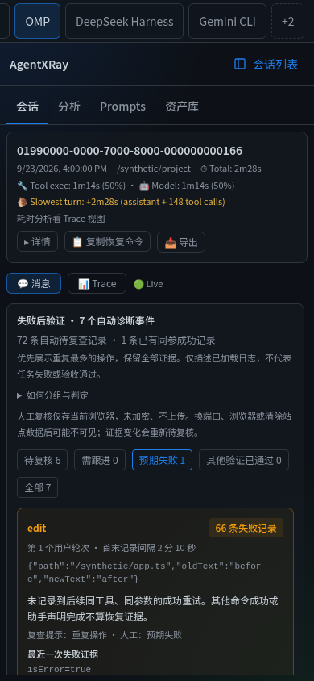

# 有证据的失败事件

**无需手动标注，即可获得自动的、有证据的会话体检。** AgentLRay 汇总记录到的失败、相关操作与结果缺口；它不判断 agent 是否正确完成了你的任务。人工笔记保持可选。

## 自动会话体检

默认的**自动会话体检**视图无需人工标签、无需读取复核存储、无需模型调用。即使你之前在某处将某些事件标记为预期或已复核，它仍展示全部自动事件。

- **失败后续证据：**失败记录数、剩余事件数，以及记录到的同参数成功重试数。候选成功不计为自动恢复。
- **重复操作：**多次失败且未解决的事件，以及这些事件中的失败记录数。这不包括已恢复的片段，也不估算浪费时间。
- **后续相关结果：**候选结果位置跨事件去重，并分别统计成功/失败/执行中/取消/未知数量。事件链接与原始结果跳转仍可用。
- **调用—结果缺口：**每条记录到的调用按 ID 和顺序关联其最后记录到的结果。执行中、未知及缺失结果的调用会列出并附证据。缺失结果并不代表进程仍在运行；旧的执行中记录不是实时状态检查。取消/已停止的调用单独计数，不视为缺口。
- 缺失/复用的调用 ID 是含混的，不做猜测。孤立或前置调用结果、无法归属的结果单独计数。未检测到失败不是任务成功的结论。

仅当你希望保存笔记、按人工标签筛选或迁移复核时，才打开**人工笔记与迁移（可选）**。这会启用已有的本地复核工作流，且不删除既有笔记。**返回自动体检**恢复所有自动事件；刷新回到自动视图。拒绝访问复核存储不阻塞默认视图。

### 无需人工标签的离线评估

`node --test test/session-health.test.js` 在 20 个固定合成基例上检查 200 个确定性变换：追加/移除一个匹配的成功、改变命令/cwd/i、插入一个预启动的并行调用，以及提供执行中/取消/未知结果。每个用例都使用显式的预期恢复计数、完整的事件证据从属关系，以及调用状态划分不变量。另设独立用例覆盖最新结果更新、缺失/孤立/复用 ID、内嵌调用与共享候选去重。

这些是**已知用例测试**，不是人工判断，也不是真实场景的精度基准。计算时间不等于人节省的时间。既有冻结日志回归也在不改变其诊断输出的前提下，对照前一实现进行了检查。

试试 `node scripts/demo-follow-up.cjs`：其夹具包含执行中、未知和无结果调用。输入 `c` 追加缺失结果；缺口计数下降而不改变无关失败。无需任何标签。输入 `q` 清理隔离服务器。



## Codex 后台进程证据

**Codex 后台进程证据**部分将记录到的 `exec_command` 启动头（`Process running with session ID ...`）与后续带有该确切数字 `session_id` 的 `write_stdin` 调用关联起来。它展示启动与轮询的源记录、是否发送过输入，以及在可得时给出明确的最终退出结果。

这是独立于每条工具调用状态的单元：历史启动仍返回执行中/未知记录，而进程可能通过后续轮询结束。轮询不是第二次启动；这些关联都不会改变失败事件、自动重试恢复或已保存的复核指纹。

- 只使用 `Output:` / `Final output:` **之前**的受支持 Codex 包装头，且限于确切的 `exec_command` / `write_stdin` 工具名或其 `functions.` 限定形式。打印在 stdout 中或从文件读取的匹配文本不是进程元数据。
- 在当前查看的会话中，启动与轮询调用 ID 必须唯一。进程 ID 必须是非负安全整数；字符串 ID 与缺失的启动历史不做猜测。
- 复用的进程 ID、重复的启动/轮询记录、返回的 ID 不匹配、缺失或无效的轮询结果、交叠轮询、或终止结果之后的轮询，都会使完成状态含混。原始记录仍可访问，但不从冲突链中采纳任何最终结果。
- 最后一条执行中记录不是实时进程监控。发送输入的轮询会标记出来，但不在进程摘要中显示输入文本。原始调用仍可自行查看。
- 可识别的验证命令可使用其关联的最终进程结果，但保留其**原始启动位置**。修改前启动、修改后才结束的检查仍与修改重叠；它不是修改后验证。接收输入或复合 shell 片段的进程，即使进程退出码为零，检查结果仍保持未知。

使用托管 Demo 的 **Codex** 页，选择 `[Synthetic demo] Background process evidence` 会话。它包含两次启动：一次通过轮询结束，一次只有执行中记录，外加一次未关联的轮询。之前的默认 Demo 保持不变。

从源码检出获取实时更新：

```sh
node scripts/demo-process-evidence.cjs
```

选择 Codex 合成会话。三次启动初始包含一次成功退出、一次失败退出和一次挂起进程；一次轮询没有匹配的启动。输入 `c` 追加缺失的完成，观察进程证据更新；或输入 `q` 停止并清理。不会执行任何记录到的命令。



## 修改与验证时序

**修改—检查时序**部分提出的问题比"任务是否通过？"更窄、更有证据依据：

> 在某个修改工具成功返回之前，是否有检查成功返回？之后又记录到了哪些检查命令？

它展示每次显式的修改工具成功、其之前最近的成功检查、所有交叠检查、之后的检查调用，以及最新的后续结果。修改之前通过的检查不能证明那次修改。修改开始之前启动、之后才完成的检查不是修改后验证，即使其结果更晚返回。先前的检查通过，并不会掩盖之后的失败检查。

**识别范围：**

- 修改指 `edit`、`Edit`、`write`、`Write` 和 `MultiEdit`，带不含歧义的字面量 `path`/`file_path`，且唯一配对成功的工具结果。这是工具结果事实，不是字节确实改变的证明。失败/不完整的变更调用及不支持的补丁/参数格式单独计数。
- 直接测试运行器包括 `pytest`、`python[3] -m pytest` 和 `node --test`。`npm test` 及 npm/pnpm/yarn 下命名的 `test/build/lint/typecheck` 脚本按**脚本名约定**识别，而非已核实的脚本内容。帮助/监听/仅列出/干跑模式被排除。
- 单独的、明确的字面量绝对 `cd ... && check` 可提供目录上下文。若该整条命令失败，失败可能在 `cd`，因此检查结果未知。
- 有界词法分析器可在更复杂的 `&&`、`;`、换行或管道命令中识别检查命令片段，而不执行任何内容。`npm test | tail ...` 中的片段，不能仅凭包装退出码**确认其已运行或已通过**，即使包装成功。echo/python 参数中的引号文本不视为可执行命令。替换、heredoc 与 shell 控制语法不被解释。
- 只比较同一会话内的记录顺序。已知不同/冲突的显式目录被排除。缺失目录上下文标记为未知。不推断文件系统查找、隐式目录跟踪、源码覆盖或跨会话因果关系。

每条展示的修改/检查都链接到其原始调用，并在存在时链接到结果。未分类的执行调用仍被计数，因此"没有后续可识别检查"绝不意味着"没有进行测试"。原始失败/候选规则与人工笔记指纹保持不变。

在源码检出中尝试受控序列：

```sh
node scripts/demo-verification.cjs
```

OMP 合成会话初始包含一次通过的检查、一次完成的修改、一次交叠检查，以及一次不同目录的检查。未记录到相关的后续检查。输入 `f` 追加修改后失败的检查，再输入 `s` 追加成功检查：UI 自动更新并保留两次尝试。输入 `q` 或 Ctrl-C 清理。不会执行合成会话中的任何命令。

静态托管示例同样先有一次较早的通过测试，随后是同一文件的修改。其后台 `verify-config` 脚本刻意不在当前命名允许列表内；不要混淆"未分类"与"失败"。



本指南覆盖 React UI。合成终端演练使用源码检出；包安装与已发布版本列于 GitHub Releases。

## 免安装体验

若要免安装试用，打开[托管 Demo](https://bowenluo718.github.io/AgentLRay/)并点击**体验自动体检 / Try diagnostics**。其合成示例在 2 个事件中有 7 条待处理失败记录（6 次重复修改和 1 次搜索失败），外加一次较早自动恢复的测试失败。可打开首/末/全部证据，或可选地记录一条浏览器本地复核笔记。这是静态示例：不会追加真实结果，也不会运行实际工具命令。下面的终端演练是用于实时更新的、更独立的更大夹具。

从仓库根目录，在安装好根目录与前端依赖后：

```sh
npm run build:ui
node scripts/demo-diagnostics.cjs
```

打开打印出的本地地址，选择 **OMP**，再选择 `[Synthetic]` 会话。脚本会创建带合成日志的临时 HOME，而非你的真实会话。它不执行任何记录到的工具命令，也不需要模型凭据。

1. **从摘要开始：**72 条待处理失败记录变为 7 个事件。第一张卡片包含同一次修改操作的 66 条失败。"再显示…"揭示其余部分。
2. **跟随证据：**"首条证据" / "末条证据"跳转到首/末结果。"全部 66 条证据"保留每条结果（含不同错误文本），并提供单独跳转按钮。跳转会展开原始工具结果，包括消息分页之外的结果。
3. **观察更新：**保持 Auto-refresh 开启，在演示终端输入 `r` 后按回车。脚本追加一条合成同参数成功。重复事件消失：剩余 6 条待处理记录 / 6 个事件，且 67 条失败记录现在有后续匹配成功证据（含一条较早的合成恢复）。
4. 输入 `q` 或按 Ctrl-C 停止隔离服务器并移除其临时数据。

合成"66 → 1"示例是夹具，不是精度或生产率基准。



## 使用你自己的日志

在构建好的检出目录运行 `npm start`。选择一个会话并打开其**消息**视图。"自动会话体检"面板使用当前加载的会话；选择子会话会分析该子会话，而非父会话的合并历史。这些规则无需 SDK、新的日志插桩或模型调用。

从重复操作开始，打开最新失败，检查周围的调用。卡片是复查该会话的理由——不是重跑某个可能有破坏性命令的指令。等价命令、替代验证和外部修复仍需要你的判断。

## 后续证据候选

当失败事件有匹配的后续操作时，展开**后续相关操作**。这些是供你复查的线索，**不是自动恢复，也不证明原任务通过**。每条候选展示其关系、调用/结果消息位置、调用的用户轮次、工具结果与源证据、参数，以及到原始结果的跳转。初始展示五条；其余可在不滤除失败结果的情况下加载。

支持两种关系：

| 关系 | 所需证据 | 不推断 |
| --- | --- | --- |
| 仅顶层 `i` 不同 | 完全相同的工具、相等的非空其余参数，但完整参数不同。对象键顺序被忽略；值与数组顺序被保留。可跨越本会话内的用户轮次。 | 该 `i` 语义无关，或后续调用修复了先前的问题。 |
| 同文件修改 | 显式的 `edit`、`Edit`、`write`、`Write` 或 `MultiEdit` 调用、相同的调用来源用户轮次、改变的参数，以及相同的字面量 `path`/`file_path` 加上记录到的工作目录字段。 | 隐藏在 shell 命令/补丁中的路径、不同轮次、符号链接、路径归一化，或隐式目录变化。 |

两者都要求有记录到的结果，且调用开始于**事件最后一次待处理失败之后**。既有的并行调用结果、孤立结果、缺失参数及无结果的调用被排除。同文件匹配要求绝对路径，或相对路径有完全相同的显式绝对 `cwd`/`workdir`/`working_directory`；含混字段被拒绝。不同的目录字段名不视为别名。

状态标签区分**成功（工具结果）、失败、执行中、取消/已停止和未知**。展示源字段，而非从乐观叙述推断。执行中的后台任务不是成功。平台适配器与自动失败/恢复匹配保持不变，包括在自动重试比较中保留 `i`。返回成功的同文件修改可能改动了完全不同的内容。

新增或改变的候选证据需要再次人工复核：事件存储键保持稳定，但复核指纹包含完整候选结果与参数。既有笔记仅对受影响事件过期；无候选的事件保留其旧指纹契约。复核迁移文件仍只包含哈希与手写笔记，而非原始候选日志。

### 本地尝试全部五种状态

从构建好的源码检出：

```sh
node scripts/demo-follow-up.cjs
```

选择其 OMP `[Synthetic]` 会话。第一条 bash 失败有七个覆盖五种结果状态的仅-`i` 候选；一次修改失败有一个同文件候选。无关文件和不同用户轮次被排除。**即使某候选成功，仍保留三个自动失败事件。**保存复核并在终端输入 `n` 追加另一候选：该复核变为过期，而不改变自动失败/恢复计数。输入 `q` 或 Ctrl-C 停止隔离 Demo。

托管的 **Try diagnostics** 示例同样包含一次带改变参数的成功同文件修改。其既有七条待处理失败记录和两个事件不消失。两个 Demo 都是合成的；不会执行任何记录到的命令。



## 本地复核工作流

人工复核是可选的：先打开**人工笔记与迁移（可选）**。自动结果与你的判断是分开的。头部始终报告自动事件与待处理失败记录。在可选模式下，复核筛选显示你已检查过哪些事件：

| 队列 | 含义 |
| --- | --- |
| 待复核 / Unreviewed | 无当前复核、证据已改变，或本地复核无法读取。 |
| 需跟进 / Follow-up | 你记录了一个具体的下一步检查或未解决的顾虑。 |
| 预期失败 / Expected failure | 你记录了该失败为何符合预期，例如负向探测。 |
| 其他验证已通过 / Verified elsewhere | 你记录了精确参数规则无法建立的替代验证。这是你的笔记，不是自动成功断言。 |
| 全部 / All | 所有自动事件（含已人工复核的），带其原始证据。 |

点击**记录人工复核**，选择状态并填写 **1–1000 字证据或下一步**。无需修改会话日志即可保存、更改或撤销复核。下次从**待复核**开始；**需跟进**是你的跟进清单。复核队列为空不代表任务通过。

笔记在同一浏览器和源中刷新后仍存在，且该源内标签页间会同步更新。笔记按平台、配置的日志目录、会话、子会话和事件隔离。事件标识与完整证据修订都是 SHA-256 指纹；应用不会把原始日志或参数复制进复核存储。你的笔记本身以明文存储，因此**不要粘贴秘密**。

追加失败或改变完整结果（包括超出显示预览的文本）会使旧修订失效。事件回到**待复核**；若其身份未变，旧笔记仍可见并带过期警告。身份改变的事件（例如参数改变或首次出现位置偏移）从待复核开始，而非复用可能不相关的旧笔记。

**尝试失效：**在合成演示中，对 66 条失败事件保存复核，然后终端输入 `n`。一条新失败加入事件（67 条失败），旧复核在无页面刷新下变为过期。随后输入 `r` 追加匹配成功：该事件离开自动队列，68 条记录到的失败现在有匹配成功证据。若你没有使用 `n`，原演示计数保持 67 条已恢复记录。



存储限制：

- 复核保存在此浏览器的 localStorage 中，不在 AgentLRay 服务器、你的会话日志或云端。不使用复核 API、账户或模型调用。
- 它们不是加密的、经认证的证明，也不是备份。另一个浏览器、改变的主机名/端口、隐私模式或清除站点数据可能使其不可用。其他标签页使用最后保存的记录；没有协作式编辑合并。
- 存储拒绝、损坏记录或配额耗尽会显式显示。保存失败不算已保存；不可读的复核仍保持待复核。你可撤销单条复核，而无需清除无关设置。
- 浏览器加密请使用 localhost 或 HTTPS。若无法计算指纹，保存复核被禁用，而自动诊断仍可用。
- 当事件被自动恢复或其身份改变时，笔记不会被自动删除；它们可能保留在站点存储中。下方提供当前事件的导出/导入，但没有全历史复核归档或自动跨设备同步。

## 在浏览器之间迁移复核

打开**人工笔记与迁移（可选）**，然后在诊断面板展开**迁移当前会话复核 / Export & import**。这是本地的、显式的文件传输——不是服务器备份，也不是任务通过的认证证明。

1. 在源浏览器，打开你复核过的会话并选择**预览导出**。下载前展示完整 JSON。仅包含身份与完整证据指纹仍与**当前加载的自动事件**匹配的复核；所选复核筛选不限制导出。
2. 检查笔记、确认明文警告，然后选择**下载复核 JSON**。文件名始终为 `agentlray-reviews.json`，不含会话 ID 或路径。妥善保存：即使应用不把日志复制进文件，你输入的笔记也可能含秘密。
3. 在目标浏览器/源，以相同的平台、配置的日志目录设置与子会话范围打开同一会话。选择 JSON 文件。**预览期间不写入任何复核。**每条记录展示其笔记、时间戳和一种决定：导入、不匹配、过期、已相同或本地冲突。
4. 检查预览后确认警告并选择**确认导入匹配记录**。只写入与当前事件/完整证据完全匹配且本地槽位为空者。每个既有本地槽位都被保留——即使过期或损坏。若打算替换，请先在普通复核 UI 中显式清除，然后重新预览。
5. 结果报告导入、跳过和失败数量。证据/复核变化会使打开的预览失效。每次写入前立即重查存储；部分失败保留成功写入并报告失败，而非全有或全无事务。重新预览以重试；已导入的记录被跳过。

### 文件格式与边界

- 格式 `agentlray-review-transfer`，版本 `1`；最大 **1 MiB UTF-8** 与 **500 条唯一记录**。无效 JSON、未知字段/版本、记录列表中的重复键、无效存储标识及无效复核字段会在导入写入前被拒绝。
- 顶层字段：`format`、`version`、`exportedAt`、`records`。每条记录含 `storageKey` 与 `record`；嵌套记录含 `version`、`fingerprint`、`status`、`note`、`reviewedAt`。
- 只导出哈希标识、证据指纹、人工状态、人工笔记和时间戳。原始命令、日志内容、路径、会话标题和自动诊断不会复制进文件。笔记是明文，不经脱敏或加密；笔记中的 HTML 以文本显示。
- 匹配保留既有指纹契约。不同浏览器或端口可工作；改变的目录设置、会话/子会话范围、首次出现、原始参数或完整证据则不行。不做跨机器的模糊路径重映射。若目标端不再有源日志，文件无法重建它们。
- 文件可被编辑或伪造。匹配哈希是关联性检查，**不是签名、信任保证或独立的任务验证**。导入的人工标签永不修改自动失败/恢复计数。
- 这不是完整的浏览器/历史备份：已恢复、缺失、过期或未加载的事件笔记被排除。不可读的当前记录中止导出并报错，而非静默产出不完整文件。超过限制需要更小的当前会话集；不提供自动拆分。
- 浏览器 localStorage 没有跨标签页事务。应用跳过观察到的冲突并在每次写入前重查，但无法保证对真正同时的独立写入加锁。不新增远程请求或自动云同步。



## 事件的含义

| 规则 | 行为 |
| --- | --- |
| 相同操作 | 确切的工具名与完整的参数值；对象键顺序被忽略，数组顺序与值被保留。OMP 的 `i` 字段不被剥离。 |
| 用户轮次边界 | 调用必须源自同一用户轮次。晚到的结果留在其调用的轮次。尚无用户消息会显式展示。 |
| 成功边界 | 匹配的成功结果分隔后续分组。只有失败之后发起的调用才能恢复该失败；既有的并行调用不能。恢复本身不限于一个用户轮次。 |
| 缺失数据 | 缺失的调用/参数保持分离。未知完成不会静默变为成功。 |
| 证据 | 每条待处理失败恰好属于一个事件。首条、末条及每条成员都可访问。按成员数排序，再按首次出现。 |
| 时间 | 卡片报告首末失败记录之间的间隔，而非执行时长或浪费时间。缺失、无效或非单调的时间戳产生未知时长。 |
| 无因果断言 | 错误可能不同，调用可能交叠。分组不证明共同原因、串行重试、无限循环、欺骗或任务失败。 |

OMP 结果以字段源证据区分成功、失败、执行中、取消与未知。Eval/搜索嵌套错误被识别；停止守护进程或列出历史失败不自动成为新的执行失败。含错误观测的成功 eval 保留这些观测可见：进程成功不证明探测或任务通过。

既有聚合错误统计仍使用其原始 `isError` 字段。它们可能与此诊断计数不同；本功能不迁移那些指标。

## 窄屏会话工作流

低于 768px 时，会话工作流使用可用宽度，而非预留固定侧栏：

- 点击**会话列表**打开导航。选择会话——即使当前选中的会话——以返回其内容。**返回内容**或 Escape 也关闭导航；键盘焦点回到切换开关。
- 会话列表搜索与当前复核表单在列表与内容间切换时保持挂载。这保留**同一会话内**的未保存草稿；不承诺跨会话切换或页面刷新的草稿持久化。
- 水平滚动平台栏以到达更多平台。活动平台保持可见；桌面在 768px 及以上显示既有双栏布局。
- 摘要在窄屏上限制高度，包括短横屏视口。展开的详情在摘要内部滚动，为会话留出空间。
- 首/末/单条证据跳转滚动消息区而非外层页面，因此导航仍可用。复核笔记与过期证据处理与桌面一致。

已在 360×640、390×844、740×360、768×1024 和 1440×1000 的 Chromium 中验证。单独的移动/触屏模拟通过了点击导航与复核保存。在 360px 处，实际诊断面板为 **340px 宽**，较先前损坏的 44px 布局提升。这取代了之前仅组件的窄屏检查。



这些检查覆盖导航、会话消息与复核工作流——不是 Trace、统计、提示、库或每个设置控件的完整移动认证。未测试物理 iOS/Android 设备或屏幕键盘。此 UI 改变不改变服务器网络绑定，也不为远程访问暴露你的日志。复核存储仍需要合适的浏览器源（用于指纹的 localhost 或 HTTPS）。[验证回执](diagnostics-verification.md)。

## 可复现检查

```sh
node --test test/diagnostic-events.test.js test/diagnostics.test.js test/omp-outcome.test.js
node --test test/diagnostic-reviews.test.js
node --test test/review-transfer.test.js
node --test test/follow-up-evidence.test.js
node --test test/session-health.test.js
node --test test/verification-chronology.test.js
node --test test/codex-process-evidence.test.js
npm test
npm run build:ui
npm run lint
```

本地冻结回归集包含 30 个会话与 9,076 条工具结果。分组将 438 张待处理卡片减至 **373 个事件（少 14.84% 卡片）**，保留全部 438 条证据记录。一个事件含 66 次修改失败。失败检测与恢复计数未变。这个已检查的集合不是盲评、准确率估计或节省时间的证据。真实日志不包含在仓库中；合成 Demo 无需它们即可工作。[本地验证回执](diagnostics-verification.md)。

## 中文使用指南

### 自动体检无需人工标注

默认进入"自动会话体检"，直接展示失败后完成证据、重复失败操作、去重后的后续相关结果，以及调用最后记录状态。全部自动事件都可见，不因旧人工标签而隐藏；不开启笔记时不会读取复核存储。

"调用结果缺口"列出记录为执行中、未知、未记录结果的调用，并可跳转证据。这里说的是日志最后状态，不是实时进程；未知不等于失败，未记录结果也不代表任务未完成。重复/候选数字都有明确单位，不提供笼统健康分。

人工笔记保留为可选：点击"人工笔记与迁移（可选）"才打开旧队列及迁移功能，旧笔记不删除；"返回自动体检"恢复所有事件。刷新默认回到自动模式。

无需人工参与的验收：`node --test test/session-health.test.js` 在 20 个固定合成基例上运行 200 个规则变换，检查已知恢复结果、证据分组和调用状态总数，不靠模型自评或人打标签。它证明规则对这些用例的行为，不等同真实准确率或节省时间。

### 修改与验证的先后顺序

自动体检中的"修改—检查时序"展示：修改工具何时成功返回、此前最近的成功检查、重叠检查、之后出现的检查，以及最新结果。**测试在修改之前通过，不代表修改之后通过；并行检查晚返回，也不算修改后的验证。**

直接测试运行器和约定命名的 test/build/lint/typecheck 脚本分开标识。有限解析器能看见 `cd ... && npm test` 等命令片段，但复合命令的整体退出码不能证明测试片段执行或通过，尤其是接 `tail` 等管道时。未知范围和未归类命令都会显示，不把"未识别"解释成"没测试"。

这里比较当前会话的记录顺序，已知不同工作目录不关联、目录缺失显示未知；不判断文件测试覆盖、不执行日志命令、不宣判任务成功。所有原始调用/结果可以点击查看。修改仅识别明确 edit/write/MultiEdit 工具，shell/patch 修改等暂不解析。

运行 `node scripts/demo-verification.cjs`，在合成会话中输入 `f` / `s` 分别追加修改后的失败/成功检查，观察结果自动更新；`q` 退出。另有 120 个固定时序变换测试，覆盖先后、重叠、缺结果等反例，无需人工参与。

**目标：先找到值得复查的重复操作，再追溯证据，而不是把几百条失败强行解释成几个根因。**

免安装体验：[在线 Demo](https://bowenluo718.github.io/AgentLRay/)，点击"体验自动体检 / Try diagnostics"。这个独立合成案例将 7 条待复查记录聚为 2 个事件（6 次同参 edit 失败、1 次搜索失败），并展示一次早先测试失败的自动恢复。可查看全部证据、填写本浏览器的人工复核；它是静态示例，不追加真实结果。下面的本机终端演示则使用更大的合成日志来验证实时变化。

从源码仓库运行 `npm run build:ui`，再运行 `node scripts/demo-diagnostics.cjs`。打开终端打印的地址，选择 OMP 的 `[Synthetic]` 会话：

- 初始为 **72 条待复查记录 → 7 个事件**，66 条同参 edit 失败集中在第一张卡片；默认展示 5 个事件，可以继续加载。
- 点击"首条证据""末条证据"或"全部 66 条证据"，可以跳转任意一条原始结果，不因聚合丢失细节。
- 保持自动刷新，在终端输入 `r` 并回车，追加合成成功结果；页面自动变为 **6 个事件、6 条待复查记录、67 条已有同参成功记录**。
- 输入 `q` 或 Ctrl-C 退出并清理。演示使用临时 HOME 和合成日志，不读取你的真实会话、不执行日志里的命令。

日常使用：构建后运行 `npm start`，选择你的会话，在"消息"视图查看"自动会话体检"。子会话独立分析；优先读最新失败和前后操作，不要不加判断地重跑原命令。

**边界：**只合并同调用轮次、同工具、完整同参数的记录，不忽略 `i` 或工作目录；成功结果切断分组，缺少参数不合并。事件可含并行调用和不同错误，不等于同一根因或串行重试。首末间隔不是耗时或浪费时间。执行中、取消和未知不算成功验证；其他方式修复、等价命令、后台任务链仍需人工判断。

本机冻结回归是 **438 → 373 个事件，少 14.84% 卡片，保留全部 438 条证据**，不是"问题减少了 14.84%"，也没有证明省下多少时间。既有聚合统计仍使用原始错误标记，可能与诊断数字不同。源码体验与安装方法见本页及 GitHub Releases；合成终端演示需要源码检出。

会话与复核流程的窄屏布局现已修复；此前 360px 下固定侧栏挤压正文的问题不再存在，具体范围见"窄屏操作"。其他复杂页面没有因此被宣称全面适配。

## 本机复核闭环

这是可选功能，不是使用前提。先打开"人工笔记与迁移（可选）"，再查看事件证据、点击"记录人工复核"，选择：

- **需跟进**：写清楚下一步检查什么、哪里仍不确定。
- **预期失败**：写清楚为什么这个失败是合理的，例如负向探测无匹配。
- **其他验证已通过**：记录替代验证的命令、结果与时间；这是人工判断，不是自动成功证据。

每次必须填写 1–1000 字依据。可重新复核、撤销单条标记，或在"全部"中查看所有自动事件。**复核队列为空，不代表任务通过**；人工标记不会改变顶部的自动失败/恢复计数。

在合成演示里，先给 66 条失败的事件写一条依据，再在终端输入 `n`：第 67 条失败加入后，旧标记失效、事件重新待复核，并保留旧依据供对照。此后输入 `r`，自动成功记录才会关闭这一事件（累计 68 条恢复，包含先前演示中的 1 条）。

**存储边界：**标记只在当前浏览器同源 localStorage 中保存，刷新可恢复、同源多标签页会同步，但不上传后端、不改原始日志。自动保存的内容为哈希标识、完整证据指纹、状态、时间和你手写的依据，不复制原始日志或参数；手写依据是明文，请勿填写密钥。不同日志目录、平台、会话及子会话隔离。换浏览器、端口、清除站点数据可能不可见或丢失，不能当备份；多标签页采用最后一次保存，不做协作合并。

新增失败、完整输出变化或状态依据变化会要求重新复核；身份变化的事件不沿用旧标记。读取损坏、浏览器拒绝存储或配额不足会明确报错，不会假装保存成功。使用 localhost 或 HTTPS 以便计算指纹。自动恢复或身份变化后的旧笔记不会自动清理；可迁移当前有效复核，但不是历史归档或自动跨设备同步。

## 迁移复核记录

先打开"人工笔记与迁移（可选）"，再展开"迁移当前会话复核 / Export & import"：

1. **源浏览器**打开已有复核的会话，点击"预览导出"，检查将下载的完整 JSON，勾选明文提醒后下载。仅导出当前自动事件中仍有效的复核，筛选队列不影响范围。
2. **目标浏览器**打开相同平台、配置目录、会话及子会话，选择文件。预览逐条展示依据、时间与处理决定，尚不写入数据。
3. 只有**身份和完整证据匹配、本地没有任何记录**的条目可导入。过期、不匹配、重复均跳过；不同、过期或损坏的本地记录也不覆盖。确需替换时，先在原复核界面主动撤销，再重新预览。
4. 明确确认后导入，显示成功、跳过、失败数量。预览期间证据或复核变化会禁用旧确认；确认时再次核对。部分写入失败不回滚成功项，可重新预览重试，已成功项会跳过。

限制 **500 条、1 MiB UTF-8**，严格检查版本、允许字段、哈希标识、重复记录和依据格式；导出文件只含哈希、状态、时间和手写笔记，不自动包含日志、命令、参数或路径。**手写内容仍可能含秘密，文件未加密、未脱敏、未签名**；不要盲目信任他人给的复核文件，哈希匹配不等于结论可信。导入不会改变自动失败/恢复计数。

不同浏览器、端口可迁移，但目录配置或原始会话/证据变化会拒绝匹配，不自动改写路径。没有原始日志时不能用文件重建事件。已恢复、过期或未加载事件不在导出范围；这不是整库备份。多标签页只做写入前复查，不提供跨标签页事务锁。操作均在浏览器本地完成，没有新增上传或同步服务。

本轮的 373 个真实冻结事件只使用**内存中的合成测试标记**检验隔离与失效，没有替你判断真实事件，也没有把这些测试标记写成真实复核。完整证据见 [本机复核验收](diagnostics-verification.md)。

## Codex 后台进程证据

展开"Codex 后台进程证据"，可以沿着 `exec_command` 的包装头进程 ID，找到同一会话内 `write_stdin.session_id` 对应的轮询与最终退出结果。启动、每次轮询和结果均可跳转。

它与"每条工具调用的最后记录状态"分开统计：历史启动结果不被改写，轮询也不是另一次启动。重复进程 ID、重复调用/结果、返回 ID 不符、交叠轮询、终止后继续轮询或缺少可靠结果时，完成状态保持未知。只认包装头，不把 stdout 中的示例文本当证据，不跨会话猜测。

若这个进程运行的是可识别检查，时序视图可采用唯一关联的终止结果，但仍保留原始启动位置：修改前启动、修改后才返回的测试仍是"重叠"，不算修改后验证。发送过输入或执行复合命令的检查结果仍保持未知；整个进程退出零码不代表任务通过。

在线 Demo 的 Codex 页有明确标记的合成案例；源码可运行 `node scripts/demo-process-evidence.cjs`，输入 `c` 为待完成进程追加结果，`q` 退出。当前只支持上述 Codex 输出契约，不宣称 OMP/Claude 后台任务链也已覆盖。

## 后续相关操作

失败事件下若有候选，可展开"后续相关操作"，查看匹配依据、五类状态、调用/结果位置、参数摘要及原始结果。**它不自动关闭事件，不代表任务已通过。**

- "仅 i 不同"：同工具，只有顶层 `i` 不同，其余完整参数相同，可跨当前会话内的用户轮次；不等于认定 `i` 无语义影响。
- "同文件修改"：仅限明确 edit/write/MultiEdit 工具、同调用轮次、相同记录路径及显式工作目录；允许不同修改参数，不推断它们是同一修复。
- 都必须在事件最后一次失败之后发起且已有结果。此前已启动的并行调用、无结果、缺参数、孤立结果不参与。
- 相对路径必须有相同的显式绝对工作目录；没有就不猜。不同字段名、隐式 cwd、软链、跨轮次修改、命令里的文件名都不自动关联。
- 成功、失败、执行中、取消、未知均有标签和字段依据。候选新增或变化会使受影响旧复核过期；不会改变自动失败/恢复计数，也不会把原始日志加入迁移文件。

源码运行 `node scripts/demo-follow-up.cjs` 可体验五类状态、无关文件反例和实时追加候选。页面里保存复核后，终端输入 `n` 验证重审；`q` 退出。在线 Demo 的合成诊断案例也有一条同文件成功修改，但仍保留原来的失败事件。

## 窄屏操作

- 小于 768px 时，点击"会话列表"进入导航，选择当前或其他会话后返回正文；"返回内容"或 Escape 也可关闭列表。桌面仍是双栏。
- 在同一会话内，打开列表再返回不会清空搜索词或未保存的复核草稿；切换其他会话、刷新页面不保证未保存草稿。
- 平台栏支持横向滚动，当前平台自动保持可见；会话列表的设置和全局搜索入口仍可使用。
- 摘要在窄屏/短横屏限制高度，展开详情后可内部滚动，不再把消息区挤没。证据跳转只滚动消息区，顶部导航保持可用。
- 360px 下诊断区由 **44px → 340px**；360×640、390×844、740×360、768×1024、1440×1000 布局及 Chromium 触屏模拟通过。另验证了 240 个合成会话的虚拟列表、长会话 ID/路径和新增失败使复核过期。

这是浏览器窄屏与触屏模拟验收，不是 iPhone/Android 真机或软键盘兼容性认证；Trace、统计、Prompts、资产库及完整设置流程不在本轮全面适配范围。没有改变服务监听地址或自动向网络暴露日志。[本轮证据](diagnostics-verification.md)。
