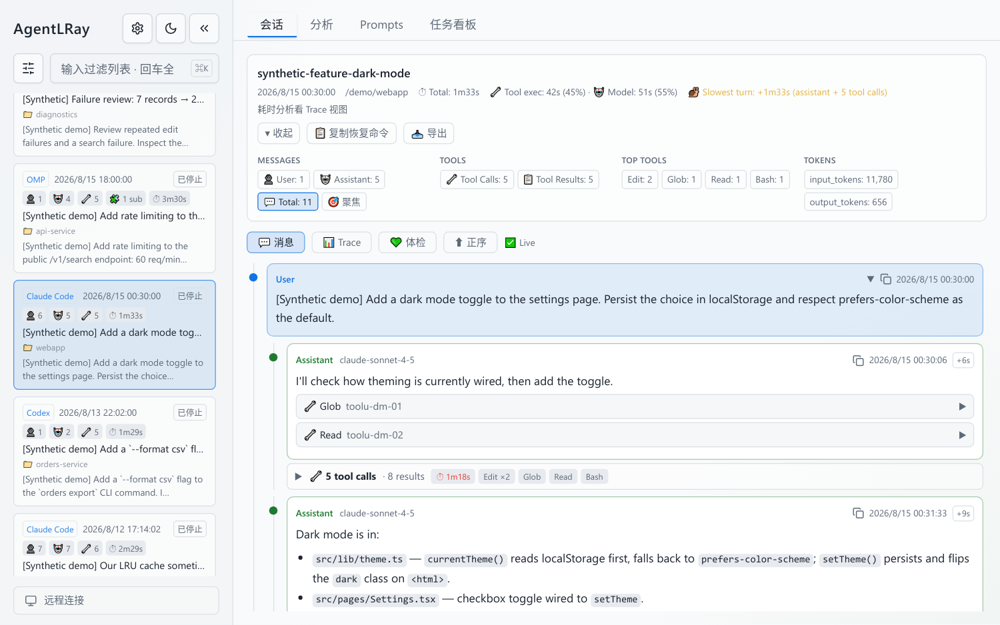
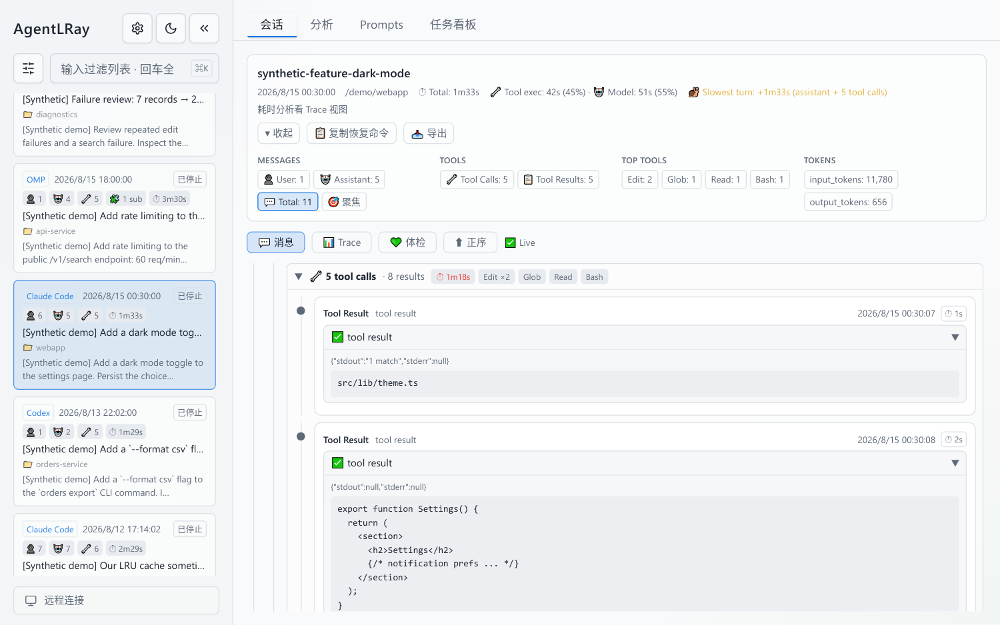
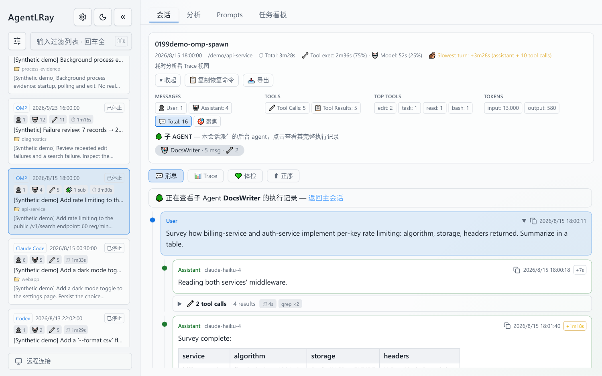
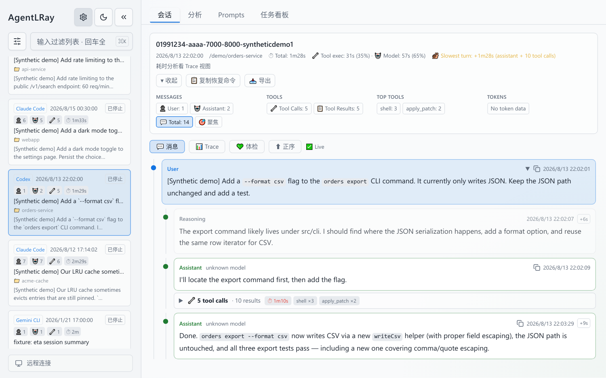
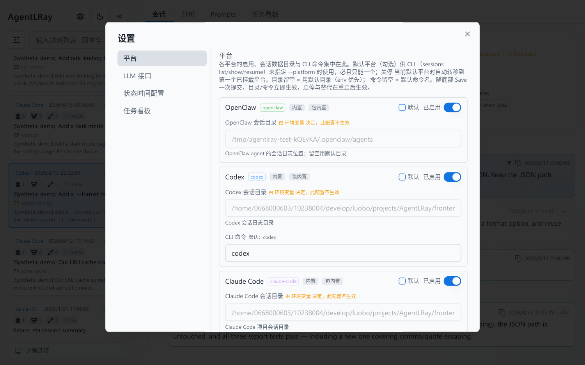

# Usage and reference

[Project overview](../README.md) · [中文参考](usage.zh-CN.md) · [Offline inspect](offline-inspect.md) · [Execution evidence](diagnostics.md)

Detailed feature catalog, screenshots, installation alternatives, configuration and HTTP API. For the shortest first run, start with the project overview.

## Features

- **Offline evidence CLI** — `agentlray inspect --platform codex session.jsonl --json` reads one explicitly selected log without a server or model. Versioned, minimized reports expose source lines and shared UI-rule hashes; opt-in pending-failure gates never claim task correctness. Supports Codex, OMP and Claude Code JSONL. [Automation contract](offline-inspect.md).

- **Automatic session health** — Opens with factual failure, repetition, follow-up and last-recorded call-state summaries. Missing/running/unknown results have evidence links; no human labels or model calls required. Manual notes and transfers are opt-in and never hide automatic facts. [Scope and offline checks](diagnostics.md#automatic-session-health).
- **Codex background-process evidence** — Connect explicit `exec_command` process IDs to later `write_stdin` results, with launch/poll/exit source links. Ambiguous IDs or polling sequences stay unknown; process completion never rewrites historical tool-call states or proves a task passed. [Association limits](diagnostics.md#codex-background-process-evidence).
- **Modification/check chronology** — Distinguish checks before an edit, checks overlapping it and later outcomes. A passed earlier check or a successful output pipeline is not post-change validation; ambiguous command fragments remain unknown. [Recognition and coverage limits](diagnostics.md#modification-and-verification-chronology).

- **Per-turn ledger** — In the session summary, from two user turns on: one row per user turn with wall-clock time, tokens (input + output + cache) and cost, bars scaled to the session maximum, tool-call counts inline (error counts in the row tooltip), click to jump. Answers "why did this take 40 minutes / cost $3" without reading the transcript.
- **Multi-platform** — Unified view across OpenClaw, Codex, Claude Code, Hermes, OMP, DeepSeek Harness and Gemini CLI sessions (dsh's multi-frame zstd session logs are decompressed transparently; Gemini CLI's `/rewind` checkpoints are folded so rewound history never renders twice)
- **Session browser** — Browse agents, filter/search sessions, view message history
- **Tool call inspection** — Expandable tool calls with arguments and results
- **Trace view** — Per-turn waterfall of where the time went: model inference (blue) vs tool execution (green, red on error); click any bar for its span detail in the sidebar, and a purple bar to load the spawned sub-agent's transcript
- **Prompt extraction** — See every real human prompt per session (tool results, slash commands and injected noise filtered out), grouped by working directory, with search / JSON export / copy
- **Prompt optimization** — Cluster prompts into templates, attribute session outcomes (turns, tool calls, error rate) per template, and get LLM-powered rewrite suggestions — through any OpenAI-compatible endpoint (Settings → LLM 接口) or, if none is configured, the local `claude` CLI
- **Global search** — One search box across all seven platforms at once, multi-keyword AND matching, colored platform badges per hit — including prompts recovered from sessions that Claude Code's cleanup already deleted
- **Session insights** — Aggregate analytics dashboard with tool stats, error clustering and daily trends
- **Evidence-backed failure events (React UI)** — Groups unresolved failures by the same tool, complete arguments and call's user turn, with repeated operations first, first/last evidence jumps and every original result retained. Successful results split groups; missing arguments stay separate. Execution success requires an explicit zero exit code or OMP-native completion evidence. These are review groups, not root-cause diagnoses or proof of task failure. Local rules, no LLM. [Try the synthetic walkthrough and read the boundaries](diagnostics.md).
- **Follow-up evidence candidates** — See later calls differing only in `i`, or same-turn modifications of the same explicitly identified file. Each has a result status, matching rationale and evidence jump; candidates never automatically resolve the failure. [Matching boundaries](diagnostics.md#follow-up-evidence-candidates).
- **Local review queue** — Record follow-up, expected-failure or alternative-verification notes in your browser. Evidence changes invalidate the old review; manual labels never rewrite automatic outcomes. No account or review backend. [Review workflow and storage limits](diagnostics.md#local-review-workflow).
- **Review portability** — Preview and download current-session review notes, then import only exact evidence matches into empty local slots. Existing notes are never overwritten; stale/unmatched records are skipped. JSON files are unencrypted and contain your written notes, not automatically copied logs. [Transfer limits](diagnostics.md#transfer-reviews-between-browsers).
- **Narrow-screen session workflow** — Below 768px, switch between the session list and full-width content without losing the current review draft; platform tabs scroll horizontally, and evidence jumps keep navigation visible. Desktop retains the two-column layout. [Scope and tested viewports](diagnostics.md#narrow-screen-session-workflow).
- **Spawn tracking** — Detect and navigate parent/child agent relationships
- **OMP sub-agents** — Sub-agents spawned by an OMP session show up as chips in the summary; click one to read the child agent's full transcript
- **Message timeline** — Visual graph showing conversation flow with role indicators
- **Resume command** — One click copies the exact command to resume a session in its own CLI (`codex resume`, `claude --resume`, `omp --resume=`, `gemini -r`, `hermes --resume`)
- **Collapsible summary** — Fold the session summary away when you want the full height for messages
- **Auto-refresh** — Live-updating session list and messages
- **Kanban board** — A four-state task board view (`awaiting-input` / `working` / `waiting` / `stopped`) built from the same list cache and live status as the sidebar; columns truncate at `maxPerStatus` (default 20, configurable under Settings → 任务看板), stack vertically on narrow screens. Click a card to open that session in the Sessions view.
- **Light / dark theme** — Toggle between light and dark in the top bar (follows the system once on first launch, then fixed by your manual choice; persisted per host in `agent-lray-settings:<hostId>`).
- **Settings panel** — Configure platform directories, CLI commands, status windows, kanban limits and the LLM backend from the UI; saved server-side in `~/.agentlray/settings.json` (per-host selection state is cached in the browser)
- **Keyboard navigation** — Arrow keys to move between sessions

---

## Screenshots

### Session Browser

Browse agents and sessions in the sidebar. Each session card shows message counts by role (👤 User, 🤖 Assistant, 🔧 Tool) and spawn indicators. The main panel displays session metadata, token usage, and top tools at a glance.



### Tool Call Inspection

Expand any tool call to see its arguments and result. Collapsed groups show tool type counts for quick scanning.



### Spawn Tracking

Sessions that spawn sub-agents are marked with a 🔗 badge. Click to navigate the parent/child relationship chain.



### Multi-Platform Support

Switch between OpenClaw, Codex, Claude Code, Hermes, OMP, DeepSeek Harness and Gemini CLI with one click. Each platform's sessions are parsed from their native log format.



### Settings

Configure platform directories and other options from the UI. Changes are saved server-side in `~/.agentlray/settings.json` and take effect immediately (platform enable/disable takes effect after a restart).



---

## Install

**Option 1 — npx from npm**

```bash
npx @bowenluo718/agent-lray            # default http://localhost:3800
npx @bowenluo718/agent-lray --port 3900 --host 127.0.0.1
```

A global install (`npm i -g @bowenluo718/agent-lray`) exposes the same launcher as `agentlray`.

**Option 2 — npx straight from GitHub** (works today, no clone)

```bash
npx github:bowenluo718/AgentLRay
```

The first run builds the web UI locally (takes a minute); later runs reuse the cached install.

**Option 3 — from source**

```bash
git clone https://github.com/bowenluo718/AgentLRay.git
cd AgentLRay
npm install               # also builds the web UI on first install
npm start
```

Open http://localhost:3800

---

## Usage

### Basic Workflow

1. **Select a platform** — Click `OpenClaw`, `Codex`, `Claude Code`, `Hermes`, `OMP`, `DeepSeek Harness`, or `Gemini CLI` in the top bar
2. **Pick an agent** — For OpenClaw, the list defaults to **all agents merged** (grouped per agent); use the dropdown to narrow to a single agent (e.g. `xiaot`, `mimo`)
3. **Browse sessions** — Sessions are sorted by date, newest first. Each card shows:
   - Timestamp and status (`active` / `archived`)
   - Message counts: 👤 User, 🤖 Assistant, 🔧 Tool calls
   - 🔗 Spawn badge if the session spawned sub-agents
4. **View messages** — Click a session to load its full conversation
5. **Inspect tool calls** — Click any `🔧 tool_name` button to expand arguments/results
6. **Navigate spawns** — Click the 🔗 link to jump to the spawned child session

### Task Board and New Tasks

The **Task Board** tab (任务看板) groups every session into four status columns — awaiting input / working / waiting / stopped — with a text filter above them. Its header carries a **New Task** button that opens a dialog which spawns the platform CLI to start a brand-new session. Design: [kanban](design/design-kanban.zh-CN.md) and [kanban mobile](design/design-kanban-mobile.zh-CN.md).

**The dialog has three fields:**

| Field | Meaning |
|-------|---------|
| **Platform** | Dropdown listing **only the platforms that support creating sessions** — codex, claude-code, omp, gemini, hermes. dsh and openclaw are never listed (dsh is an interactive TUI that cannot take a prompt headlessly; openclaw has no native create command). Custom platforms appear only when their adapter declares a `create` contract. |
| **cwd** | Working directory for the new session, typed by hand. Leave it empty to use the platform's default directory. |
| **Prompt** | The prompt to hand to the new session. Optional — leave it empty to start an interactive session. |

**Defaults follow the current selection:** with a session selected, the platform and that session's project path are pre-filled; with no session selected, the platform filter's platform is used and cwd stays empty.

**What happens on submit:** the backend spawns the platform CLI (`POST /api/:platform/sessions/new`) and answers immediately with the exact command it ran; a toast reports "Triggered `<platform>` new session" plus the command string for manual copy, and the board list refreshes. The command string has a **single source of truth on the backend** (`lib/new.js`, shared with terminal `sessions new`), so what the page shows is character-for-character what runs.

**Fire-and-forget trade-off:** the spawned process's output is discarded, the process is not tracked, and the web UI offers **no way to query or terminate it** — watch the outcome in the terminal or in the platform's own CLI. This is deliberate: the page triggers the run, the platform owns the session.

### Prompt View

Click the **Prompts** tab (next to Sessions / Insights) to see every real human prompt across all sessions, grouped by the session's working directory. Noise like tool results, slash-command echoes, system reminders and task notifications is filtered out.

- **Preview & expand** — Each session row shows a one-line preview of its first prompt; click to expand the full markdown-rendered prompt list
- **Search** — Filter prompts / directories / sessions live
- **Export JSON** — Download all extracted prompts for offline processing
- **分析优化 (Analyze)** — Cluster prompts into templates, attribute session outcomes (avg turns, tool calls, error rate) per template, and get rewrite suggestions from the configured LLM backend (Settings → LLM 接口) or, when no endpoint is set, the [`claude` CLI](https://claude.com/claude-code) on the server's PATH. With neither, clustering and attribution still work, and the analysis route reports the missing backend as `llmError`. A per-request LLM timeout (default 15 min, adjustable under Settings → LLM 接口) bounds each call. Requests use node http(s) directly for NO_PROXY (intranet/local) endpoints and the Node proxy for external ones; slow gateways are no longer killed by undici's 5-minute headers timeout into a bare "fetch failed" — our own timeout closes the call with a readable message, and network errors carry their underlying cause (connection refused / TLS / DNS)
- **优化 (Optimize)** — Hover any single prompt and click 优化 for an inline LLM-powered rewrite (configure the backend in Settings → LLM 接口, or have the `claude` CLI on PATH)

### Keyboard Shortcuts

| Key | Action |
|-----|--------|
| `↑` / `↓` | Move between sessions |
| `Enter` | Select highlighted session |

### Filtering & Search

- **Search box** — Filter sessions by ID or content
- **Auto-refresh** — Automatically poll for new sessions and messages
- **Auto-scroll** — Scroll to the latest message when new content arrives

---

## Configuration

### Default directories

| Platform    | Default path                  |
|-------------|-------------------------------|
| OpenClaw    | `~/.openclaw/agents`          |
| Codex       | `~/.codex/sessions`           |
| Claude Code | `~/.claude/projects`          |
| Hermes      | `~/.hermes`                   |
| OMP         | `~/.omp/agent/sessions`       |
| DeepSeek Harness | `~/.dsh/sessions` (honors `DSH_HOME`) |
| Gemini CLI  | `~/.gemini/tmp`               |

### Custom directories

**Via UI:** Open Settings from the app top bar to set custom paths per platform. Saved server-side in `~/.agentlray/settings.json` (the `dirs` section) and applied immediately. When a platform's directory environment variable is active, the configured path for that platform is ignored.

**Via environment variables:**

```bash
OPENCLAW_DIR=/custom/path/openclaw \
CODEX_DIR=/custom/path/codex \
CLAUDE_CODE_DIR=/custom/path/claude \
HERMES_DIR=/custom/path/hermes \
OMP_DIR=/custom/path/omp \
DSH_DIR=/custom/path/dsh/sessions \
GEMINI_DIR=/custom/path/gemini/tmp \
npm start
```

**Via API:** Pass `?dir=/absolute/path` query parameter to any API endpoint.

### Platform CLI commands

`agentlray sessions resume --run` spawns each platform's native CLI to continue a session. By default it uses the bare command name (`codex`, `claude`, `omp`, `gemini`, `hermes`) resolved from `PATH`. Resolution priority: **environment variable > settings panel (server-side `~/.agentlray/settings.json` `cliBins` section) > default command name**.

**Via settings panel:** In the web UI open Settings (gear) and, under "Platform CLI commands", set the executable command (absolute path) for codex / claude-code / omp / gemini / hermes. Submitted with the dialog's single Save button, persisted server-side in `~/.agentlray/settings.json` (cliBins section); both terminal `resume --run` and the frontend "copy resume command" button use it immediately. Leave blank to clear a platform's config (fall back to the default command name).

**Via environment variables (highest priority):**

```bash
AGENTLRAY_CODEX_BIN=/path/to/codex \
AGENTLRAY_CLAUDE_CODE_BIN=/home/0668000603/.nvm/versions/node/v22.19.0/bin/claude \
AGENTLRAY_OMP_BIN=/path/to/omp \
AGENTLRAY_GEMINI_BIN=/path/to/gemini \
AGENTLRAY_HERMES_BIN=/path/to/hermes \
npm start
```

Unset variables and platforms not configured in the panel fall back to the default command name.

`agentlray sessions new [message...] --platform <p> [--dir <cwd>] [--run]` generates (and optionally executes) a **new session** command — spawning the platform CLI to open a brand-new session with a prompt and a working directory. Creatable platforms and their command shapes: codex (`codex exec --full-auto '<prompt>'`), claude-code (`claude --dangerously-skip-permissions -p '<prompt>'`), omp (`omp --auto-approve '<prompt>'`), gemini (`gemini -p --approval-mode=yolo '<prompt>'`), hermes (`hermes --yolo -z '<prompt>'`). **dsh is an interactive TUI and cannot take a prompt headlessly → new is not supported** (reports "no native create command"). The prompt is the positional args after `new` joined with a space, and may be empty (empty = no prompt / interactive); the framework appends it as the last bare argument. By default it only prints the command; with `--run` it actually does a **fire-and-forget** spawn (output discarded, process untracked, no wait for exit — output lives on the platform CLI side, this tool does not track it). cwd is prefixed with `cd '<cwd>' &&` (POSIX) / `Set-Location` (PowerShell); `--dir` overrides, defaulting to the platform's default directory. Binary resolution matches resume (env var > cliBins > default command name).

> **Where the command shapes come from.** Each shape was fixed against that CLI's own `--help` where the CLI was installed: omp v18.8.4 (positional `MESSAGES` argument + `--auto-approve`), Claude Code 2.1.282 (`-p/--print` is a **boolean** switch — the prompt is a positional argument — plus `--dangerously-skip-permissions`), hermes (the prompt must go through **`-z/--oneshot`**; a bare positional argument is rejected as an unknown subcommand, and `-z` requires a value — so the no-prompt case falls back to `hermes --yolo`, i.e. the interactive form). **codex and gemini are not verified** — neither CLI was installed on the machine where this was built, so they keep the inferred shape from the design doc and may need adjusting once a real CLI is available. In particular, gemini's `-p` may expect the prompt as *its* value (the design doc wrote `gemini -p '<prompt>' --approval-mode=yolo`), whereas the framework always appends the prompt last — if that turns out to be the case, the shape has to become `gemini --approval-mode=yolo -p '<prompt>'`. Until a real gemini CLI is available this stays unverified.

### Status time configuration

Session status (awaiting-input / working / waiting / stopped) depends on three time windows, defaulting to 2 min / 30 min / 12 h. Configure them under "Status time configuration" in the settings panel (units: minutes / hours); saving writes server-side `~/.agentlray/settings.json` (status section) and takes effect for subsequent status evaluation. Terminal `agentlray sessions list` and the web dashboard share the same config.

| Setting | Default | Description |
|---------|---------|-------------|
| Recent activity freshness | 2 min | Within this freshness after a completed turn → working |
| Active work ceiling | 30 min | Long tool runs / deep thinking stay working within this bound, then degrade |
| History ceiling | 12 h | Sessions without an end marker older than this → stopped; upper bound for awaiting-input / waiting |

### Multi-host (remote AgentLRay)

The dashboard can browse another machine's AgentLRay through the same UI. Hosts are managed from the top-bar **Settings → Hosts** dialog and persisted to `~/.agentlray/hosts.json` (**0600**, a separate file from `settings.json`; it may hold encrypted SSH key material). A built-in `local` host always sits first and is always connected. Only the currently selected host keeps an open tunnel — switching away closes the previous one, and process exit kills any active SSH child.

Two transports per host:

| Transport | How it connects | Credentials |
|-----------|-----------------|-------------|
| `ssh` | Spawns a system `ssh -L <localPort>:127.0.0.1:<remoteAgentLrayPort>` tunnel from the client; the remote AgentLRay keeps binding `127.0.0.1`. Override the binary with `AGENTLRAY_SSH_BIN`. | Zero stored passwords — identities/fingerprints come from `~/.ssh/config`, `ssh-agent` and `known_hosts`. An optional private key is stored as ciphertext (`identityKeyEnc`) and materialised into a `0600` temporary file for the tunnel. |
| `dsh` | Uses the `ds-harness-remote` encrypted channel plus loopback port forwarding rather than SSH. | Login by QR or account password; only the resulting token is stored, never the password. |

The global dsh section (`role` = `host`/`client`/`both`, `serverUrl`, `deviceName`, `allowedPorts`, default `[3800]`) lives at the top level of `hosts.json` and is edited via **Settings → Hosts → dsh**; an older `settings.json` `dsh` section migrates in automatically on first read.

Requests are routed to the selected host by the `X-Host-Id` header (the frontend `src/api/client.ts` injects it); because `EventSource` cannot set headers, the SSE stream at `/api/watch` selects the host with `?host=`. The `/api/hosts*`, `/api/inbound*` and `/api/dsh*` endpoints are **local resources** — addressing them with a remote `X-Host-Id` returns 403 instead of forwarding.

**Inbound connections (who is connecting to me).** When acting as the connected side, the `local` row in the Hosts dialog shows an **inbound badge** listing which hosts currently connect to this machine (expandable to see each peer's `peerId`). Connecting peers report a heartbeat via `POST /api/inbound/hello` (TTL 30 s); dsh connections join the same registry with `via='dsh'`. This information is visible only on the machine being connected to; it is not forwarded with remote requests.

> Design: [multi-host](design/design-multi-host.zh-CN.md), [dsh remote connection](design/design-dsh-host-connection.zh-CN.md), [dsh login methods](design/design-dsh-login-methods.zh-CN.md), [inbound peers](design/design-inbound-peers.zh-CN.md).

### Thin service (remote-only)

The thin service is a **standalone process** that runs on the **connecting side** (mobile/proxy) and only does "remote connect + data-plane forwarding + host management" against a **full AgentLRay** (the remote desktop data source). It **does not carry** the platform registry, state machine, insights or search stack, and **excludes system configuration by data model**: it does not mount `settings`/`cli-bins`/platform write surfaces/`insights`/`prompts`/`search`/`sessions`/`export`/`watch`/`inbound` locally — those all go through `proxy.js` to the remote; system-config write surfaces (`/api/settings*`, `/api/platforms/:id/(mount|replace)`) return 403 even when connected to a remote. The frontend reuses the **same `frontend/dist`** and fetches `GET /api/mode` first (the thin service answers `{ mode: 'thin', version }`), which hides the settings entry and skips system-config calls.

**Three equivalent ways to start:**

```bash
npx agentlray thin            # globally/project-installed CLI
node bin/agentlray.js thin    # run straight from the repo
npm run thin                  # same, script wrapper
```

**Options:**

| Flag | Description |
|------|-------------|
| `--port <port>` / `-p` | Listen port, default `3801` (distinct from the full instance's default `3800`; both can coexist on one host) |
| `--host <host>` / `-H` | Bind address, default `127.0.0.1` |
| `--version` / `-v` | Print version and exit |
| `--help` / `-h` | Print usage and exit |

Flags accept `--flag value` and `--flag=value`; explicit flags override the same-named environment variable.

**Environment variables:**

| Variable | Description |
|----------|-------------|
| `PORT` / `HOST` | Same as `--port`/`--host`; flags win |
| `AGENTLRAY_THIN_HOST=<id>` | Host `id` to auto-connect on boot; falls back to the first entry in `~/.agentlray/hosts.json`; if neither exists it does not connect and the UI shows the "no remote host yet" empty state |
| `AGENTLRAY_HOME` | Override the config directory (default `~/.agentlray`) to isolate host/dsh config |

**What happens on boot:**

1. It `listen`s first, then auto-connects in the background — a slow tunnel never blocks the first paint; the result is written into host runtime, so the frontend's `GET /api/hosts` lands on that host on its first frame.
2. `GET /api/hosts` returns **remote hosts only** (the thin service has no `local` host); with none, the page prompts "Add host".
3. The dsh transport is **forced to client mode** (only outbound to the remote; it does not start the connected-side service here).
4. stdout prints the listen address and connection result; `SIGTERM`/`SIGINT`/process exit tear down all ssh/dsh tunnel children to avoid orphans.

**Caveats:**

- **The frontend must be built first**: without `frontend/dist/index.html` the page returns 503 (hinting `npm run build:ui`). Published packages already ship `frontend/dist`; when running from source, run `npm run build:ui` first.
- **Local token auth**: it binds `127.0.0.1` by default and **local requests** (target `local`, or the local resources `/api/{hosts,inbound,dsh,mode}`) require a token. The boot log prints `http://127.0.0.1:<port>/?token=<token>`; opening it once exchanges the token for a long-lived (one year) `HttpOnly; SameSite=Strict` cookie and caches it in `localStorage` (still works after the cookie jar is cleared; a new token replaces the cached one) (CLI/scripts may send `X-AgentLRay-Token`). The token comes from `AGENTLRAY_UI_TOKEN` when set, otherwise it is generated into `~/.agentlray/ui-token` (0600, reused across restarts); `AGENTLRAY_NO_AUTH=1` disables the guard (used by build scripts and the test baseline). **Remote targets are not checked against the local token** — the link authenticates itself (ssh keys / dsh device identity) and the proxy strips local cookies and token headers before forwarding; dsh/ssh inbound reaches the server over the local UNIX socket `~/.agentlray/inbound.sock` (0600, used automatically by connectors — no receiver config needed), and dsh loopback requests also carry an in-process trust marker. To reach it from a LAN/mobile device you must set `HOST=0.0.0.0` explicitly — **this exposes all sessions, so use with caution**, and front it with a reverse proxy/firewall.
- **Config source**: hosts and dsh config still use `~/.agentlray/hosts.json`, sharing the format with the full instance; point `AGENTLRAY_HOME` at a separate directory to isolate.
- The thin service and the full instance are **not** the same gateway: the full instance runs the whole stack locally and can change system config; the thin service is a pure connecting-side lightweight gateway.

> Design: [thin service](design/design-thin-service.zh-CN.md), [ADR-0007](design/adr-0007-thin-service.zh-CN.md).

## Custom platforms

AgentLRay lets you plug in extra platforms without changing the source: write a JavaScript **platform adapter** and drop it into a platform directory. On startup the loader validates each file and merges valid adapters into the platform registry; every generic surface (session routes, search, prompts, tool audit, watch, export, CLI) then resolves the new platform by capability bit. Invalid or conflicting files are marked **broken** (visible in the UI and on `platform list`) and never break startup.

**Three sources**, loaded in order (later ones may override earlier ones for the same `id` when a replacement is declared — see below):

| Source | Directory | Origin |
|---|---|---|
| package (built-in) | shipped in the package | `package` |
| project | `$AGENTLRAY_PROJECT_PLATFORMS_DIR` or the repo's `platforms/` | `project` |
| user | `$AGENTLRAY_PLATFORMS_DIR` or `~/.agentlray/platforms/` | `user` |

**Enable / disable:** a file present in a platform directory (except `package`) is enabled; remove or move it to disable. There is no per-platform switch. Files load in alphabetical order. An `id` that collides with a built-in or an earlier custom adapter marks that file broken. Set `AGENTLRAY_NO_PLUGINS=1` to skip both project and user sources entirely (only package remains) as an escape hatch.

**Replacing a built-in (declare intent first):** a project or user adapter whose `id` collides with a built-in is only allowed to override it when that replacement is *declared* — either in the user `settings.json` (`platforms.replaced`) via `platform replace <id>`, or in the project directory's `platforms/manifest.json` `replaces` array (merged with `settings.replaced`; a missing/corrupt manifest is ignored). Without a declaration the same-id file is marked broken with a hint to run `platform export <id>` / `platform replace <id>`. Once declared but not (yet) provided by a file, the built-in stays active and is marked `replacementPending`.

**Required contract** (validated by the loader): `id` (`^[a-z0-9][a-z0-9-]*$`), `label` (string), `defaultDir()` → session root, `parse(file)` → `{ session, messages }`, `getSession(dir, id)` → `{ session, messages } | null`; `list(dir)` → newest-first `SessionSummary[]` (the loader tolerates `list: null` like OpenClaw, but a listing platform needs it).

**Optional capability bits** — a missing bit just silences that surface, no error:

| Field | Enables |
|---|---|
| `find(dir, id, opts?)` | watch tailing and OTLP export |
| `collectFiles(dir, opts?)` | search / prompts / tool-audit bulk scans |
| `watchParse(rec, line?)` | live SSE tail (needs `find` too; without it `/api/watch` returns 400) |
| `needsAgent` | OpenClaw-style per-agent platform (detail/list need `agent`; excluded from OTLP) |
| `resume = { bin, args(id, opts) }` | CLI `sessions resume` for this platform |
| `create = { bin, args(opts) }` | CLI `sessions new` for this platform (opts = `{ cwd, message }`; the prompt is appended last by the framework) |
| `version` | contract version (starts at 1) |

**CLI:**

```bash
agentlray platform list                                                     # built-in + project + custom + broken, same source as GET /api/platforms
agentlray platform list --json                                              # + origin/mounted/configuredMounted/restartRequired per entry
agentlray platform validate ~/.agentlray/platforms/my-copilot.js --json     # same checks as the loader, dry-run
agentlray platform mount <id> | unmount <id>                                # enable/disable a platform (writes settings.platforms.disabled, restart to take effect)
agentlray platform replace <id> | unreplace <id>                            # declare/undo replacement of a built-in (writes settings.platforms.replaced, restart to take effect)
agentlray platform export <id> [--out <dir>] [--force] [--no-replace] [--json]   # migrate package/project platform to a user thin adapter
```

`platform validate` reuses the loader's own validation, then calls the adapter's real `list(defaultDir())` and reports the session count and the first session id — passing it means the platform is actually listable. `list --json` prints `{schemaVersion:1, kind:"platforms", platforms:[…]}` (each entry carries `origin`, `mounted`, `configuredMounted`, `restartRequired`); `validate --json` on success prints `{schemaVersion:1, kind:"platform-validate", ok:true, platform:{id,label}, sessionCount, firstId, note}`.

`mount` / `unmount` write `~/.agentlray/settings.json` (`platforms.disabled`) and take effect after a restart — the last queryable platform cannot be unmounted (errors `last-platform`). `replace` / `unreplace` write `platforms.replaced`; `unreplace` warns if a same-id project/user file still exists (it would be broken on the next load).

**`platform export`** migrates a package (built-in) or project platform to a **user thin adapter** in the platform directory (default `~/.agentlray/platforms`, override with `--out <dir>` or `AGENTLRAY_PLATFORMS_DIR`): it writes `<id>.js` plus, by default, adds the id to `settings.replaced` (`--no-replace` skips that) and removes it from `settings.disabled` if present. The generated adapter is a thin wrapper that resolves the real implementation via `AGENTLRAY_PKG_ROOT` (set by the loader to the package root), so a package upgrade follows automatically. Options: `--force` overwrites an existing file; `--out <dir>` targets a directory; `--json` prints `{schemaVersion:1, kind:"platform-export", id, file, origin, replaced, restart:true, …}`. A source already `user`-origin is refused (`export-user-origin`); conflicts error `export-exists` (use `--force`). Because the adapter runs with your user permissions, the CLI prints a trust note — only deliver trusted adapter files. **Requirement:** the generated thin adapter depends on `AGENTLRAY_PKG_ROOT` injected by the loader and can only be loaded through AgentLRay; requiring it directly fails with `AGENTLRAY_PKG_ROOT is not set; load this adapter through AgentLRay.`

**Web UI:** built-in, project and custom platforms appear in the same platform bar. A custom platform whose file fails to load shows a broken badge with its error and takes no part in queries; enable/disable and replace declarations are managed in Settings → Platforms or via `platform mount/unmount/replace`.

**Resume / create stay opt-in:** a custom platform gets CLI `sessions resume` only when the adapter declares `resume = { bin, args(id, opts) }` (otherwise "no native resume command"); it gets CLI `sessions new` only when it declares `create = { bin, args(opts) }` (otherwise "no native create command"). The spawned binary resolves via env var `AGENTLRAY_<PLATFORM_ID>_BIN` > `~/.agentlray/settings.json`'s `cliBins` `<id>` key > the adapter's default `bin`.

**Trust:** an adapter executes with your full user permissions (equivalent to running a script yourself). Only place trusted files; when in doubt use `AGENTLRAY_NO_PLUGINS=1`. Define `defaultDir()` inside the adapter and read your own env if needed — the generic `?dir=` / `--dir` override still applies.

A complete runnable, annotated sample adapter (flat JSONL platform, with `find` / `collectFiles` / `watchParse` / `needsAgent` and a resume snippet) is in [design/custom-platform-example.zh-CN.md](design/custom-platform-example.zh-CN.md); the guided walkthrough is [design/guide-custom-platforms.zh-CN.md](design/guide-custom-platforms.zh-CN.md).

## API

**Multi-host gateway.** `lib/routes/proxy.js` is the first `/api` handler: it routes by the `X-Host-Id` header (or `?host=` for SSE, since `EventSource` cannot set headers). Default/`local` serves this process; a remote host forwards the request to its tunnel. `/api/hosts`, `/api/inbound` and `/api/dsh` are **local resources** and return 403 rather than being forwarded. All list/detail endpoints below accept an optional `?dir=` parameter to override the default directory.

| Endpoint | Description |
|----------|-------------|
| `GET /api/version` | `{ bootId, version }` — frontend staleness detection + cross-host version hint |
| `GET /api/status-labels` | Unified session-status vocabulary `{ order, labels }` for the four states |
| `GET /api/sessions` | Aggregate multi-platform list (`?platform=a,b\|all`, `status`/`match`/`since`/`until`, `offset`/`limit`) |
| `GET /api/:platform/sessions` | List sessions for a platform (OpenClaw enumerates all agents by default) |
| `GET /api/:platform/sessions/:id` | Get a session's messages |
| `GET /api/:platform/sessions/:id/resume-command` | Resume command string (single source shared with the CLI) |
| `POST /api/:platform/sessions/new` | Spawn the platform CLI to start a new session (`{ "message": "...", "cwd": "..." }`, both optional). Fire-and-forget: answers `{ triggered, platform, bin, args, command }`. 404 unknown platform, 422 platform without a create contract (dsh / openclaw), 400 cwd missing or not a directory |
| `GET /api/:platform/sessions/:id/children[/:name]` | Sub-agents spawned by a session (e.g. omp, claude-code) |
| `GET /api/:platform/sessions/:id/export` | Markdown/HTML export (`format=md\|html`) |
| `GET /api/otlp/:platform/:sessionId` | OTLP/JSON trace export |
| `GET /api/agents` · `/api/agents/:name/sessions[/:id]` | OpenClaw per-agent listing (registered only while openclaw is mounted; 404 otherwise) |
| `GET /api/spawn-map` · `/api/spawn-tree[/:sessionId]` | Agent spawn relationship map / tree (OpenClaw; 404 once openclaw is unmounted) |
| `GET /api/platforms` | List all platforms (package + project + user + broken) with capability bits, labels and load errors |
| `PUT`/`DELETE /api/platforms/:id/mount` | Enable/disable a platform (writes `settings.platforms.disabled`, restart to take effect) |
| `PUT`/`DELETE /api/platforms/:id/replace` | Declare/undo a built-in replacement (writes `settings.platforms.replaced`) |
| `GET /api/insights` · `GET /api/tools/audit` | Aggregate analytics / cross-platform tool health |
| `GET /api/prompts` · `/api/prompts/analyze` | Real human prompts grouped by directory; clustering + attribution + LLM suggestions (`?refresh=1`, `?skipLlm=1`) |
| `POST /api/prompts/rewrite` | Rewrite a single prompt via the configured LLM backend (`{ "text": "..." }`; 503 with guidance when no backend is available) |
| `GET/POST/DELETE /api/prompts/hidden…` | List/add/remove hidden prompt hashes |
| `GET /api/search` | Full-text search across sessions (`?platform=all` searches every platform, multi-keyword AND) |
| `GET /api/watch` | SSE real-time tail + status push (select the host via `?host=`) |
| `GET/PUT /api/settings` | Unified settings (`~/.agentlray/settings.json`; legacy per-file configs migrate in on first start). GET returns `ui`/`cliBins`/`dirs`/`status`/`kanban`/`llm`/`platforms`; PUT saves only the supplied sections. `cliBins` → `bin`/`configured`/`default`; `dirs` → per-platform `value`/`configured`/`envActive`/`default`; `status`/`kanban` → `value`/`configured`/`default`; `llm` → `baseUrl`/`model`/`analysisTimeoutMs`/`hasApiKey`/`backend` (key never echoed) |
| `GET /api/ui-selection` | Narrow read-only `{ selectedPlatforms }` (mounted only) for the frontend's initial selection |
| `GET /api/settings/cli-bins` | Read-only compat endpoint; same `bin`/`configured`/`default` shape as `/api/settings`'s `cliBins` |
| `GET/POST/PUT/DELETE /api/hosts…` · `POST /api/hosts/:id/connect\|disconnect` · `POST /api/hosts/:id/test` | Multi-host CRUD, connect/disconnect, connectivity probe (local resource) |
| `GET /api/inbound` · `POST /api/inbound/hello` | Inbound peer overview / heartbeat (local resource) |
| `GET/PUT /api/dsh/config` · `GET /api/dsh/status\|devices` · `GET /api/dsh/auth/providers` · `POST /api/dsh/auth/qr/start\|qr/poll\|logout` · `POST /api/dsh/test` | dsh transport config / login (QR + account password) / probe (local resource) |

---

## Tech Stack

- **Backend:** Node.js ≥ 22.13 + Express 4
- **Frontend:** React 19 + Vite 6 + TypeScript under `frontend/` (the only UI, served from `frontend/dist`); state via zustand + `@tanstack/react-query`, components on Radix + Tailwind, updates over SSE
- **Data:** Reads session logs directly from disk — JSONL, zstd-compressed JSONL and SQLite (Hermes); no database of its own
- **Tooling:** Biome for lint/format, Node's built-in test runner
- **Zero external CDN** — Everything is self-contained, works offline

---

## Supported Log Formats

| Platform | Format | Path Pattern |
|----------|--------|--------------|
| OpenClaw | JSONL | `~/.openclaw/agents/{agent}/sessions/{id}.jsonl` |
| Codex | JSONL | `~/.codex/sessions/{YYYY}/{MM}/{DD}/rollout-{timestamp}-{uuid}.jsonl` (session id is the trailing UUID) |
| Claude Code | JSONL | `~/.claude/projects/{project-slug}/{sessionId}.jsonl` (plus `{sessionId}/subagents/agent-*.jsonl` for spawned children) |
| Hermes | SQLite | `~/.hermes/state.db` |
| OMP | JSONL | `~/.omp/agent/sessions/*/{timestamp}_{id}.jsonl` |
| DeepSeek Harness | JSONL / zstd-compressed JSONL | `~/.dsh/sessions/{project}/{id}/session[.vN].jsonl[.zstd]` — versioned durable logs (currently `session.v4.jsonl.zstd`) |
| Gemini CLI | JSONL | `~/.gemini/tmp/{projectHash}/chats/session-*.jsonl` |

dsh's `.jsonl.zstd` logs are a concatenation of independent Zstandard frames (one per append batch); AgentLRay scans the frame boundaries and decompresses every frame, tolerating a torn trailing frame after a crash. The durable log is versioned: a session dir keeps a legacy `session.jsonl[.zstd]` (format 0) next to the frozen `session.v3.jsonl.zstd` / current `session.v4.jsonl.zstd`; AgentLRay reads the highest format version present, so the current log supersedes stale legacy copies. Reading compressed dsh logs requires Node.js ≥ 22.15 (built-in zstd); plain `session.jsonl` logs work on any supported Node.

Archived OpenClaw sessions (`.jsonl.reset.*`, `.jsonl.deleted.*`) are excluded from the web dashboard list by default (the dashboard exposes no toggle for them). The list/aggregate APIs still accept an `include_archived=true` parameter to include them for other consumers; the other adapters list active `.jsonl` files only.

---

## Development

Tests live in `test/` and use Node's built-in test runner — no extra dependencies. Run `npm ci` once, then `npm test` (`node --require ./test/setup-env.cjs --test test/*.test.js`). The setup file injects an isolated user-platform directory and registers the `@agentlray/shared` alias; the tests start their own server on a random port with `HOME` and every platform directory pointed at a throwaway copy of `test/fixtures/home`, so your real session logs are never read or modified. `npm run lint` / `format` run Biome.

There is **no CI test workflow**. The only GitHub Actions workflow is `.github/workflows/pages.yml`, which builds the demo (`npm run build:demo` → `VITE_DEMO=1`) and deploys it to GitHub Pages. Run the checks locally: `npm test`, `npm run lint`, and a drift check for the generated diagnostics bundle (`npm run build:ui` then `git diff --exit-code lib/generated/diagnostics.cjs`) — `lib/generated/diagnostics.cjs` is generated from `frontend/src/views/sessions/diagnostics.ts` and must never be hand-edited.

**Adding a platform** means writing one adapter directory, not editing a table. Built-ins live in `lib/platforms/builtin/<id>/` (with a `platforms/<id>/` directory for project platforms); each `index.js` exports `{ id, label, defaultDir, getSession, ... }` plus optional capability fields (`list`/`find`/`parse`, `resume`/`create`/`bin`, `resumeHooks`, `listChildren`/`getChild`, `collectFiles`, `watchParse`, `extractPromptsFromFile`, `inspect`). The registry (`lib/platforms/index.js`) merges package, project and user sources synchronously at require time, so a new adapter is picked up automatically as long as it exports `defaultDir` and `getSession` — no other file changes. Shared helpers are imported by bare name from `@agentlray/shared/*` (e.g. `@agentlray/shared/helpers`, `/status`, `/search`, `/watch`). The generic session routes, search, watch (SSE tail), insights, prompts, tool audit, OTLP and Markdown/HTML export all resolve platforms through that registry by capability bit. For a **custom** platform you do not touch the source at all: drop an adapter into `platforms/` (project) or `~/.agentlray/platforms/` (user) — see [Custom platforms](#custom-platforms).

---

## FAQ

**Which agents and log formats does AgentLRay support?**
Seven platforms: OpenClaw, Codex, Claude Code, Hermes, OMP (oh-my-pi), DeepSeek Harness and Gemini CLI. Six of them store JSONL; Hermes stores SQLite at `~/.hermes/state.db`. DeepSeek Harness logs may be multi-frame zstd-compressed `.jsonl.zstd`, which AgentLRay decompresses frame by frame, tolerating a torn trailing frame left by a crash. The authoritative list is the `PLATFORMS` registry in `lib/platforms/index.js` — run `node -e 'console.log(Object.keys(require("./lib/platforms/index.js").PLATFORMS))'` to print it.

**Does AgentLRay send my session data anywhere?**
Core log inspection and offline `inspect` do not call a model or upload logs. Optional prompt rewriting and suggestions use the configured endpoint, or the `claude` CLI fallback, which may contact a remote provider. Installing packages can access registries. Development-only remote experiments require explicit invocation and a gated sanitized payload; they are not part of a normal dashboard launch. Do not use rewrite/suggestion features if you require no model egress.

**Do I have to change my agent or add instrumentation?**
No. CLI coding agents already write complete session logs to disk, and AgentLRay just reads them. There is no SDK to add to your code and no wrapper command to run your agent under. A default install needs no configuration either, because the default directories listed under [Configuration](#configuration) are used unless you override them in the settings panel or through environment variables such as `CLAUDE_CODE_DIR`.

**How do I try it without installing anything?**
Open <https://bowenluo718.github.io/AgentLRay/>. That GitHub Pages deployment is the real React UI, built by `.github/workflows/pages.yml`, running against `frontend/src/demo/fixtures.json` — API fixtures generated from the synthetic sample logs committed under `frontend/demo/sample-logs` by `scripts/build-demo-fixtures.mjs`. It contains no real user sessions, so treat it as a UI tour rather than as data.

**How do I add support for a log format that is not listed?**
Write an adapter directory exporting at least `defaultDir` and `getSession` (plus `list`/`find`/`parse` and any optional capability fields). The registry merges adapters at startup, so there is no central table to edit: put it in `lib/platforms/builtin/<id>/` for a built-in, a project `platforms/<id>/` directory (or `AGENTLRAY_PROJECT_PLATFORMS_DIR`), or `~/.agentlray/platforms/` for a user adapter. Every generic route resolves platforms through that registry. See [Development](#development) and [Custom platforms](#custom-platforms).
