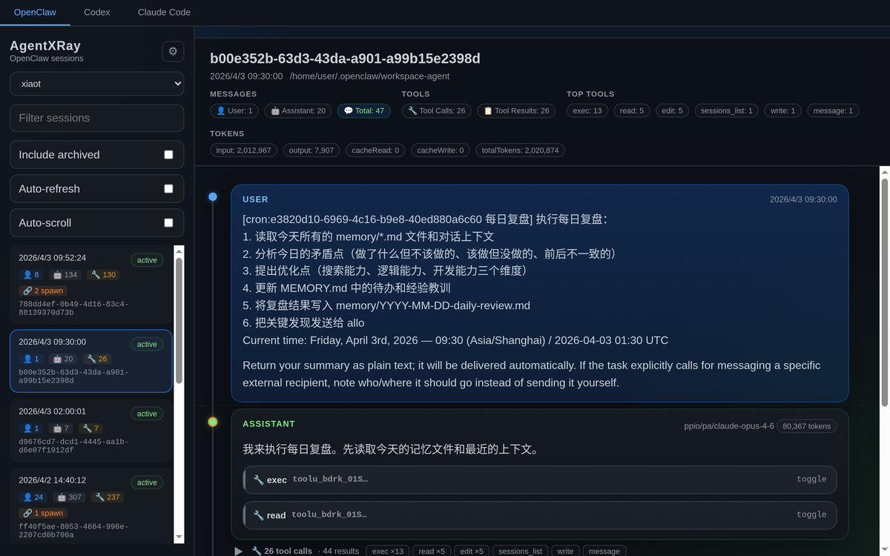
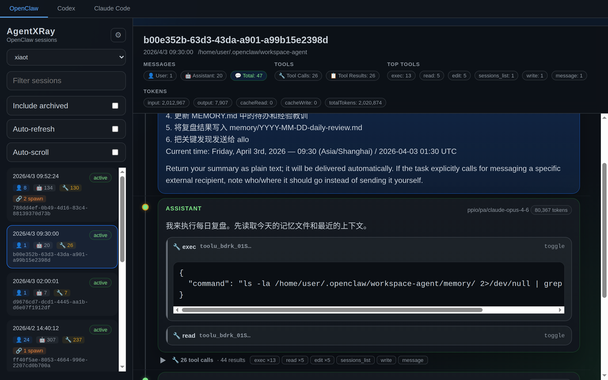
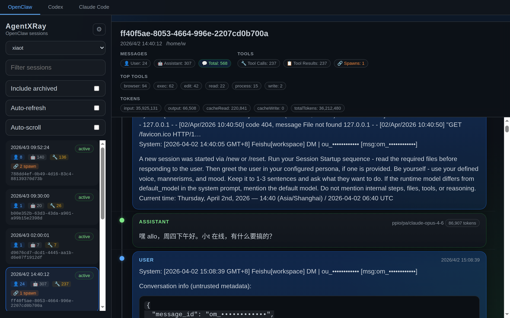
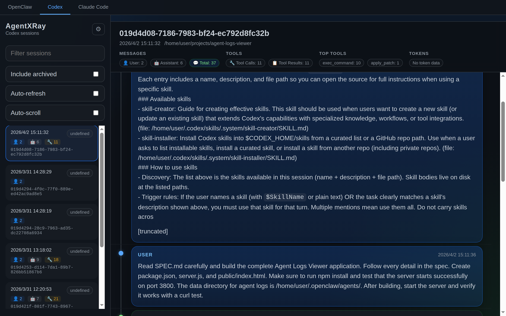
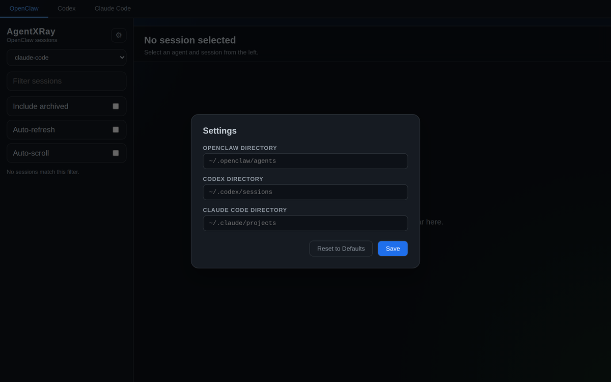

# 使用与参考

[项目首页](../README.zh-CN.md) · [English reference](usage.md) · [离线 inspect](offline-inspect.md) · [执行证据](diagnostics.md)

本页保留完整功能、截图、安装方式、配置和 HTTP API；首次体验请先看项目首页。

## 功能特性

- **离线证据 CLI** — `agentlray inspect --platform codex session.jsonl --json` 无需启动服务或调用模型，输出带输入/规则哈希和原始行号的结构化报告，供 Agent、脚本和 CI 使用。只读明确指定的 Codex、OMP、Claude Code JSONL；默认不输出日志正文和参数，门禁须显式开启。[自动化契约](offline-inspect.md)。

- **自动会话体检** — 默认自动整理失败、重复操作、后续候选和调用最后记录状态；执行中、未知及未记录结果可追溯证据。不依赖人工标注或模型调用，笔记与迁移改为可选，不影响自动事实展示。[口径与离线验证](diagnostics.md#自动体检无需人工标注)。
- **Codex 后台进程证据** — 用明确进程 ID 关联启动、`write_stdin` 轮询和退出结果，可逐步跳转原始证据。ID 重用、轮询交叠和冲突保持未知；不改写历史工具状态，不把进程退出当作任务通过。[关联边界](diagnostics.md#codex-后台进程证据)。
- **修改—检查时序** — 区分修改前成功的检查、与修改重叠的检查及后续最新结果；不把先前通过或管道整体成功当作修改后的验证。复杂命令片段执行状态保持未知。[识别边界](diagnostics.md#修改与验证的先后顺序)。

- **有证据的失败事件（React UI）** — 将同一调用所在用户轮次、同工具、完整同参数的待复查失败分组，重复最多的操作优先展示；可跳转首末及每条原始证据。同参成功切断分组，缺少参数不合并。执行成功采用明确零退出码或 OMP 原生完成证据；事件不等于根因或任务失败。本地规则，无 LLM。[合成演示与判定边界](diagnostics.md#中文使用指南)。
- **后续相关操作** — 展示仅 `i` 参数不同的调用，以及同轮次、明确同文件的后续修改；标明关系依据、五类结果状态并可跳转证据。候选不自动关闭事件、不代表原问题已修复。[匹配边界](diagnostics.md#后续相关操作)。
- **本机复核队列** — 用必填依据标记“需跟进”“预期失败”“其他验证已通过”，仅存当前浏览器；新证据使旧标记失效，人工判断不改写自动结果。无需账号或复核后端。[使用方式与存储边界](diagnostics.md#本机复核闭环)。
- **复核迁移** — 预览并导出当前会话的有效复核，导入只接受完整证据匹配且本地为空的记录；不覆盖已有笔记，跳过过期或不匹配记录。明文 JSON 含手写依据，不自动复制日志。[迁移边界](diagnostics.md#迁移复核记录)。
- **窄屏会话复核** — 小于 768px 时切换“会话列表 / 返回内容”，正文获得完整宽度，切换列表不清空当前复核草稿；平台栏横向滚动，证据跳转保留顶部导航，桌面继续双栏。[验收范围](diagnostics.md#窄屏操作)。

- **多平台支持** — 一个界面统一查看 OpenClaw、Codex、Claude Code、Hermes、OMP、DeepSeek Harness、Gemini CLI 的会话日志（dsh 的多帧 zstd 压缩日志透明解压；Gemini CLI 的 `/rewind` 回滚记录会先折叠，回滚掉的历史不会重复渲染）
- **会话浏览** — 浏览 Agent 列表，搜索/过滤会话，查看消息历史
- **会话状态与分组** — 每个会话带统一状态徽标（待用户输入 / 工作中 / 等待中 / 已停止），列表默认按该顺序分组，组内按各平台默认排序（多数按开始时间新→旧）；状态由日志记录 + 时间窗口推断（取证口径，非进程级实时），详见[设计文档](.local/session-status-design.zh-CN.md)
- **工具调用检查** — 可展开的工具调用详情，包含参数和返回结果
- **Trace 视图** — 每轮对话的耗时瀑布图：模型推理（蓝）与工具执行（绿，出错为红）一目了然，点击色条在侧栏查看该 span 详情（紫色条则加载派生出的子 Agent 对话）
- **Prompt 提取** — 按 session 提取全部真人 prompt（自动过滤工具结果、斜杠命令、系统注入等噪音），按工作目录分组，支持搜索 / JSON 导出 / 复制
- **Prompt 优化** — 相似 prompt 自动聚类成模板，结合 session 效果归因（轮次、工具调用、错误率），通过配置的 LLM 后端（设置 → LLM 接口）或本机 `claude` CLI 生成改写建议
- **全局搜索** — 一个搜索框同时搜七个平台，多关键词 AND 匹配，每条结果带平台色标 —— 包含从被 Claude Code 清理掉的会话里恢复出来的 prompt
- **会话洞察** — 聚合分析面板：工具统计、错误聚类、每日趋势
- **Spawn 追踪** — 检测并导航父子 Agent 之间的调用关系
- **OMP 子 Agent** — OMP 会话派生的子 Agent 会在摘要区以标签列出，点击即可查看子 Agent 的完整对话
- **消息时间线** — 可视化对话流程图，不同角色用不同颜色标识
- **Resume 命令** — 一键复制该会话在原 CLI 中的续跑命令（`codex resume`、`claude --resume`、`omp --resume=`、`dsh --profile pi-tui --preset standard --resume`、`gemini -r`、`hermes --resume`）
- **摘要可折叠** — 需要更多阅读空间时可折叠会话摘要
- **自动刷新** — 会话列表和消息实时更新；状态徽标随日志增长即时变化（SSE 推送）并按 5s 轮询校准
- **任务看板视图** — 按会话四态（待用户输入 / 工作中 / 等待中 / 已停止）分桶的任务看板，与侧栏共用同一份列表缓存与实时状态；每列按 `maxPerStatus`（默认 20，可在 设置 → 任务看板 调整）截断，窄屏纵向堆叠。点击卡片即可在 Sessions 视图打开该会话
- **白天 / 黑夜主题** — 顶栏一键切换亮/暗主题（首启跟随系统一次，之后由手动选择固定，持久化在 `agent-xray-settings`）
- **设置面板** — 在页面上直接配置各平台目录，保存到 localStorage，无需重启
- **键盘导航** — 使用方向键在会话之间切换

## 截图预览

### 会话浏览

侧边栏浏览 Agent 和会话列表。每个会话卡片显示按角色分类的消息数（👤 用户、🤖 助手、🔧 工具）和 spawn 标记。主面板展示会话元数据、Token 用量和热门工具概览。



### 工具调用检查

展开任意工具调用可查看其参数和返回结果。折叠状态下按工具类型显示调用次数，方便快速扫视。



### Spawn 追踪

含有子 Agent 的会话会标注 🔗 徽章。点击可导航父子 Agent 调用链。



### 多平台支持

一键切换 OpenClaw、Codex、Claude Code、Hermes、OMP、DeepSeek Harness、Gemini CLI。每个平台的会话均从其原生日志格式解析。



### 设置面板

在页面上配置各平台目录，保存到 localStorage，无需重启服务。



## 安装

**方式一 — 通过 npm 使用 npx**

```bash
npx @bowenluo718/agent-lray            # 默认 http://localhost:3800
npx @bowenluo718/agent-lray --port 3900 --host 127.0.0.1
```

全局安装（`npm i -g @bowenluo718/agent-lray`）后可直接使用 `agentlray` 命令。

**方式二 — 直接从 GitHub 运行 npx**（现在即可用，无需克隆）

```bash
npx github:bowenluo718/AgentLRay
```

首次运行会在本地构建 Web UI（约一分钟），之后会复用缓存。

**方式三 — 源码运行**

```bash
git clone https://github.com/bowenluo718/AgentLRay.git
cd AgentLRay
npm install               # 首次安装会自动构建 Web UI
npm start
```

打开 http://localhost:3800

## 使用方法

### 基本流程

1. **选择平台** — 点击顶部 `OpenClaw`、`Codex`、`Claude Code`、`Hermes`、`OMP`、`DeepSeek Harness` 或 `Gemini CLI`
2. **选择 Agent** — OpenClaw 平台下默认展示**全部 agent 合并**的会话（按 agent 分组），可从下拉菜单改选单个 Agent（如 `xiaot`、`mimo`）
3. **浏览会话** — 会话默认按状态分组排序：待用户输入 → 工作中 → 等待中 → 已停止（组内按开始时间新→旧），每张卡片显示：
   - 时间戳与四态状态徽标（`待用户输入` / `工作中` / `等待中` / `已停止`；归档会话带 📦）
   - 消息计数：👤 用户、🤖 助手、🔧 工具调用
   - 🔗 Spawn 标记（如果该会话产生了子 Agent）
4. **查看消息** — 点击会话加载完整对话
5. **检查工具调用** — 点击 `🔧 tool_name` 按钮展开参数/结果
6. **导航 Spawn** — 点击 🔗 链接跳转到子 Agent 会话

### 任务看板与新建任务

**任务看板**标签页按会话四态分列展示（待用户输入 / 工作中 / 等待中 / 已停止），顶部有文本筛选框；看板头部有 **「新建任务」** 按钮，弹窗可 spawn 平台 CLI 开一个全新会话。

**弹窗三个字段：**

| 字段 | 说明 |
| --- | --- |
| **平台** | 下拉只列**支持新建会话的平台**——codex、claude-code、omp、gemini、hermes。dsh 与 openclaw 不在其中（dsh 是交互式 TUI、无法 headless 传提示词；openclaw 无原生新建命令）。自定义平台仅在适配器声明了 `create` 契约时出现。 |
| **cwd** | 新会话的工作目录，手动输入。留空则使用平台默认目录。 |
| **提示词** | 交给新会话的提示词，可空——留空则开交互式会话。 |

**默认值跟随当前选中会话**：有选中会话时预填它的平台与项目路径；无选中会话时用当前筛选的平台、cwd 留空。

**提交后**：后端 spawn 平台 CLI（`POST /api/:platform/sessions/new`）并立即返回实际执行的命令串；页面 toast 提示「已触发 `<platform>` 新建会话」并附命令串供手动复制，看板列表随之刷新。命令串的**单一真源在后端**（`lib/new.js`，与终端 `sessions new` 共享），页面展示与实际执行逐字符一致。

**fire-and-forget 取舍**：spawn 的进程输出被丢弃、进程不被跟踪，页面**不提供查询/终止**——结果需在终端或平台 CLI 侧自行观察。这是刻意取舍：页面只负责触发，会话本身归平台所有。

### Prompt 视图

点击顶部 **Prompts** 标签（Sessions / Insights 旁），即可看到所有 session 的真人 prompt，按 session 所属工作目录分组。工具结果、斜杠命令回显、系统提醒、任务通知等噪音会被自动过滤。

- **预览与展开** — 每个 session 行内直接预览首条 prompt，点击展开完整列表（markdown 渲染）
- **搜索** — 实时过滤 prompt / 目录 / session
- **Export JSON** — 导出全部提取的 prompt 用于离线处理
- **分析优化** — 相似 prompt 聚类成模板，结合每个模板的 session 效果归因（平均轮次、工具调用、错误率），由配置的 LLM 后端（设置 → LLM 接口）生成模板改写建议；未配置端点时改由服务器 PATH 中的 [`claude` CLI](https://claude.com/claude-code) 生成。两者都没有时，聚类和归因仍然可用，接口会把缺失的后端报告为 `llmError`。单次分析请求有 LLM 超时上限（默认 15 分钟，可在 设置 → LLM 接口 调整）。请求走 node http(s) 直连（NO_PROXY 内网/本地端点）或 Node 代理（外部端点）；慢网关不再被 undici 默认 5 分钟 headers 超时误杀成 "fetch failed"，超时由本请求的超时上限收口并给出可读提示，网络错误会带上底层原因（连接拒绝/证书/DNS）
- **优化单条** — 悬停任意 prompt 点击「优化」，内联生成 LLM 改写版本（在 设置 → LLM 接口 配置后端，或 PATH 上有 `claude` CLI）

### 键盘快捷键

| 按键 | 操作 |
|------|------|
| `↑` / `↓` | 在会话间切换 |
| `Enter` | 选中高亮的会话 |

### 过滤与搜索

- **搜索框** — 按 ID 或内容过滤会话
- **包含已归档** — 切换显示/隐藏已归档（`.reset.*` / `.deleted.*`）会话
- **自动刷新** — 自动轮询获取新会话和消息
- **自动滚动** — 新内容到达时自动滚动到最新消息

## 配置

### 默认目录

| 平台        | 默认路径                      | Windows 提示 |
|-------------|-------------------------------|--------------|
| OpenClaw    | `~/.openclaw/agents`          | 不一致时设 `OPENCLAW_DIR` |
| Codex       | `~/.codex/sessions`           | 不一致时设 `CODEX_DIR` |
| Claude Code | `~/.claude/projects`          | 不一致时设 `CLAUDE_CODE_DIR` |
| Hermes      | `~/.hermes`                   | 不一致时设 `HERMES_DIR` |
| OMP         | `~/.omp/agent/sessions`       | 不一致时设 `OMP_DIR` |
| DeepSeek Harness | `~/.dsh/sessions`（同时识别 `DSH_HOME`） | 不一致时设 `DSH_DIR` |
| Gemini CLI  | `~/.gemini/tmp`               | 不一致时设 `GEMINI_DIR` |

> **Windows 提示**：默认路径中的 `~` 即家目录，由 `os.homedir()` 解析（Windows 取 `%USERPROFILE%`，macOS/Linux 取 `HOME`），支持 `AGENTLRAY_HOME` 覆盖。多数跨平台 CLI 在 Windows 上也把各自的点目录放在 `%USERPROFILE%` 下，开箱即用；**若某平台 CLI 在 Windows 上的实际数据目录与上表不一致，请通过对应的环境变量覆盖**（`OPENCLAW_DIR` / `CODEX_DIR` / `CLAUDE_CODE_DIR` / `HERMES_DIR` / `OMP_DIR` / `DSH_DIR` / `GEMINI_DIR`），不内置 Windows 专属硬编码映射表。

### 自定义目录

**通过页面设置：** 点击侧边栏的齿轮图标，为每个平台设置自定义路径。保存到 localStorage，无需重启服务。

**通过环境变量：**

```bash
OPENCLAW_DIR=/custom/path/openclaw \
CODEX_DIR=/custom/path/codex \
CLAUDE_CODE_DIR=/custom/path/claude \
HERMES_DIR=/custom/path/hermes \
OMP_DIR=/custom/path/omp \
DSH_DIR=/custom/path/dsh/sessions \
GEMINI_DIR=/custom/path/gemini/tmp \
npm start
```

**通过 API：** 在任意 API 请求后附加 `?dir=/absolute/path` 参数。

### 平台 CLI 命令

`agentlray sessions resume --run` 会 spawn 各平台的原生 CLI 来续跑会话。默认使用裸命令名（`codex`、`claude`、`omp`、`dsh`、`gemini`、`hermes`）从 `PATH` 解析；当 CLI 不在 `PATH` 上（例如 nvm 安装的 `claude`）时，可配置覆盖。解析优先级：**环境变量 > 设置面板（服务端 `~/.agentlray/settings.json` 的 `cliBins` section）> 默认命令名**。

**通过设置面板：** 打开 web 界面的 Settings（齿轮），在「平台 CLI 命令」分区为 codex / claude-code / omp / dsh / gemini / hermes 填写可执行命令（绝对路径）。经对话框底部统一 Save 提交后写服务端 `~/.agentlray/settings.json`（`cliBins` section）；终端 `resume --run` 与前端「复制恢复命令」按钮都会立即使用该命令；留空 = 清除该平台配置（回退默认命令名）。

**通过环境变量（优先级最高）：**

```bash
AGENTLRAY_CODEX_BIN=/path/to/codex \
AGENTLRAY_CLAUDE_CODE_BIN=/home/0668000603/.nvm/versions/node/v22.19.0/bin/claude \
AGENTLRAY_OMP_BIN=/path/to/omp \
AGENTLRAY_DSH_BIN=/path/to/dsh \
AGENTLRAY_GEMINI_BIN=/path/to/gemini \
AGENTLRAY_HERMES_BIN=/path/to/hermes \
npm start
```

未设置的环境变量与未在面板配置的平台回退到默认命令名。

`agentlray sessions new [message...] --platform <p> [--dir <cwd>] [--run]` 会生成（并可选执行）**新建会话**命令——spawn 平台 CLI 开一个全新会话，带提示词 + 工作目录。可建平台与命令形态：codex（`codex exec --full-auto '<prompt>'`）、claude-code（`claude --dangerously-skip-permissions -p '<prompt>'`）、omp（`omp --auto-approve '<prompt>'`）、gemini（`gemini -p --approval-mode=yolo '<prompt>'`）、hermes（`hermes --yolo -z '<prompt>'`）。**dsh 是交互式 TUI、无法 headless 传提示词 → 不支持新建**（报「该平台不支持新建会话」）。提示词 = `new` 后剩余位置参数 `join(' ')`，可空（空 = 无提示词裸启/开交互式）；由框架追加为平台 CLI 参数末位裸参。默认只打印命令不执行；加 `--run` 才真正 **fire-and-forget** spawn（输出丢弃、不跟踪进程、不等待退出——输出在平台 CLI 侧，本工具不跟踪）。cwd 用 `cd '<cwd>' &&`（POSIX）/ `Set-Location`（PowerShell）前缀；`--dir` 覆盖、缺省取平台默认目录。可执行名解析与 resume 一致（环境变量 > cliBins > 默认命令名）。

> **命令形态的实测来源**：各形态以该平台 CLI 自身的 `--help` 核定（仅限本机已安装者）——omp v18.8.4（位置参数 `MESSAGES` + `--auto-approve`）、Claude Code 2.1.282（`-p/--print` 是**布尔开关**，提示词走位置参数；另有 `--dangerously-skip-permissions`）、hermes（提示词必须走 **`-z/--oneshot`**；裸位置参数会被判为非法子命令，且 `-z` 必须带值——故无提示词时回落 `hermes --yolo` 交互式形态）。**codex 与 gemini 未实测**——构建本功能的机器上未安装这两个 CLI，暂沿用设计文档的推断形态，待有真实 CLI 时再校正。其中 gemini 的 `-p` 若需**取值**（设计文档写作 `gemini -p '<prompt>' --approval-mode=yolo`），而框架始终把提示词追加在末位，则该形态需改为 `gemini --approval-mode=yolo -p '<prompt>'`——待实测确认。

### 状态时间配置

会话四态（awaiting-input / working / waiting / stopped）的判定依赖三个时间窗口，默认值 2 分钟 / 30 分钟 / 12 小时。可在 web 设置面板「状态时间配置」分区调整（单位：分钟 / 小时），保存即写服务端 `~/.agentlray/settings.json`（`status` section）并对后续状态判定生效；终端 `agentlray sessions list` 与 web 看板共用同一配置。

| 配置项 | 默认 | 说明 |
|--------|------|------|
| 最近活动新鲜度 | 2 分钟 | 回合完成 / 无进行中证据的短鲜度内判 working |
| 进行中工作上界 | 30 分钟 | 长工具执行 / 深思考在界内一律 working，超过才降级 |
| 取证闭口窗口 | 12 小时 | 无结束标记会话证据超过此界判 stopped；awaiting-input / waiting 的上界 |

## 自定义平台（Custom platforms）

AgentLRay 支持**不修改源码**接入新平台：写一个 JS **平台适配器**放进平台目录，启动时加载器逐文件校验并把合法适配器并入平台注册表；所有 generic 表面（会话路由 / search / prompts / tool-audit / watch / export / CLI）按**能力位**自动接入。校验失败或 id 冲突的文件标记 **broken**（页面与 `agentlray platform list` 可见），绝不拖垮启动。

**三种来源**（按序加载，声明了替代时后者可覆盖同 id 的前者）：

| 来源 | 目录 | origin |
|---|---|---|
| 包内置（package） | 随包分发 | `package` |
| 项目（project） | `$AGENTLRAY_PROJECT_PLATFORMS_DIR` 或仓库 `platforms/` 目录 | `project` |
| 用户（user） | `$AGENTLRAY_PLATFORMS_DIR` 或 `~/.agentlray/platforms/` | `user` |

**启用 / 禁用：** 文件在非包的平台目录里即启用，删除/移走即禁用，无 per-platform 开关。按文件名字母序加载；`id` 与内置（如 `codex`）或先前自定义冲突 → 该文件 broken。`AGENTLRAY_NO_PLUGINS=1` 为全局逃生（跳过 project 与 user 两个来源，仅保留 package）。

**替代包内置（先声明后覆盖）：** project/user 中与内置同 id 的适配器，仅当替代已**声明**才被允许覆盖内置——声明途径为 `settings.json` 的 `platforms.replaced`（经 `platform replace <id>` 写入），或项目目录 `platforms/manifest.json` 的 `replaces` 数组（与 `settings.replaced` 求并集；manifest 缺失/损坏忽略不失败）。未声明替代时同 id 文件 broken，并提示先 `platform export <id>` / `platform replace <id>`。已声明但尚未有文件覆盖时，内置仍生效并标记 `replacementPending`。

**必需契约**（加载器校验）：`id`（正则 `^[a-z0-9][a-z0-9-]*$`）、`label`（字符串）、`defaultDir()` → 会话根目录、`parse(file)` → `{ session, messages }`、`getSession(dir, id)` → `{ session, messages } | null`；`list(dir)` → 最新在前的 `SessionSummary[]`（加载器对 `list: null` 宽容，与 openclaw 一致，但要列会话的平台必须提供）。

**可选能力位** — 缺谁谁缺位、不报错：

| 字段 | 启用 |
|---|---|
| `find(dir, id, opts?)` | watch 实时尾随 与 OTLP 导出 |
| `collectFiles(dir, opts?)` | search / prompts / tool-audit 批量扫描 |
| `watchParse(rec, line?)` | SSE 实时尾随（需与 `find` 一起；缺位时 `/api/watch` 返回 400） |
| `needsAgent` | openclaw 式按 agent 平台（详情/列表需 `agent`，不进入 OTLP） |
| `resume = { bin, args(id, opts) }` | 该平台的 CLI `sessions resume` |
| `create = { bin, args(opts) }` | 该平台的 CLI `sessions new`（opts = `{ cwd, message }`；提示词由框架追加末位） |
| `version` | 契约版本（自 1 起） |

**CLI：**

```bash
agentlray platform list                                                     # 内置 + 项目 + 自定义 + broken，与 GET /api/platforms 同源
agentlray platform list --json                                              # 每条带 origin/mounted/configuredMounted/restartRequired
agentlray platform validate ~/.agentlray/platforms/my-copilot.js --json     # 与加载器同一套校验，dry-run
agentlray platform mount <id> | unmount <id>                                # 启用/停用平台（写 settings.platforms.disabled，重启生效）
agentlray platform replace <id> | unreplace <id>                            # 声明/撤销替代包内置（写 settings.platforms.replaced，重启生效）
agentlray platform export <id> [--out <dir>] [--force] [--no-replace] [--json]   # 把包/项目平台迁移为用户薄适配器
```

`platform validate` 复用加载器自己的校验，随后真的调用适配器 `list(defaultDir())` 报告会话计数与首条 id——通过即代表该平台可实际列出会话。`list --json` 输出 `{schemaVersion:1, kind:"platforms", platforms:[…]}`（每条含 `origin` / `mounted` / `configuredMounted` / `restartRequired`）；`validate --json` 成功输出 `{schemaVersion:1, kind:"platform-validate", ok:true, platform:{id,label}, sessionCount, firstId, note}`。

`mount` / `unmount` 写 `~/.agentlray/settings.json`（`platforms.disabled`），重启后生效；最后一个可查询平台不可被停用（报 `last-platform`）。`replace` / `unreplace` 写 `platforms.replaced`；`unreplace` 若同 id 的 project/user 文件仍存在会提示（下次加载会 broken）。

**`platform export`** 把包内置（package）或项目（project）平台迁移为**用户薄适配器**，写入平台目录（默认 `~/.agentlray/platforms`，可用 `--out <dir>` 或 `AGENTLRAY_PLATFORMS_DIR` 指定）：生成 `<id>.js`，并默认把 id 加入 `settings.replaced`（`--no-replace` 关闭）、若在 `settings.disabled` 中则移出。薄适配器通过 `AGENTLRAY_PKG_ROOT`（加载器设置的包根）解析真实实现，包升级自动跟随。选项：`--force` 覆盖已存在文件、`--out <dir>` 指定目录、`--json` 输出 `{schemaVersion:1, kind:"platform-export", id, file, origin, replaced, restart:true, …}`。来源已为 user 时拒绝（`export-user-origin`）；文件冲突报 `export-exists`（用 `--force` 覆盖）。因适配器按用户权限执行任意代码，CLI 输出信任提示——只投递可信的适配器文件。**前提：** 生成的薄适配器依赖加载器注入的 `AGENTLRAY_PKG_ROOT`，只能经 AgentLRay 加载；脱离 AgentLRay 直接 `require` 会以 `AGENTLRAY_PKG_ROOT is not set; load this adapter through AgentLRay.` 失败。

**Web 前端：** React 与 legacy 两套 UI 都经 `GET /api/platforms` 展示内置 + 自定义平台；加载失败的自定义平台显示 broken 徽标（含错误），不参与查询。

**resume / create 均保持 opt-in：** 自定义平台仅当适配器声明 `resume = { bin, args(id, opts) }` 时 `sessions resume` 可用（否则报「无原生续跑」）；仅当声明 `create = { bin, args(opts) }` 时 `sessions new` 可用（否则报「该平台不支持新建会话」）。spawn 的可执行名解析：环境变量 `AGENTLRAY_<平台id>_BIN` > `~/.agentlray/settings.json` 的 `cliBins` `<id>` 键 > 适配器默认 `bin`。

**信任边界：** 适配器以你的用户全权限执行任意代码（等同自己手动跑脚本）。只投递可信文件，必要时用 `AGENTLRAY_NO_PLUGINS=1` 逃生。`defaultDir()` 由适配器自行定义、可读自身 env；通用 `?dir=` / `--dir` 覆盖仍然生效。

完整可运行、带注释的样例适配器（扁平 JSONL 平台，含 `find` / `collectFiles` / `watchParse` / `needsAgent` / resume 示例块）见 [docs/.local/custom-platform-example.zh-CN.md](.local/custom-platform-example.zh-CN.md)。

## API

| 接口 | 说明 |
|------|------|
| `GET /api/status-labels` | 会话四态的统一状态词汇 `{ order, labels }`（两套 UI 的状态徽标/组头单一来源） |
| `GET /api/agents` | 获取 OpenClaw Agent 列表（legacy 兼容端点：仅当 openclaw 已挂载时注册；openclaw 停用/卸载后 404，下同） |
| `GET /api/agents/:name/sessions` | 获取指定 Agent 的会话列表（legacy 兼容，生命周期同上） |
| `GET /api/agents/:name/sessions/:id` | 获取会话消息详情（legacy 兼容，生命周期同上） |
| `GET /api/codex/sessions` | 获取 Codex 会话列表 |
| `GET /api/codex/sessions/:id` | 获取 Codex 会话消息详情 |
| `GET /api/claude-code/sessions` | 获取 Claude Code 会话列表 |
| `GET /api/claude-code/sessions/:id` | 获取 Claude Code 会话消息详情 |
| `GET /api/hermes/sessions` | 获取 Hermes 会话列表 |
| `GET /api/hermes/sessions/:id` | 获取 Hermes 会话消息详情 |
| `GET /api/omp/sessions` | 获取 OMP（oh-my-pi）会话列表 |
| `GET /api/omp/sessions/:id` | 获取 OMP 会话消息详情 |
| `GET /api/dsh/sessions` | 获取 DeepSeek Harness 会话列表 |
| `GET /api/dsh/sessions/:id` | 获取 DeepSeek Harness 会话消息详情 |
| `GET /api/gemini/sessions` | 获取 Gemini CLI 会话列表 |
| `GET /api/gemini/sessions/:id` | 获取 Gemini CLI 会话消息详情 |
| `GET /api/platforms` | 列出全部平台（内置 + 自定义 + broken）：含能力位、label 与加载错误 |
| `POST /api/:platform/sessions/new` | spawn 平台 CLI 开新会话（body `{ "message": "...", "cwd": "..." }`，均可空）。fire-and-forget：触发成功即返回 `{ triggered, platform, bin, args, command }`。404 平台不存在、422 平台无 create 契约（dsh / openclaw）、400 cwd 不存在或不是目录 |
| `GET /api/spawn-map` | 获取 Agent spawn 关系图（legacy 兼容端点：仅当 openclaw 已挂载时注册；openclaw 停用/卸载后 404，`/api/spawn-tree` 同） |
| `GET /api/insights` | 聚合分析（工具统计、错误聚类、趋势） |
| `GET /api/prompts` | 按目录分组的各 session 真人 prompt |
| `GET /api/prompts/analyze` | 模板聚类 + 效果归因 + Claude 建议（`?refresh=1` 重算，`?skipLlm=1` 仅聚类） |
| `POST /api/prompts/rewrite` | 通过配置的 LLM 后端改写单条 prompt（`{ "text": "..." }`；无可用后端时返回 503 及配置指引） |
| `GET/PUT /api/settings` | 统一设置端点：所有服务端设置聚合在 `~/.agentlray/settings.json`（旧 `ui-settings.json`/`cli-bins.json`/`status-config.json`/`kanban-config.json`/`llm.json` 首启幂等迁移）。PUT 只保存请求体提供的 section（`ui`/`cliBins`/`status`/`kanban`/`llm`），未提供者保持原值。`cliBins` 返回 `bin`/`configured`/`default`，空串 = 清除回退默认；`status`/`kanban` 返回 `value`/`configured`/`default`，保存即生效；`llm` 返回 `baseUrl`/`model`/`analysisTimeoutMs`/`hasApiKey`（key 不回显） |
| `GET /api/settings/cli-bins` | 只读兼容端点；与 `/api/settings` 的 `cliBins` 同构 |
| `GET /api/search` | 会话全文搜索（`?platform=all` 一次搜索全部平台，多关键词 AND） |
| `GET /api/omp/sessions/:id/children` | 获取该 OMP 会话派生的子 Agent 列表 |
| `GET /api/omp/sessions/:id/children/:name` | 获取指定子 Agent 的消息详情 |

所有列表和详情接口均支持 `?dir=` 参数来覆盖默认目录。

## 技术栈

- **后端：** Node.js + Express
- **前端：** `frontend/` 下的 React + Vite + TypeScript（默认 UI，服务自 `frontend/dist`）
- **数据：** 直接从磁盘读取 JSONL 会话文件 / SQLite 数据库
- **零外部 CDN** — 完全自包含，离线可用

## 支持的日志格式

| 平台 | 格式 | 路径模式 |
|------|------|----------|
| OpenClaw | JSONL | `~/.openclaw/agents/{agent}/sessions/{id}.jsonl` |
| Codex | JSONL | `~/.codex/sessions/{YYYY}/{MM}/{DD}/rollout-{timestamp}-{uuid}.jsonl`（session id 是结尾的 UUID） |
| Claude Code | JSONL | `~/.claude/projects/{project-slug}/{sessionId}.jsonl`（派生子 Agent 另有 `{sessionId}/subagents/agent-*.jsonl`） |
| Hermes | SQLite | `~/.hermes/state.db` |
| OMP | JSONL | `~/.omp/agent/sessions/*/{timestamp}_{id}.jsonl` |
| DeepSeek Harness | JSONL / zstd 压缩 JSONL | `~/.dsh/sessions/{project}/{id}/session[.vN].jsonl[.zstd]` — 版本化持久日志（当前为 `session.v4.jsonl.zstd`） |
| Gemini CLI | JSONL | `~/.gemini/tmp/{projectHash}/chats/session-*.jsonl` |

dsh 的 `.jsonl.zstd` 日志是多个独立 Zstandard 帧的串联（每次持久化批次一帧）；AgentLRay 会扫描帧边界并逐帧解压，崩溃残留的尾部不完整帧会被容忍丢弃。持久日志是版本化的：会话目录可能同时保有一份遗留的 `session.jsonl[.zstd]`（格式 0）与固化后的 `session.v3.jsonl.zstd` / 当前 `session.v4.jsonl.zstd`；AgentLRay 读取目录内最高格式版本，保证用当前日志取代陈旧的遗留副本。读取压缩日志需要 Node.js ≥ 22.15（内置 zstd）；未压缩的 `session.jsonl` 在任何受支持的 Node 上都能读。

OpenClaw 的归档会话（`.jsonl.reset.*`、`.jsonl.deleted.*`）默认不纳入 web 看板列表（看板不再提供该开关）；列表/聚合 API 仍接受 `include_archived=true` 参数供其他消费方包含归档会话。其他适配器只列出活跃的 `.jsonl` 文件。

## 开发

测试代码位于 `test/`，使用 Node 内置的测试运行器，无需额外依赖。先执行一次 `npm ci`，然后运行 `npm test`（即 `node --test test/*.test.js`）。测试会在随机端口上启动自己的服务实例，并把 `HOME` 及各平台目录都指向 `test/fixtures/home` 的临时副本，因此不会读取或修改你的真实会话日志。CI（`.github/workflows/test.yml`）在每次向 `master` 的 push 和 pull request 上以 Node 22 执行四个步骤：`npm ci`（其 `prepare` 脚本会构建 Web UI）、漂移检查（`git diff --exit-code lib/generated/diagnostics.cjs`）、`npx biome check .` 和 `npm test`。

**新增平台只需两个文件**：在 `lib/platforms/<name>.js` 写一个适配器（针对该日志格式的 list / find / parse / normalize，`lib/platforms/shared.js` 提供元数据缓存、归一化消息工厂和会话排序），再到 `lib/platforms/index.js` 的 `PLATFORMS` 注册表登记一条。通用会话路由、搜索、watch（SSE 实时跟踪）、洞察、Prompt 提取、工具体检、OTLP 与 Markdown/HTML 导出全部通过该注册表解析平台，无需改动其他文件。**自定义平台**则完全不用改源码：把适配器放进 `~/.agentlray/platforms/` 即可（见 [自定义平台（Custom platforms）](#自定义平台custom-platforms)）。

## 常见问题

**AgentLRay 支持哪些 agent 和日志格式？**
七个平台：OpenClaw、Codex、Claude Code、Hermes、OMP（oh-my-pi）、DeepSeek Harness 和 Gemini CLI。其中六个是 JSONL，Hermes 是位于 `~/.hermes/state.db` 的 SQLite。DeepSeek Harness 的日志可能是多帧 zstd 压缩的 `.jsonl.zstd`，AgentLRay 会逐帧解压，并容忍崩溃残留的尾部不完整帧。权威清单是 `lib/platforms/index.js` 里的 `PLATFORMS` 注册表，可用 `node -e 'console.log(Object.keys(require("./lib/platforms/index.js").PLATFORMS))'` 打印。

**AgentLRay 会把我的会话数据传到别处吗？**
核心日志查看和离线 `inspect` 不调用模型、不上传日志。可选的 prompt 改写与建议会使用配置的端点，或回退到可能访问远程服务的 `claude` CLI；安装依赖可能访问包仓库。开发实验中的远程对照须单独运行且只接收通过门禁的脱敏载荷，不随正常看板启动。要求零模型外发时，请勿使用改写与建议功能。

**需要改动我的 agent 或加埋点吗？**
不需要。CLI coding agent 本来就把完整会话日志写在磁盘上，AgentLRay 只是读它们。你不需要在代码里接 SDK，也不需要用什么包装命令来启动 agent。默认安装同样无需配置，[配置](#配置) 一节列出的默认目录会直接生效，除非你在设置面板里改，或用 `CLAUDE_CODE_DIR` 之类的环境变量覆盖。

**不装任何东西能先试试吗？**
可以，打开 <https://bowenluo718.github.io/AgentLRay/>。这个 GitHub Pages 部署就是真实的 React UI，由 `.github/workflows/pages.yml` 构建，跑在 `frontend/src/demo/fixtures.json` 上 —— 这些 API fixture 由 `scripts/build-demo-fixtures.mjs` 从仓库里提交的合成示例日志 `frontend/demo/sample-logs` 生成。它不含任何真实用户会话，所以请把它当作界面导览，而不是数据。

**想支持一个没列出的日志格式怎么办？**
两个文件：在 `lib/platforms/<name>.js` 写一个适配器，实现该格式的 list / find / parse / normalize，然后在 `lib/platforms/index.js` 的 `PLATFORMS` 表里登记一条。所有通用路由都通过该注册表解析平台，无需改动其他文件。详见 [开发](#开发)。
